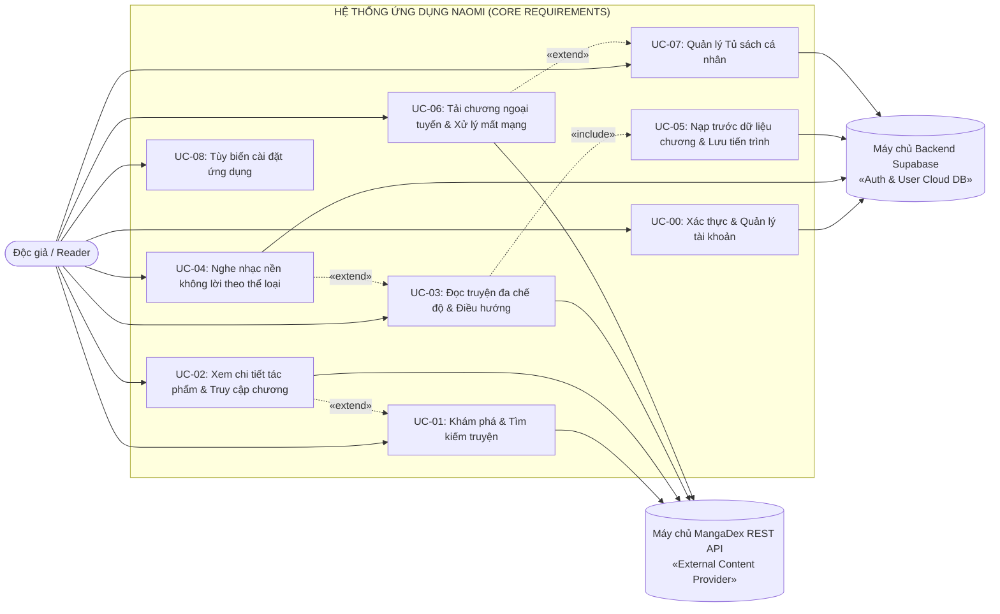

# 1.2 FUNCTIONAL REQUIREMENTS SPECIFICATION

---

## 1. Phương Pháp Luận & Phân Nhóm Ưu Tiên MoSCoW (MoSCoW Prioritisation)

Để kiểm soát chặt chẽ phạm vi dự án (Scope Management), đảm bảo tính khả thi cao nhất khi hiện thực hóa ở Assignment 02 và bám sát các phát hiện từ khảo sát người dùng thực tế ở Mục 1.1, toàn bộ các yêu cầu chức năng của hệ thống **Naomi** được phân cấp khoa học theo mô hình **MoSCoW**:

```
┌────────────────────────────────────────────────────────────────────────┐
│                   MA TRẬN PHÂN LOẠI TÍNH NĂNG MOSCOW                   │
├───────────────────┬────────────────────────────────────────────────────┤
│ Phân nhóm         │ Định nghĩa & Cam kết kỹ thuật                      │
├───────────────────┼────────────────────────────────────────────────────┤
│ **MUST-HAVE**     │ Bắt buộc phải hoàn thành 100% ở Assignment 02 để   │
│ *(Cốt lõi)*       │ hệ thống vận hành trơn tru và đạt chuẩn nghiệm thu.│
├───────────────────┼────────────────────────────────────────────────────┤
│ **SHOULD-HAVE**   │ Các tính năng gia tăng chất lượng trải nghiệm đọc, │
│ *(Chất lượng cao)*│ hướng đến mục tiêu đạt điểm xuất sắc (9.0 – 10.0). │
├───────────────────┼────────────────────────────────────────────────────┤
│ **COULD-HAVE**    │ Các tính năng công nghệ hiện đại (AI Dịch, Quét    │
│ *(Sáng tạo)*      │ ảnh), phát triển ở mức nguyên mẫu (Prototype).     │
├───────────────────┼────────────────────────────────────────────────────┤
│ **WON'T-HAVE**    │ Nằm ngoài phạm vi đồ án để giữ vững cam kết        │
│ *(Loại bỏ)*       │ phi lợi nhuận, không quảng cáo, không phân tâm.    │
└───────────────────┴────────────────────────────────────────────────────┘
```

### Bảng phân loại chi tiết các yêu cầu chức năng (Functional Requirements Matrix):

| Mã FR | Tên yêu cầu chức năng | Phân nhóm MoSCoW | Mô tả năng lực nghiệp vụ của hệ thống |
| :---: | :--- | :---: | :--- |
| **FR-00** | **Xác thực tài khoản người dùng** | **MUST-HAVE** | Cho phép người dùng đăng ký, đăng nhập và khôi phục mật khẩu qua Email (Supabase Auth). Lưu trữ phiên đăng nhập an toàn. Chưa hỗ trợ xác thực qua bên thứ ba để đảm bảo tính độc lập. |
| **FR-01** | **Khám phá & Tìm kiếm truyện (MangaDex API)** | **MUST-HAVE** | Tìm kiếm truyện theo từ khóa tác phẩm hoặc tác giả; phân loại danh mục theo truyện Thịnh hành (Trending) và theo Thể loại (Genre); hỗ trợ xem danh sách đầy đủ của từng mục. |
| **FR-02** | **Trình đọc nội dung toàn màn hình** | **MUST-HAVE** | Trình diễn toàn bộ hình ảnh trang truyện liền mạch, tối đa hóa không gian hiển thị tác phẩm; cung cấp công cụ điều hướng chương tập trung và chế độ đọc không phân tâm (Focus Mode). |
| **FR-03** | **Chuyển đổi chế độ đọc linh hoạt** | **MUST-HAVE** | Hỗ trợ chuyển đổi nhanh giữa hai hình thức đọc: Cuộn dọc liên tục (Webtoon) và Lật trang ngang (Manga truyền thống). |
| **FR-04** | **Tự động lưu tiến trình & Tiếp tục đọc tức thì** | **MUST-HAVE** | Tự động ghi nhớ chính xác vị trí chương và số trang đọc dở vào cơ sở dữ liệu cục bộ (SQLite) và đồng bộ đám mây; cung cấp chức năng tiếp tục đọc ngay tại màn hình chính. |
| **FR-05** | **Đề xuất nhạc nền không lời theo thể loại truyện** | **MUST-HAVE** | Tự động đề xuất danh sách các bản nhạc không lời (Instrumental Audio) phù hợp với chủ đề/thể loại của bộ truyện đang đọc; hỗ trợ phát âm thanh nền thư giãn khi đọc truyện. |
| **FR-06** | **Tải chương truyện đọc ngoại tuyến (Offline Mode)** | **MUST-HAVE** | Cho phép người dùng tải toàn bộ dữ liệu ảnh của chương truyện về thiết bị lưu trữ cục bộ để đọc khi không có mạng; hiển thị tiến trình tải trực quan theo thời gian thực. |
| **FR-07** | **Quản lý Tủ sách cá nhân (Library Management)** | **MUST-HAVE** | Cho phép người dùng phân loại và truy cập nhanh vào hai danh mục chính: Danh sách truyện yêu thích (Favorites) và Kho truyện đã tải ngoại tuyến (Offline Reading). |
| **FR-08** | **Màn hình chính tổng hợp & Đề xuất cá nhân** | **SHOULD-HAVE** | Cung cấp cái nhìn tổng quan tại Trang chủ gồm: Phiên đọc gần nhất để tiếp tục tức thì, danh sách các tác phẩm đọc gần đây, và danh sách các tác phẩm đề xuất. |
| **FR-09** | **Điều khiển âm thanh tối giản** | **SHOULD-HAVE** | Cung cấp các thao tác điều khiển: Bật/Tạm dừng phát, điều chỉnh mức âm lượng, và chọn đổi bản nhạc trong danh mục gợi ý; tự động tạm dừng khi có cuộc gọi hoặc ứng dụng thu nhỏ. |
| **FR-10** | **Xem chi tiết tác phẩm & Truy cập nhanh chương** | **SHOULD-HAVE** | Hiển thị đầy đủ siêu dữ liệu tác phẩm (tác giả, đánh giá, tóm tắt); cung cấp các hành động đọc từ chương đầu, đọc chương mới nhất, đánh dấu yêu thích và chọn tải chương. |
| **FR-11** | **Tìm kiếm thông minh bằng hình ảnh (Visual Search)** | **COULD-HAVE** | Cho phép người dùng chọn ảnh chụp khung tranh từ bộ sưu tập thiết bị thông qua Photo Picker hệ thống (không đòi quyền truy cập bộ nhớ nhạy cảm) để nhận diện tác phẩm. |
| **FR-12** | **Dịch thuật nội dung chương bằng AI (AI Translation)** | **COULD-HAVE** | Tích hợp tính năng AI quét và dịch trực tiếp toàn bộ nội dung văn bản thoại trong chương truyện hiện tại sang tiếng Việt khi người dùng có yêu cầu. |
| **FR-13** | **Xử lý ngoại lệ mất kết nối mạng (Offline Fallback)** | **SHOULD-HAVE** | Tự động nhận diện trạng thái mất mạng; khi người dùng mở chương chưa lưu trữ cục bộ, hệ thống hiển thị thông báo lỗi thân thiện và điều hướng người dùng đến kho truyện ngoại tuyến. |
| **FR-14** | **Quản lý Hồ sơ & Tùy biến cài đặt hệ thống** | **SHOULD-HAVE** | Quản lý thông tin tài khoản cá nhân; tùy biến chủ đề giao diện (Theo hệ thống / Sáng / Tối), ngôn ngữ ứng dụng (Tiếng Anh / Tiếng Việt), quản lý bộ nhớ đệm (Cache) và đăng xuất. |
| **FR-15** | **Thanh toán nạp tiền / Mua xu ảo (IAP)** | **WON'T-HAVE** | Loại bỏ hoàn toàn để bảo đảm cam kết ứng dụng 100% phi lợi nhuận, không paywall, không cản trở độc giả. |
| **FR-16** | **Mạng xã hội & Nhắn tin riêng tư 1-1** | **WON'T-HAVE** | Loại bỏ để người dùng tập trung hoàn toàn vào việc đọc, tránh phức tạp hóa kiến trúc di động ngoài phạm vi đồ án. |

---

## 2. Sơ Đồ Ca Sử Dụng Hệ Thống (Use Case Diagram Chuẩn UML)

Sơ đồ mô hình hóa tương tác giữa **Độc giả (Reader - Human Actor)**, hệ thống ứng dụng **Naomi**, máy chủ đám mây **Supabase Backend (User Auth & Cloud DB)** và dịch vụ cung cấp dữ liệu mở **MangaDex API (External Content Provider)**:



---

## 3. Danh Mục & Đặc Tả Chi Tiết Các Ca Sử Dụng (Use Case Specifications)

### 3.1 Bảng tổng hợp phạm vi 9 Use Case của hệ thống

| Mã UC | Tên Ca sử dụng | Tác nhân chính | Mục tiêu nghiệp vụ của ca sử dụng |
| :---: | :--- | :---: | :--- |
| **UC-00** | Xác thực & Quản lý tài khoản | Độc giả | Đăng ký, đăng nhập tài khoản bằng Email/Mật khẩu; lưu trữ phiên làm việc an toàn trên Supabase. |
| **UC-01** | Khám phá & Tìm kiếm truyện | Độc giả | Tìm kiếm truyện qua từ khóa; lọc theo danh mục Thịnh hành và Thể loại; hỗ trợ tìm bằng ảnh AI. |
| **UC-02** | Xem chi tiết tác phẩm & Truy cập chương | Độc giả | Xem siêu dữ liệu tác phẩm; mở đọc từ đầu, đọc chương mới nhất, thêm vào yêu thích hoặc tải chương. |
| **UC-03** | Đọc truyện đa chế độ & Điều hướng | Độc giả | Đọc toàn màn hình; chuyển đổi Cuộn dọc ⇄ Lật ngang; điều hướng tập truyện và kích hoạt chế độ tập trung. |
| **UC-04** | Nghe nhạc nền không lời theo thể loại | Độc giả | Tự động nhận diện thể loại truyện để đề xuất danh sách nhạc không lời; điều khiển phát/dừng, âm lượng và đổi bài. |
| **UC-05** | Nạp trước dữ liệu chương & Lưu tiến trình | Hệ thống / Độc giả | Nạp trọn bộ hình ảnh của chương trước khi đọc; tự động ghi nhận vị trí trang đọc dở theo thời gian thực. |
| **UC-06** | Tải chương ngoại tuyến & Xử lý mất mạng | Độc giả | Lưu trữ hình ảnh chương truyện vào bộ nhớ cục bộ; chuyển hướng sang kho ngoại tuyến khi mất mạng. |
| **UC-07** | Quản lý Tủ sách cá nhân | Độc giả | Quản lý và truy cập nhanh vào hai kho nội dung: Danh sách Yêu thích và Kho truyện tải Ngoại tuyến. |
| **UC-08** | Tùy biến cài đặt ứng dụng | Độc giả | Thiết lập chủ đề giao diện (System/Light/Dark), ngôn ngữ hiển thị và dọn dẹp bộ nhớ đệm (Cache). |

---

### 3.2 Đặc tả chi tiết đầy đủ 9 Use Case của hệ thống

#### 📌 UC-00: Xác thực & Quản lý tài khoản người dùng
* **Actor chính:** Độc giả (Reader).
* **Actor phụ:** Máy chủ Backend Supabase (`Supabase Auth`).
* **Mục tiêu:** Cho phép người dùng đăng nhập tài khoản để đồng bộ tiến trình đọc và danh sách yêu thích lên đám mây; hỗ trợ tạo tài khoản mới và yêu cầu cấp lại mật khẩu.
* **Tiền điều kiện:** Thiết bị có kết nối Internet.
* **Hậu điều kiện:** Phiên làm việc được thiết lập; Token xác thực được lưu trữ mã hóa trong `FlutterSecureStorage`.
* **Luồng sự kiện chính (Main Flow - Đăng nhập):**
  1. Người dùng mở màn hình đăng nhập tài khoản (`S01`).
  2. Người dùng nhập thông tin Email và Mật khẩu hợp lệ, sau đó xác nhận yêu cầu đăng nhập.
  3. Hệ thống kiểm tra định dạng dữ liệu đầu vào.
  4. Hệ thống gửi yêu cầu xác thực HTTPS đến dịch vụ Supabase Auth.
  5. Xác thực thành công: Hệ thống lưu Token vào SecureStorage, cập nhật trạng thái người dùng và chuyển hướng vào màn hình chính (`S02`).
* **Luồng thay thế (Alternative Flows):**
  - *Đăng ký tài khoản mới:* Người dùng chọn chức năng Đăng ký $\to$ nhập Email và Mật khẩu mới $\to$ hệ thống khởi tạo tài khoản trên Supabase và tự động thiết lập phiên đăng nhập.
  - *Khôi phục mật khẩu:* Người dùng chọn chức năng Quên mật khẩu $\to$ nhập Email $\to$ hệ thống gửi liên kết đặt lại mật khẩu qua thư điện tử.
* **Luồng ngoại lệ (Exception Flow):**
  - *Sai thông tin xác thực:* Hệ thống hiển thị thông báo lỗi xác thực và giữ nguyên dữ liệu đã nhập để người dùng chỉnh sửa.

---

#### 📌 UC-01: Khám phá & Tìm kiếm truyện
* **Actor chính:** Độc giả (Reader).
* **Actor phụ:** Máy chủ MangaDex REST API (`MangaDex API`).
* **Mục tiêu:** Giúp độc giả tìm kiếm nhanh tác phẩm theo tên/tác giả, duyệt danh mục truyện Thịnh hành (Trending) hoặc theo từng Thể loại (Genre), và hỗ trợ tìm kiếm thông minh bằng hình ảnh.
* **Tiền điều kiện:** Ứng dụng đang ở màn hình Khám phá (`S03`).
* **Hậu điều kiện:** Hiển thị danh sách các bộ truyện khớp với tiêu chí tìm kiếm hoặc danh mục đã chọn.
* **Luồng sự kiện chính (Main Flow):**
  1. Người dùng truy cập màn hình Khám phá (`S03`).
  2. Hệ thống truy vấn API `GET /manga` từ MangaDex để hiển thị các hàng danh mục cuộn ngang: Truyện Thịnh hành (`Trending`) và các Thể loại (`Fantasy`, `Action`...).
  3. Người dùng nhập từ khóa vào thanh tìm kiếm hoặc bấm nút mở rộng (`>`) tại một danh mục bất kỳ.
  4. Hệ thống mở màn hình danh sách mở rộng (`S03b`) hiển thị lưới tác phẩm đầy đủ kèm phân trang.
* **Luồng thay thế (Alternative Flow - Tìm kiếm bằng ảnh AI `FR-11`):**
  - Người dùng chạm vào biểu tượng Camera trên thanh tìm kiếm $\to$ Hệ thống mở `System Photo Picker` của hệ điều hành (không yêu cầu cấp quyền bộ nhớ) $\to$ Người dùng chọn 1 ảnh khung tranh $\to$ Hệ thống trích xuất đặc trưng và trả về bộ truyện tương ứng.
* **Luồng ngoại lệ (Exception Flow):**
  - *Không tìm thấy kết quả hoặc vượt Rate-Limit (HTTP 429):* Hệ thống hiển thị trạng thái Empty State thân thiện hoặc tự động kích hoạt Exponential Backoff để thử lại.

---

#### 📌 UC-02: Xem chi tiết tác phẩm & Truy cập chương
* **Actor chính:** Độc giả (Reader).
* **Actor phụ:** Máy chủ MangaDex REST API (`MangaDex API`).
* **Mục tiêu:** Hiển thị đầy đủ siêu dữ liệu của bộ truyện và danh sách chương; cung cấp các nút thao tác nhanh (Đọc từ đầu, Đọc mới nhất, Yêu thích, Tải chương).
* **Tiền điều kiện:** Người dùng chọn một bộ truyện từ Trang chủ (`S02`) hoặc Khám phá (`S03`/`S03b`).
* **Hậu điều kiện:** Thông tin chi tiết và danh sách chương được hiển thị; trạng thái Yêu thích hoặc Tải về được cập nhật khi người dùng thao tác.
* **Luồng sự kiện chính (Main Flow):**
  1. Người dùng chạm vào thẻ một bộ truyện bất kỳ.
  2. Hệ thống mở màn hình Chi tiết truyện (`S04`), gọi đồng thời thông tin metadata tác phẩm và danh sách chương (`GET /manga/{id}/feed`).
  3. Hệ thống hiển thị ảnh bìa, tên truyện, tác giả, điểm đánh giá, thể loại, tóm tắt nội dung, cụm 4 nút hành động (`Read First`, `Read Latest`, `Favorite`, `Download`) và danh sách toàn bộ các chương.
  4. Người dùng chạm vào nút `Read First`, `Read Latest` hoặc một hàng chương bất kỳ để bắt đầu đọc (chuyển sang `UC-05` $\to$ `UC-03`).
* **Luồng thay thế:**
  - *Đánh dấu Yêu thích:* Người dùng bấm nút `Favorite` (`♡`) $\to$ Hệ thống lưu vào bảng `bookmarks` cục bộ và đồng bộ lên Supabase Cloud.

---

#### 📌 UC-03: Đọc truyện đa chế độ & Điều hướng tập trung
* **Actor chính:** Độc giả (Reader).
* **Mục tiêu:** Cung cấp không gian đọc truyện toàn màn hình; hỗ trợ chuyển đổi linh hoạt giữa Webtoon và Manga; cung cấp công cụ điều hướng chương nhanh chóng và chế độ đọc không phân tâm.
* **Tiền điều kiện:** Người dùng đã chọn một chương truyện cụ thể để đọc.
* **Hậu điều kiện:** Vị trí trang đọc được cập nhật liên tục vào cơ sở dữ liệu.
* **Luồng sự kiện chính (Main Flow):**
  1. Hệ thống hiển thị toàn bộ trang ảnh của chương truyện chiếm trọn diện tích màn hình.
  2. Thanh điều hướng chức năng hiển thị tại cạnh trên màn hình cung cấp các tác vụ:
     - Cho phép quay trở lại màn hình trước đó.
     - Hiển thị tên chương đang đọc kèm hai nút điều hướng chuyển tiếp (Chương trước / Chương sau).
     - Cho phép người dùng chọn nhanh một chương bất kỳ trong danh sách toàn bộ các chương của tác phẩm.
     - Cung cấp tính năng kích hoạt âm thanh nền (UC-04).
     - Cung cấp tính năng Chế độ tập trung (Focus Mode): Ẩn toàn bộ công cụ điều khiển để người dùng tập trung hoàn toàn vào nội dung tranh.
     - Cung cấp tính năng chuyển đổi chế độ đọc: Đảo qua lại giữa Cuộn dọc (Webtoon) và Lật trang ngang (Manga).
     - Cung cấp tính năng yêu cầu dịch nội dung chương sang tiếng Việt bằng AI.
* **Luồng ngoại lệ:**
  - *Mất kết nối mạng khi đang đọc:* Nếu dữ liệu chương đã được nạp trước đầy đủ vào bộ nhớ tạm (UC-05), người dùng tiếp tục đọc bình thường mà không bị gián đoạn.

---

#### 📌 UC-04: Nghe nhạc nền không lời theo thể loại truyện
* **Actor chính:** Độc giả (Reader).
* **Mục tiêu:** Tự động nhận diện thể loại truyện để phát các bản nhạc không lời phù hợp, tạo không gian thư giãn; cho phép độc giả điều khiển âm thanh tinh gọn.
* **Tiền điều kiện:** Người dùng đang trong phiên đọc của một chương truyện.
* **Luồng sự kiện chính (Main Flow):**
  1. Khi người dùng kích hoạt công cụ âm thanh trong trình đọc, hệ thống mở bảng tác vụ âm thanh.
  2. Hệ thống hiển thị thông tin bản nhạc không lời đang phát (được đề xuất tự động theo thể loại truyện).
  3. Người dùng có thể thực hiện các thao tác:
     - Tạm dừng hoặc tiếp tục phát bản nhạc.
     - Điều chỉnh mức âm lượng phát phù hợp.
     - Chọn phát một bản nhạc khác trong danh sách các bài nhạc không lời cùng thể loại được gợi ý.
  4. Hệ thống duy trì phát âm thanh liên tục dưới nền trong suốt phiên đọc truyện.
* **Luồng ngoại lệ:**
  - *Ứng dụng mất tiêu điểm hoặc có cuộc gọi đến:* Hệ thống tự động phát hiện sự kiện vòng đời ứng dụng và tạm dừng âm thanh để tránh xung đột tài nguyên.

---

#### 📌 UC-05: Nạp trước dữ liệu chương & Lưu tiến trình đọc
* **Actor chính:** Hệ thống / Độc giả.
* **Mục tiêu:** Nạp toàn bộ các trang ảnh của chương vào bộ nhớ tạm trước khi hiển thị nhằm loại bỏ hiện tượng giật lag hoặc tải chậm khi lướt trang; tự động lưu trữ tiến trình đọc.
* **Luồng sự kiện chính (Main Flow):**
  1. Khi người dùng kích hoạt mở một chương truyện, hệ thống bắt đầu tiến trình nạp trước toàn bộ các trang ảnh của chương.
  2. Hệ thống hiển thị thông báo tiến độ nạp dữ liệu (số trang đã sẵn sàng / tổng số trang).
  3. Khi $100\%$ dữ liệu trang ảnh được chuẩn bị hoàn tất trong bộ nhớ tạm, hệ thống lập tức mở trình đọc nội dung.
  4. Người dùng cuộn đọc mượt mà từ đầu đến cuối chương mà không phải chờ nạp thêm dữ liệu giữa chừng.
  5. Hệ thống liên tục ghi nhận vị trí chương và số trang đọc dở vào cơ sở dữ liệu SQLite cục bộ và đồng bộ lên Supabase.

---

#### 📌 UC-06: Tải chương ngoại tuyến & Xử lý ngoại lệ mất mạng
* **Actor chính:** Độc giả (Reader).
* **Mục tiêu:** Cho phép tải nội dung chương truyện về lưu trữ cục bộ; đồng thời xử lý thân thiện khi người dùng mất kết nối Internet.
* **Luồng sự kiện chính (Main Flow - Tải ngoại tuyến):**
  1. Tại màn hình thông tin tác phẩm, người dùng chọn chức năng Tải chương.
  2. Hệ thống hiển thị danh sách các chương để người dùng chọn các chương cần tải.
  3. Hệ thống bắt đầu tải tuần tự dữ liệu ảnh về thiết bị và hiển thị tiến trình tải trực quan theo phần trăm.
  4. Quá trình tải hoàn tất, hệ thống cập nhật đường dẫn tệp vào SQLite và đánh dấu trạng thái đã lưu trữ ngoại tuyến.
* **Luồng ngoại lệ (Xử lý khi mất mạng):**
  1. Thiết bị mất kết nối Internet và người dùng truy cập vào một chương chưa được lưu trữ cục bộ.
  2. Hệ thống nhận diện trạng thái ngoại tuyến và hiển thị thông báo lỗi mất kết nối.
  3. Hệ thống cung cấp tùy chọn điều hướng trực tiếp chuyển người dùng sang Kho truyện ngoại tuyến để tiếp tục đọc các nội dung đã tải về máy trước đó.

---

#### 📌 UC-07: Quản lý Tủ sách cá nhân
* **Actor chính:** Độc giả (Reader).
* **Mục tiêu:** Cung cấp không gian quản lý tập trung và phân loại rõ ràng giữa truyện yêu thích và truyện đã lưu trữ ngoại tuyến.
* **Luồng sự kiện chính (Main Flow):**
  1. Người dùng truy cập vào chức năng Tủ sách cá nhân (Library).
  2. Hệ thống cung cấp hai lối vào phân định rõ ràng:
     - **Danh mục Truyện Yêu thích (Favorites):** Truy xuất toàn bộ các tác phẩm người dùng đã đánh dấu yêu thích, đồng bộ theo tài khoản cá nhân.
     - **Kho Truyện Ngoại tuyến (Offline Reading):** Truy xuất danh sách các chương truyện đã tải về thiết bị, hiển thị dung lượng bộ nhớ đã sử dụng và cung cấp chức năng xóa để giải phóng dung lượng.

---

#### 📌 UC-08: Tùy biến cài đặt ứng dụng
* **Actor chính:** Độc giả (Reader).
* **Mục tiêu:** Cho phép người dùng cấu hình các tùy chọn hệ thống theo sở thích cá nhân.
* **Luồng sự kiện chính (Main Flow):**
  1. Người dùng truy cập màn hình Cài đặt cá nhân.
  2. Người dùng có thể tùy chỉnh:
     - **Chủ đề hiển thị:** Chuyển đổi giữa chế độ Tự động theo hệ thống (System), chế độ Sáng (Light) và chế độ Tối (Dark).
     - **Ngôn ngữ hiển thị:** Lựa chọn ngôn ngữ giao diện giữa Tiếng Anh và Tiếng Việt.
     - **Quản lý bộ nhớ đệm (Cache):** Xem thông số dung lượng tạm và thực hiện dọn dẹp bộ nhớ đệm.
     - **Đăng xuất:** Thoát phiên làm việc hiện tại một cách an toàn.

---

## 4. User Stories & Tiêu Chí Nghiệm Thu (Acceptance Criteria — BDD Syntax)

Toàn bộ các yêu cầu chức năng được cụ thể hóa thành các **User Story** kèm kịch bản kiểm thử chuẩn **BDD (Given - When - Then)** để phục vụ trực tiếp cho việc viết Unit Test và Acceptance Test ở Assignment 02:

### 📖 US-00: Xác thực tài khoản người dùng
```gherkin
Scenario: Đăng nhập thành công với tài khoản hợp lệ
  Given Người dùng đang ở màn hình Đăng nhập
  When Người dùng nhập email hợp lệ "user@example.com" và mật khẩu chính xác
  And Xác nhận đăng nhập
  Then Hệ thống xác thực thành công qua Supabase Auth và chuyển hướng vào ứng dụng

Scenario: Đăng ký tài khoản người dùng mới
  Given Người dùng đang ở màn hình Đăng nhập và chọn chức năng Đăng ký
  When Người dùng nhập thông tin email và mật khẩu mới hợp lệ
  And Xác nhận đăng ký
  Then Hệ thống tạo mới tài khoản trên Supabase và tự động thiết lập phiên đăng nhập

Scenario: Yêu cầu đặt lại mật khẩu khi quên
  Given Người dùng đang ở màn hình Đăng nhập và chọn chức năng Quên mật khẩu
  When Người dùng nhập địa chỉ email đã đăng ký
  Then Hệ thống gửi thư điện tử chứa liên kết khôi phục mật khẩu đến người dùng
```

---

### 📖 US-01: Khám phá truyện & Xem danh mục mở rộng
```gherkin
Scenario: Duyệt truyện theo danh mục Thịnh hành và Thể loại
  Given Người dùng đang ở màn hình Khám phá
  When Người dùng xem các phân mục nội dung
  Then Hệ thống hiển thị danh sách truyện Thịnh hành và danh sách truyện theo từng Thể loại
  And Mỗi danh mục đều có tùy chọn để xem toàn bộ danh sách

Scenario: Mở toàn bộ danh sách truyện của một danh mục
  Given Người dùng đang xem danh mục "Trending" tại màn hình Khám phá
  When Người dùng chọn xem tất cả danh mục này
  Then Hệ thống mở màn hình danh sách đầy đủ hiển thị toàn bộ các tác phẩm thuộc danh mục
```

---

### 📖 US-02: Xem chi tiết tác phẩm & Truy cập nhanh chương
```gherkin
Scenario: Mở đọc chương đầu tiên hoặc chương mới nhất
  Given Người dùng đang xem thông tin chi tiết một bộ truyện
  When Người dùng chọn chức năng "Đọc từ đầu"
  Then Hệ thống lập tức mở đọc Chapter 1 của tác phẩm
  When Người dùng chọn chức năng "Đọc mới nhất"
  Then Hệ thống lập tức mở đọc Chapter mới nhất của tác phẩm

Scenario: Thêm bộ truyện vào danh mục Yêu thích
  Given Người dùng đang xem thông tin chi tiết một bộ truyện
  When Người dùng chọn chức năng "Yêu thích"
  Then Bộ truyện được lưu vào danh sách Yêu thích của người dùng và đồng bộ lên đám mây
```

---

### 📖 US-03: Đọc truyện toàn màn hình & Điều hướng tập trung
```gherkin
Scenario: Đọc truyện toàn màn hình và chuyển chương nhanh
  Given Người dùng đang trong trình đọc truyện
  When Người dùng quan sát màn hình
  Then Nội dung trang truyện hiển thị chiếm trọn toàn bộ diện tích màn hình
  And Thanh công cụ điều hướng cho phép chọn chuyển nhanh sang chương trước hoặc chương sau
  When Người dùng chọn mở danh sách chương từ thanh điều hướng
  Then Hệ thống hiển thị danh sách toàn bộ các chương để người dùng chọn chuyển tập tức thì

Scenario: Kích hoạt Chế độ tập trung (Focus Mode)
  Given Người dùng đang mở thanh công cụ trong trình đọc
  When Người dùng chọn kích hoạt Chế độ tập trung
  Then Toàn bộ các thanh công cụ điều khiển lập tức ẩn đi để người dùng tập trung đọc truyện
  When Người dùng thao tác chạm vào màn hình
  Then Các công cụ điều khiển hiển thị trở lại
```

---

### 📖 US-04: Nghe nhạc nền không lời theo thể loại truyện
```gherkin
Scenario: Tự động phát và điều khiển nhạc nền không lời
  Given Người dùng đang đọc một bộ truyện có gán thể loại
  When Người dùng mở bảng điều khiển âm thanh
  Then Hệ thống phát bản nhạc không lời được gợi ý theo thể loại của truyện
  And Cung cấp các thao tác tạm dừng, phát tiếp, điều chỉnh âm lượng và chọn bài hát khác
  When Người dùng chọn một bản nhạc khác trong danh sách đề xuất
  Then Hệ thống lập tức chuyển sang phát bản nhạc mới được chọn
```

---

### 📖 US-05: Nạp trước trọn bộ chương truyện (Preload)
```gherkin
Scenario: Nạp trước toàn bộ các trang ảnh của chương
  Given Người dùng kích hoạt đọc một chương truyện có 40 trang ảnh
  When Hệ thống bắt đầu xử lý dữ liệu
  Then Hệ thống hiển thị tiến trình nạp trước các trang ảnh cho đến khi đạt 100%
  And Khi nạp hoàn tất, trình đọc mở ra cho phép người dùng cuộn xem liên tục không bị gián đoạn
```

---

### 📖 US-06: Xử lý ngoại lệ mất mạng khi mở chương chưa tải
```gherkin
Scenario: Nhận diện mất kết nối mạng và điều hướng ngoại tuyến
  Given Thiết bị không có kết nối Internet
  When Người dùng mở một chương truyện chưa được tải về máy trước đó
  Then Hệ thống hiển thị thông báo lỗi mất kết nối mạng
  And Cung cấp lối chuyển tiếp nhanh sang Kho truyện ngoại tuyến
  When Người dùng chọn lối chuyển tiếp này
  Then Hệ thống mở danh sách các nội dung đã lưu trữ ngoại tuyến để người dùng tiếp tục đọc
```

---

### 📖 US-07: Quản lý Tủ sách cá nhân
```gherkin
Scenario: Truy cập danh mục Yêu thích và Kho truyện Ngoại tuyến
  Given Người dùng đang ở màn hình Tủ sách cá nhân
  When Người dùng chọn mục "Truyện yêu thích"
  Then Hệ thống hiển thị danh sách các tác phẩm người dùng đã đánh dấu yêu thích
  When Người dùng chọn mục "Kho ngoại tuyến"
  Then Hệ thống hiển thị danh sách các chương đã tải về thiết bị kèm thông số bộ nhớ đã lưu
```

---

### 📖 US-08: Tùy biến chủ đề giao diện (Theme Settings)
```gherkin
Scenario: Thay đổi chủ đề hiển thị của ứng dụng
  Given Người dùng đang ở màn hình Cài đặt ứng dụng
  When Người dùng thay đổi tùy chọn chủ đề sang chế độ Tối (Dark Mode)
  Then Toàn bộ giao diện ứng dụng lập tức chuyển sang tông màu tối AMOLED
  When Người dùng chọn chế độ Tự động theo hệ thống (System)
  Then Ứng dụng tự động điều chỉnh màu sắc đồng bộ theo cài đặt ngày/đêm của thiết bị
```
