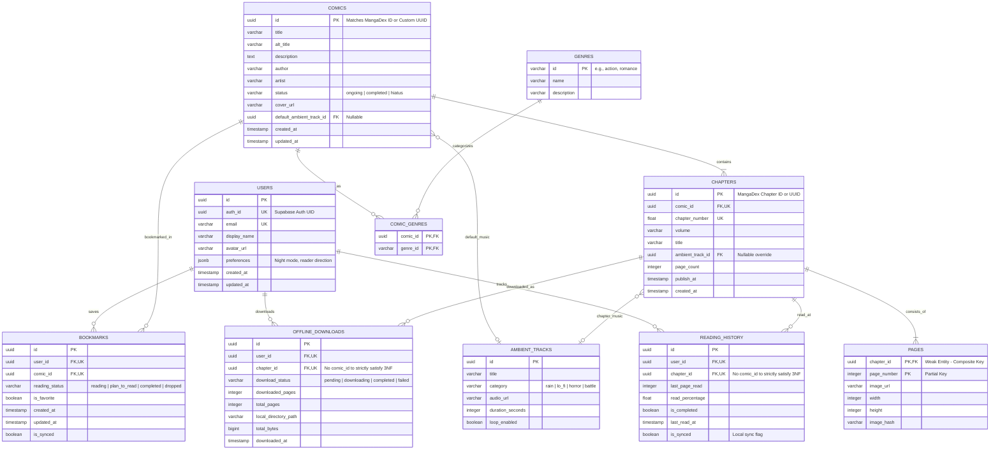
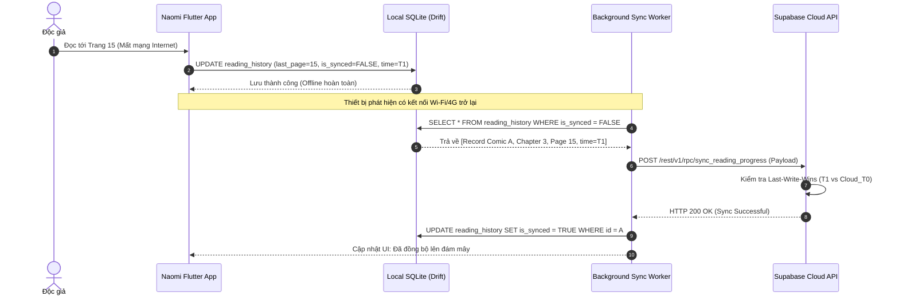

# 1.5 DATA & API DESIGN

---

## 1. Tổng quan Kiến trúc Dữ liệu & Nguyên lý Thiết kế (Data Architecture Overview)

Hệ thống dữ liệu của ứng dụng **Naomi** được thiết kế theo nguyên lý **Hybrid Offline-First (Ưu tiên Ngoại tuyến Kết hợp)**, phân bổ dữ liệu chặt chẽ trên 3 phân vùng độc lập:
1. **Cloud Database (Supabase PostgreSQL):** Đóng vai trò Single Source of Truth cho các dữ liệu định danh, tiến trình đọc cá nhân, và các bản ghi thư viện cần đồng bộ đa thiết bị.
2. **External Content Provider (MangaDex REST API v5 & MangaDex@Home CDN):** Cung cấp metadata truyện cộng đồng khổng lồ và mạng lưới phân phối ảnh phi tập trung.
3. **Local Persistence Storage (On-Device SQLite / Drift + Sandboxed Filesystem):** Đóng vai trò bộ đệm cục bộ, cho phép ứng dụng đọc truyện, phát nhạc, và lưu vết tiến trình ngay cả khi hoàn toàn mất kết nối mạng.

```
┌────────────────────────────────────────────────────────────────────────────────────────┐
│                              LOCAL CLIENT STORAGE (DEVICE)                             │
├───────────────────────────────┬────────────────────────────────┬───────────────────────┤
│    Secure Storage (Tokens)    │     SQLite / Drift (DB)        │   Sandboxed Files     │
│   (Android Keystore / iOS KC) │   (Metadata, Offline, Queue)   │  (WebP Images & MP3)  │
└───────────────────────────────┴────────────────────────────────┴───────────────────────┘
                                ▲                                ▲
                   Sync Queue   │                                │ Offline Download
             (Bidirectional)    ▼                                ▼
┌───────────────────────────────────────────────┐ ┌──────────────────────────────────────┐
│       APP BACKEND TIER (SUPABASE)             │ │  EXTERNAL CONTENT TIER (MANGADEX)    │
├───────────────────────────────────────────────┤ ├──────────────────────────────────────┤
│ • PostgreSQL Database with Row-Level Security │ │ • MangaDex REST API v5 (Search, Feed)│
│ • Supabase Storage (Ambient Audio Tracks)     │ │ • MangaDex@Home CDN (Page Images)    │
│ • Supabase Auth (JWT Engine)                  │ │ • Rate-limited at 5 req/s (Burst 8)  │
└───────────────────────────────────────────────┘ └──────────────────────────────────────┘
```

---

## 2. Mô hình Thực thể Kết hợp (Conceptual & Logical Data Model)

### 2.1. Danh mục Thực thể (Data Dictionary)

Hệ thống bao gồm 10 bảng dữ liệu được chuẩn hóa, đáp ứng trọn vẹn các yêu cầu chức năng từ **FR-00** đến **FR-14**:

| STT | Tên Bảng (Table Name) | Vị trí Lưu trữ | Mục đích & Mô tả Chức năng | Ánh xạ FR |
| :---: | :--- | :--- | :--- | :--- |
| 1 | `users` | Supabase Cloud | Thông tin hồ sơ người dùng (Auth ID, Display Name, Avatar, Preferences). | FR-00, FR-14 |
| 2 | `comics` | Cloud & Local Cache | Metadata truyện (Tiêu đề, Tác giả, Mô tả, Trạng thái, Bìa, Ambient Track mặc định). | FR-01, FR-08, FR-10 |
| 3 | `genres` | Cloud & Local Cache | Danh mục thể loại (Action, Fantasy, Romance, Slice of Life...). | FR-01, FR-05 |
| 4 | `comic_genres` | Cloud & Local Cache | Bảng liên kết nhiều-nhiều ($M:N$) giữa Truyện và Thể loại. | FR-01, FR-05 |
| 5 | `chapters` | Cloud & Local Cache | Thông tin từng chương (Số chương, Tiêu đề, Track âm thanh riêng, Số trang). | FR-02, FR-04, FR-10 |
| 6 | `pages` | Cloud & Local Cache | Danh sách các trang trong chương (Thứ tự trang, URL ảnh gốc, Kích thước). | FR-02, FR-03 |
| 7 | `ambient_tracks` | Supabase Storage/DB | Danh mục các bản nhạc không lời theo thể loại truyện kèm URL và Duration. | FR-05, FR-09 |
| 8 | `reading_history` | Cloud & Local SQLite | Lưu vết đọc dở chính xác đến từng số trang, phần trăm đọc, hỗ trợ đồng bộ đa thiết bị. | FR-04, FR-08 |
| 9 | `bookmarks` | Cloud & Local SQLite | Thư viện truyện Yêu thích cá nhân của độc giả, đồng bộ đám mây. | FR-07, FR-10 |
| 10 | `offline_downloads` | Local SQLite Only | Quản lý tiến trình và trạng thái các chương đã tải xuống thiết bị kèm đường dẫn file cục bộ. | FR-06, FR-07, FR-13 |

---

### 2.2. Sơ đồ Thực thể Kết hợp (Entity-Relationship Diagram - ERD)

Sơ đồ sử dụng ký hiệu chân quạ (**Crow's Foot Notation**), thể hiện đầy đủ Khóa chính (PK), Khóa ngoại (FK) và bản số quan hệ:



---

### 2.3. Lược đồ Cơ sở Dữ liệu Quan hệ (Relational Database Schema)

#### Bảng 1: `users` (Thông tin người dùng)
* **Khóa chính (PK):** `id` (UUID).
* **Ràng buộc:** `auth_id` (UUID, NOT NULL, UNIQUE, tham chiếu `auth.users(id)` của Supabase).
* **Cột:**
  - `id`: UUID PRIMARY KEY DEFAULT gen_random_uuid()
  - `auth_id`: UUID NOT NULL UNIQUE
  - `email`: VARCHAR(255) NOT NULL UNIQUE
  - `display_name`: VARCHAR(100) NOT NULL
  - `avatar_url`: TEXT NULL
  - `preferences`: JSONB DEFAULT '{"scroll_direction": "vertical", "ambient_auto_play": true, "ambient_volume": 0.7}'::jsonb
  - `created_at`: TIMESTAMPTZ DEFAULT NOW()
  - `updated_at`: TIMESTAMPTZ DEFAULT NOW()

#### Bảng 2: `comics` (Metadata truyện tranh)
* **Khóa chính (PK):** `id` (UUID).
* **Khóa ngoại (FK):** `default_ambient_track_id` trỏ về `ambient_tracks(id)` ON DELETE SET NULL.
* **Cột:**
  - `id`: UUID PRIMARY KEY
  - `title`: VARCHAR(255) NOT NULL
  - `alt_title`: VARCHAR(255) NULL
  - `description`: TEXT NULL
  - `author`: VARCHAR(150) NULL
  - `artist`: VARCHAR(150) NULL
  - `status`: VARCHAR(20) NOT NULL DEFAULT 'ongoing' (Check constraint: in `('ongoing', 'completed', 'hiatus', 'cancelled')`)
  - `cover_url`: TEXT NOT NULL
  - `default_ambient_track_id`: UUID NULL
  - `created_at`: TIMESTAMPTZ DEFAULT NOW()
  - `updated_at`: TIMESTAMPTZ DEFAULT NOW()

#### Bảng 3: `genres` (Danh mục thể loại)
* **Khóa chính (PK):** `id` (VARCHAR(50)).
* **Cột:**
  - `id`: VARCHAR(50) PRIMARY KEY (ví dụ: 'action', 'fantasy', 'horror')
  - `name`: VARCHAR(100) NOT NULL
  - `description`: TEXT NULL

#### Bảng 4: `comic_genres` (Bảng kết hợp Truyện - Thể loại)
* **Khóa chính phức hợp (Composite PK):** `(comic_id, genre_id)`.
* **Khóa ngoại (FK):** 
  - `comic_id` trỏ về `comics(id)` ON DELETE CASCADE.
  - `genre_id` trỏ về `genres(id)` ON DELETE CASCADE.

#### Bảng 5: `chapters` (Chương truyện)
* **Khóa chính (PK):** `id` (UUID).
* **Khóa ngoại (FK):** 
  - `comic_id` trỏ về `comics(id)` ON DELETE CASCADE.
  - `ambient_track_id` trỏ về `ambient_tracks(id)` ON DELETE SET NULL.
* **Ràng buộc duy nhất (Unique Constraint):** `UNIQUE(comic_id, chapter_number)` (Hệ thống lọc và lưu trữ 1 bản dịch ngôn ngữ ưu tiên cho mỗi số chương của một bộ truyện, ngăn chặn trùng lặp số chương).
* **Cột:**
  - `id`: UUID PRIMARY KEY
  - `comic_id`: UUID NOT NULL
  - `chapter_number`: REAL NOT NULL (Ví dụ: 1, 2, 2.5)
  - `volume`: VARCHAR(20) NULL
  - `title`: VARCHAR(255) NULL
  - `ambient_track_id`: UUID NULL
  - `page_count`: INTEGER NOT NULL DEFAULT 0
  - `publish_at`: TIMESTAMPTZ NOT NULL
  - `created_at`: TIMESTAMPTZ DEFAULT NOW()

#### Bảng 6: `pages` (Trang truyện trong chương - Thực thể Yếu)
* **Khóa chính phức hợp (Composite PK - Chuẩn ánh xạ Thực thể yếu Elmasri & Navathe Ch.3):** `PRIMARY KEY (chapter_id, page_number)`.
* **Khóa ngoại (FK):** `chapter_id` trỏ về `chapters(id)` ON DELETE CASCADE.
* **Ngữ nghĩa Thực thể yếu (Weak Entity):** Thực thể `PAGES` phụ thuộc tồn tại hoàn toàn vào `CHAPTERS`; mỗi trang được định danh duy nhất bởi khóa bộ phận (Partial Key) `page_number` kết hợp với khóa chính của thực thể chủ `chapter_id`, hoàn toàn không sử dụng Surrogate Key `id` dư thừa.
* **Cột:**
  - `chapter_id`: UUID NOT NULL
  - `page_number`: INTEGER NOT NULL
  - `image_url`: TEXT NOT NULL
  - `width`: INTEGER NULL
  - `height`: INTEGER NULL
  - `image_hash`: VARCHAR(64) NULL
  - `PRIMARY KEY (chapter_id, page_number)`

#### Bảng 7: `ambient_tracks` (Kho nhạc nền không lời theo thể loại)
* **Khóa chính (PK):** `id` (UUID).
* **Cột:**
  - `id`: UUID PRIMARY KEY DEFAULT gen_random_uuid()
  - `title`: VARCHAR(150) NOT NULL
  - `category`: VARCHAR(50) NOT NULL (Đồng bộ mã thể loại truyện `genres.id`: `('fantasy', 'action', 'romance', 'slice_of_life', 'horror', 'chill', 'rain')`)
  - `audio_url`: TEXT NOT NULL
  - `duration_seconds`: INTEGER NOT NULL
  - `loop_enabled`: BOOLEAN DEFAULT TRUE

#### Bảng 8: `reading_history` (Lịch sử đọc chi tiết - Đạt chuẩn 3NF tuyệt đối)
* **Khóa chính (PK):** `id` (UUID).
* **Khóa ngoại (FK):** 
  - `user_id` trỏ về `users(id)` ON DELETE CASCADE.
  - `chapter_id` trỏ về `chapters(id)` ON DELETE CASCADE.
* **Quy chuẩn 3NF:** Đã **loại bỏ hoàn toàn thuộc tính dư thừa `comic_id`** để triệt tiêu phụ thuộc bắc cầu $\text{id} \to \text{chapter\_id} \to \text{comic\_id}$. Khi cần truy xuất thông tin truyện, hệ thống JOIN thông qua bảng `chapters(comic_id)`.
* **Ràng buộc duy nhất:** `UNIQUE(user_id, chapter_id)` (Mỗi người dùng chỉ lưu 1 bản ghi tiến độ đọc mới nhất cho từng chương, cập nhật trang đọc dở thay vì chèn dòng rác).
* **Cột:**
  - `id`: UUID PRIMARY KEY DEFAULT gen_random_uuid()
  - `user_id`: UUID NOT NULL
  - `chapter_id`: UUID NOT NULL
  - `last_page_read`: INTEGER NOT NULL DEFAULT 1
  - `read_percentage`: REAL NOT NULL DEFAULT 0.0
  - `is_completed`: BOOLEAN DEFAULT FALSE
  - `last_read_at`: TIMESTAMPTZ DEFAULT NOW()
  - `is_synced`: BOOLEAN DEFAULT TRUE

#### Bảng 9: `bookmarks` (Tủ truyện cá nhân)
* **Khóa chính (PK):** `id` (UUID).
* **Khóa ngoại (FK):** 
  - `user_id` trỏ về `users(id)` ON DELETE CASCADE.
  - `comic_id` trỏ về `comics(id)` ON DELETE CASCADE.
* **Ràng buộc duy nhất:** `UNIQUE(user_id, comic_id)` (Đảm bảo mỗi độc giả chỉ đánh dấu 1 bộ truyện một lần duy nhất).
* **Cột:**
  - `id`: UUID PRIMARY KEY DEFAULT gen_random_uuid()
  - `user_id`: UUID NOT NULL
  - `comic_id`: UUID NOT NULL
  - `reading_status`: VARCHAR(30) DEFAULT 'reading' (Check: in `('reading', 'plan_to_read', 'completed', 'dropped')`)
  - `is_favorite`: BOOLEAN DEFAULT FALSE
  - `created_at`: TIMESTAMPTZ DEFAULT NOW()
  - `updated_at`: TIMESTAMPTZ DEFAULT NOW()
  - `is_synced`: BOOLEAN DEFAULT TRUE

#### Bảng 10: `offline_downloads` (Lưu cục bộ trên thiết bị - Đạt chuẩn 3NF tuyệt đối)
* **Khóa chính (PK):** `id` (UUID).
* **Khóa ngoại (FK):** 
  - `user_id` trỏ về `users(id)` ON DELETE CASCADE (Xác định rõ tác nhân tải về, đồng bộ với Diagram 1).
  - `chapter_id` trỏ về `chapters(id)` ON DELETE CASCADE.
* **Quy chuẩn 3NF:** Đã **loại bỏ thuộc tính `comic_id`** nhằm triệt tiêu hoàn toàn phụ thuộc bắc cầu qua `chapter_id`.
* **Ràng buộc duy nhất:** `UNIQUE(user_id, chapter_id)` (Tránh tải trùng lặp cùng 1 chương cho 1 tài khoản).
* **Cột:**
  - `id`: UUID PRIMARY KEY
  - `user_id`: UUID NOT NULL
  - `chapter_id`: UUID NOT NULL
  - `download_status`: VARCHAR(20) NOT NULL DEFAULT 'pending' (Check: in `('pending', 'downloading', 'completed', 'failed')`)
  - `downloaded_pages`: INTEGER DEFAULT 0
  - `total_pages`: INTEGER NOT NULL
  - `local_directory_path`: TEXT NOT NULL
  - `total_bytes`: BIGINT DEFAULT 0
  - `downloaded_at`: TIMESTAMPTZ DEFAULT NOW()

---

### 2.4. Chứng minh Chuẩn hóa Lược đồ (Normalization Proof - 3NF / BCNF)

Theo lý thuyết thiết kế CSDL (Elmasri & Navathe Chapter 5):
1. **Đạt Dạng chuẩn 1 (1NF - First Normal Form):**
   * Tất cả các trường dữ liệu đều có giá trị nguyên tử (Atomic). 
   * Không chứa thuộc tính đa trị (Multi-valued attribute): Ví dụ danh sách thể loại của truyện không được lưu thành chuỗi phân cách bởi dấu phẩy `action,comedy` trong bảng `comics`, mà được tách thành quan hệ $M:N$ qua bảng `comic_genres`.
   * Trường `preferences` trong `users` được lưu ở định dạng JSONB bán cấu trúc (Semi-structured), tuân thủ tiêu chuẩn mở rộng của hệ thống PostgreSQL hiện đại cho cấu hình giao diện.

2. **Đạt Dạng chuẩn 2 (2NF - Second Normal Form):**
   * Lược đồ đã đạt 1NF.
   * Mọi thuộc tính phi khóa đều phụ thuộc hàm **đầy đủ** vào toàn bộ khóa chính:
     - Bảng `comic_genres` có Khóa chính phức hợp là `(comic_id, genre_id)` và không chứa thuộc tính phi khóa nào bị phụ thuộc một phần vào `comic_id` hoặc `genre_id`.
     - Các bảng còn lại đều sử dụng Surrogate Key đơn thuộc tính (`id` dạng UUID) làm Khóa chính, do đó hiển nhiên không tồn tại phụ thuộc hàm một phần (Partial Dependency).

3. **Đạt Dạng chuẩn 3 (3NF - Third Normal Form) & BCNF:**
   * Lược đồ đã đạt 2NF.
   * **Triệt tiêu hoàn toàn Phụ thuộc Bắc cầu (Transitive Dependency) $X \rightarrow Y \rightarrow Z$:**
     - Trong bảng `reading_history` và `offline_downloads`: Ta nhận diện được phụ thuộc hàm $\text{chapter\_id} \to \text{comic\_id}$ (mỗi chương luôn thuộc về một bộ truyện duy nhất). Do đó, nếu lưu cả `comic_id` thì sẽ hình thành phụ thuộc bắc cầu: $\text{PK} \to \text{chapter\_id} \to \text{comic\_id}$. Thiết kế đã **loại bỏ triệt để cột `comic_id` khỏi cả 2 bảng**, xóa bỏ hoàn toàn sự dư thừa và nguy cơ dị thường cập nhật (Update Anomaly).
     - Thuộc tính âm thanh môi trường không lưu trực tiếp thông tin tiêu đề, thời lượng vào bảng `chapters` hay `comics`, mà tách riêng thành thực thể `ambient_tracks` và liên kết qua FK `ambient_track_id`.
     - Thông tin chi tiết về từng trang (`pages`) tách khỏi `chapters` để tránh lặp lại siêu dữ liệu chương theo số trang.
   * Mọi phụ thuộc hàm không tầm thường $X \rightarrow Y$ đều thỏa mãn điều kiện $X$ là một siêu khóa (Superkey). Do đó, toàn bộ lược đồ đạt chuẩn **Boyce-Codd Normal Form (BCNF)** tuyệt đối theo đúng giáo trình *Elmasri & Navathe (Chapter 5)*.

---

### 2.5. Bảo mật Cơ sở Dữ liệu & Chính sách Row-Level Security (RLS)

Để tuân thủ yêu cầu an toàn thông tin **NFR-10, NFR-11** và giáo trình Database Security (Elmasri & Navathe Chapter 7), toàn bộ bảng chứa dữ liệu cá nhân trên Supabase PostgreSQL đều kích hoạt **Row-Level Security (RLS)**:

```sql
-- Kích hoạt RLS cho bảng nhạy cảm
ALTER TABLE users ENABLE ROW LEVEL SECURITY;
ALTER TABLE reading_history ENABLE ROW LEVEL SECURITY;
ALTER TABLE bookmarks ENABLE ROW LEVEL SECURITY;

-- 1. Chính sách cho bảng USERS: Người dùng chỉ được xem, tạo mới và sửa hồ sơ của chính mình
-- (Hỗ trợ cả Database Trigger on_auth_user_created SECURITY DEFINER lẫn Client Upsert)
CREATE POLICY "Users can view own profile" 
ON users FOR SELECT 
USING (auth.uid() = auth_id);

CREATE POLICY "Users can insert own profile" 
ON users FOR INSERT 
WITH CHECK (auth.uid() = auth_id);

CREATE POLICY "Users can update own profile" 
ON users FOR UPDATE 
USING (auth.uid() = auth_id);

-- 2. Chính sách cho bảng READING_HISTORY: Cách ly hoàn toàn lịch sử giữa các user
CREATE POLICY "Users can access own reading history" 
ON reading_history FOR ALL 
USING (auth.uid() = (SELECT auth_id FROM users WHERE users.id = reading_history.user_id));

-- 3. Chính sách cho bảng BOOKMARKS: Người dùng toàn quyền CRUD trên tủ truyện của mình
CREATE POLICY "Users can manage own bookmarks" 
ON bookmarks FOR ALL 
USING (auth.uid() = (SELECT auth_id FROM users WHERE users.id = bookmarks.user_id));

-- 4. Bảng COMICS, CHAPTERS, PAGES, GENRES, AMBIENT_TRACKS: Cho phép cộng đồng đọc công khai
ALTER TABLE comics ENABLE ROW LEVEL SECURITY;
CREATE POLICY "Public read-only comics" ON comics FOR SELECT USING (true);

ALTER TABLE chapters ENABLE ROW LEVEL SECURITY;
CREATE POLICY "Public read-only chapters" ON chapters FOR SELECT USING (true);

ALTER TABLE pages ENABLE ROW LEVEL SECURITY;
CREATE POLICY "Public read-only pages" ON pages FOR SELECT USING (true);
```

---

## 3. Chiến lược Lưu trữ Cục bộ trên Thiết bị Di động (Local Persistence & Caching Strategy)

### 3.1. Ma trận Phân tầng Lưu trữ trên Di động (Mobile Storage Tiering)

Ứng dụng di động chịu giới hạn khắt khe về dung lượng RAM, Flash Disk và tuổi thọ pin. Do đó, Naomi áp dụng chiến lược **Phân tầng Lưu trữ 4 Lớp (4-Tier Mobile Storage)**:

| Phân tầng (Tier) | Công nghệ / Engine | Loại Dữ liệu Lưu trữ | Mã hóa & Bảo mật | Cơ chế Dọn dẹp (Eviction) |
| :--- | :--- | :--- | :--- | :--- |
| **Tier 1: Secure Credentials** | `flutter_secure_storage` | Supabase JWT Access Token, Refresh Token, User Session Key. | **Phần cứng AES-256** (Android Keystore / iOS Keychain). | Tự động xóa khi người dùng chọn Đăng xuất (Logout) hoặc Token bị thu hồi. |
| **Tier 2: Relational Metadata** | `Drift` (Wrapper type-safe trên nền `SQLite`) | Danh mục truyện đọc gần đây, Offline chapters metadata, Hàng đợi đồng bộ (Sync Queue). | Mã hóa CSDL cấp tệp qua SQLCipher (tùy chọn) hoặc Sandboxed Private DB. | Giữ nguyên dữ liệu có cấu trúc; không xóa tự động trừ khi người dùng xóa dữ liệu app. |
| **Tier 3: Downloaded Media (Offline)** | App Sandboxed Storage (`getApplicationDocumentsDirectory()`) | File ảnh Webtoon (`.webp`) và file âm thanh Ambient (`.mp3`) của các chapter tải về. | Sandboxed Storage (Cô lập cấp tiến trình HĐH Android/iOS). | Quản lý chủ động bởi người dùng thông qua màn hình Quản lý Tải về (Xóa theo từng chapter). |
| **Tier 4: Dynamic Network Cache** | `cached_network_image` + File Disk Cache | Bìa truyện, các trang đọc online tạm thời trên RAM/Disk. | Lưu tạm tại thư mục `getTemporaryDirectory()`. | **Thuật toán LRU (Least Recently Used)**: Tự động dọn khi chạm trần 500 MB (NFR-07). |

> [!CAUTION] Quy tắc Vàng về Quản trị Media trên Di động:
> **Tuyệt đối không lưu file ảnh truyện hoặc file nhạc dưới dạng `BLOB` vào trong bảng SQLite**. 
> Việc lưu nhị phân BLOB vào SQLite sẽ làm kích thước file CSDL phình to hàng Gigabyte, gây hiện tượng nghẽn I/O, tràn bộ nhớ RAM (Out Of Memory Crash - vi phạm NFR-06) và vi phạm nghiêm trọng tốc độ dựng hình NFR-03 (60 FPS). Toàn bộ file media được lưu trực tiếp xuống File System, SQLite chỉ lưu trữ chuỗi đường dẫn tương đối (Relative Path).

---

### 3.2. Thuật toán Đồng bộ Hai chiều Offline-First (Bidirectional Sync Algorithm)

Khi thiết bị hoạt động ở trạng thái Ngoại tuyến (Offline Mode - UC-06):
1. Mọi tương tác đọc (chuyển trang, đánh dấu bookmark) được ghi trực tiếp vào SQLite cục bộ với cờ `is_synced = FALSE` và mốc thời gian `last_read_at = CURRENT_TIMESTAMP`.
2. Khi phát hiện kết nối mạng được khôi phục (lắng nghe `connectivity_plus` Stream):
   - Background Sync Worker kích hoạt.
   - Quét tất cả bản ghi có `is_synced = FALSE`.
   - Gửi payload đồng bộ hàng loạt (Batch Upsert) lên Supabase qua RPC function `sync_reading_progress()`.
   - Sử dụng chiến lược **Last-Write-Wins (LWW)** dựa trên trường `last_read_at`: Nếu bản ghi trên Cloud có timestamp mới hơn bản ghi cục bộ (do đọc trên thiết bị khác), app sẽ cập nhật CSDL cục bộ theo Cloud; ngược lại, Cloud nhận dữ liệu từ Client.
   - Khi nhận phản hồi `200 OK`, chuyển cờ `is_synced = TRUE`.



---

### 3.3. Chính sách Dọn dẹp Bộ nhớ Đệm (LRU Cache Eviction Policy)

Nhằm đảm bảo tuân thủ tiêu chí **NFR-07** (Giới hạn bộ nhớ đệm ảnh tạm thời Disk Cache $\le 500\text{ MB}$):
1. **Ngưỡng kiểm soát (Threshold):**
   * *Mức cảnh báo (Soft Cap):* 400 MB.
   * *Mức trần bắt buộc dọn dẹp (Hard Cap):* 500 MB.
2. **Cơ chế hoạt động:**
   * Khi kích thước thư mục Dynamic Network Cache (Tier 4) chạm ngưỡng trần 500 MB, tiến trình dọn dẹp tự động quét metadata `last_accessed_at` của tất cả các file ảnh/nhạc tạm thời.
   * Xóa tuần tự các file có `last_accessed_at` xa nhất theo thuật toán **Least Recently Used (LRU)** cho đến khi dung lượng bộ nhớ đệm hạ xuống dưới mức an toàn (350 MB).
   * Các chương truyện do người dùng chủ động tải về đọc ngoại tuyến (Offline Downloads - Tier 3) được lưu tách biệt tại `ApplicationDocumentsDirectory` và được bảo vệ, **không bị xóa tự động** bởi tiến trình LRU. Người dùng có thể chủ động xem dung lượng và xóa từng chương tại màn hình `Library -> Offline Reading` (`FR-07`) hoặc dọn nhanh bộ nhớ đệm tại `Profile -> Storage & Cache` (`FR-14`).

---

## 4. Đặc tả Hợp đồng Giao tiếp API (API Contract Specification)

Toàn bộ giao tiếp mạng của Naomi tuân thủ chuẩn kiến trúc **RESTful API**, truyền nhận dữ liệu qua giao thức bảo mật `HTTPS / TLS 1.3`, định dạng dữ liệu chuẩn `application/json; charset=utf-8`.

---

### 4.1. Nhóm API MangaDex REST API v5 (External Content Provider)

#### API 01: Tìm kiếm và Khám phá Truyện (Search Comics)
* **Endpoint:** `GET /manga`
* **Base URL:** `https://api.mangadex.org`
* **Mục đích:** Tìm kiếm truyện theo từ khóa, lọc theo thể loại, phân trang (Ánh xạ **FR-01**).
* **Headers:**
  ```http
  Accept: application/json
  User-Agent: NaomiWebtoonApp/1.0.0
  ```
* **Query Parameters:**
  - `title` (string, optional): Từ khóa tìm kiếm.
  - `includedTags[]` (uuid array, optional): Danh sách UUID thể loại cần lọc.
  - `limit` (integer, default: 20, max: 100): Số lượng kết quả mỗi trang.
  - `offset` (integer, default: 0): Vị trí bắt đầu.
  - `order[rating]` (string, optional): `desc` hoặc `asc`.
  - `contentRating[]` (array): `safe`, `suggestive`.
* **Phản hồi Thành công (HTTP 200 OK):**
  ```json
  {
    "result": "ok",
    "response": "collection",
    "data": [
      {
        "id": "f9c33ab4-6224-4f8a-9f5a-0d85348b61c7",
        "type": "manga",
        "attributes": {
          "title": { "en": "Solo Leveling" },
          "altTitles": [{ "ko": "나 혼자만 레벨업" }],
          "description": { "en": "10 years ago, after the Gate that connected the real world with the monster world opened..." },
          "status": "completed",
          "year": 2018,
          "contentRating": "safe"
        },
        "relationships": [
          { "id": "4955c478-f7b8-4f36-9e6e-6603a749321e", "type": "author" },
          { "id": "a1b2c3d4-e5f6-7890-1234-56789abcdef0", "type": "cover_art", "attributes": { "fileName": "solo_cover.jpg" } }
        ]
      }
    ],
    "limit": 20,
    "offset": 0,
    "total": 1250
  }
  ```
* **Mã lỗi (Error Responses):**
  - `400 Bad Request`: Tham số truy vấn không hợp lệ.
  - `429 Too Many Requests`: Vượt ngưỡng Rate-limit (5 requests/giây). Client tạm dừng và thử lại sau `Retry-After`.

---

#### API 02: Lấy Danh sách Chương của Bộ truyện (Get Comic Feed)
* **Endpoint:** `GET /manga/{id}/feed`
* **Base URL:** `https://api.mangadex.org`
* **Mục đích:** Lấy toàn bộ danh sách chapter có sẵn của truyện, sắp xếp theo thứ tự đọc (Ánh xạ **FR-02, FR-10**).
* **Path Parameters:** `id` (UUID): Manga ID.
* **Query Parameters:**
  - `translatedLanguage[]`: `vi`, `en`.
  - `order[chapter]`: `asc` (đọc từ chap 1) hoặc `desc`.
  - `limit`: 100.
* **Phản hồi Thành công (HTTP 200 OK):**
  ```json
  {
    "result": "ok",
    "response": "collection",
    "data": [
      {
        "id": "chapter-uuid-101",
        "type": "chapter",
        "attributes": {
          "volume": "1",
          "chapter": "1",
          "title": "Hồi sinh (Prologue)",
          "pages": 42,
          "publishAt": "2026-01-10T14:00:00+00:00",
          "readableAt": "2026-01-10T14:00:00+00:00"
        }
      }
    ],
    "limit": 100,
    "offset": 0,
    "total": 179
  }
  ```

---

#### API 03: Lấy URL Cụm CDN MangaDex@Home để Tải Ảnh Trang (Get Chapter Pages Server)
* **Endpoint:** `GET /at-home/server/{chapterId}`
* **Base URL:** `https://api.mangadex.org`
* **Mục đích:** Lấy Base URL của node CDN phân phối ảnh và danh sách file hash của từng trang (Ánh xạ **FR-02, FR-03, FR-06, NFR-18**).
* **Path Parameters:** `chapterId` (UUID): ID của chương cần đọc.
* **Phản hồi Thành công (HTTP 200 OK):**
  ```json
  {
    "result": "ok",
    "baseUrl": "https://cmdxd98sb0x3yprd.mangadex.network",
    "chapter": {
      "hash": "a823f99c15e8bc42f2b3b0d23c10",
      "data": [
        "page_001.webp",
        "page_002.webp",
        "page_003.webp"
      ],
      "dataSaver": [
        "page_001.jpg",
        "page_002.jpg",
        "page_003.jpg"
      ]
    }
  }
  ```
  *Quy tắc dựng URL ảnh trang của Client:*
  $$\text{Page Image URL} = \text{baseUrl} + \text{"/data/"} + \text{hash} + \text{"/"} + \text{fileName}$$

---

### 4.2. Nhóm API Naomi Backend (Supabase Services)

#### API 04: Xác thực Người dùng — Đăng nhập & Đăng ký (Auth Engine)
* **Endpoint Đăng nhập:** `POST /auth/v1/token?grant_type=password`
* **Endpoint Đăng ký:** `POST /auth/v1/signup`
* **Endpoint Refresh Token:** `POST /auth/v1/token?grant_type=refresh_token`
* **Base URL:** `https://[supabase-project-id].supabase.co`
* **Mục đích:** Cấp phát và duy trì JSON Web Token (JWT) Bearer để bảo vệ toàn bộ các truy vấn nhạy cảm (Ánh xạ **FR-00, NFR-05, NFR-10**).
* **Headers:**
  ```http
  Content-Type: application/json
  apikey: [SUPABASE_ANON_PUBLIC_KEY]
  ```
* **Request Body Schema (Đăng nhập):**
  ```json
  {
    "email": "reader.kiet@gmail.com",
    "password": "SecurePassword@2026"
  }
  ```
* **Request Body Schema (Làm mới Token):**
  ```json
  {
    "refresh_token": "f47ac10b-58cc-4372-a567-0e02b2c3d479"
  }
  ```
* **Phản hồi Thành công (HTTP 200 OK):**
  ```json
  {
    "access_token": "eyJhbGciOiJIUzI1NiIsInR5cCI6IkpXVCJ9...",
    "token_type": "bearer",
    "expires_in": 3600,
    "refresh_token": "f47ac10b-58cc-4372-a567-0e02b2c3d479",
    "user": {
      "id": "e4eaaaf2-d142-11e1-b3e4-080027620cdd",
      "email": "reader.kiet@gmail.com",
      "user_metadata": {
        "display_name": "Tuấn Kiệt",
        "avatar_url": "https://img.naomi.app/avatars/kiet.png"
      }
    }
  }
  ```
* **Mã lỗi (Error Responses):**
  - `400 Bad Request`: Email hoặc mật khẩu không chính xác (`{"error": "invalid_grant", "error_description": "Invalid login credentials"}`).

---

#### API 05: Đồng bộ Tiến trình Lịch sử Đọc (Upsert Reading History)
* **Endpoint:** `POST /rest/v1/reading_history`
* **Base URL:** `https://[supabase-project-id].supabase.co`
* **Mục đích:** Cập nhật vị trí trang đọc dở tức thời hoặc đồng bộ batch khi có mạng trở lại (Ánh xạ **FR-04, FR-08, NFR-09**).
* **Headers:**
  ```http
  Content-Type: application/json
  apikey: [SUPABASE_ANON_PUBLIC_KEY]
  Authorization: Bearer [USER_ACCESS_TOKEN]
  Prefer: resolution=merge-duplicates,return=representation
  ```
* **Request Body Schema:**
  ```json
  {
    "user_id": "e4eaaaf2-d142-11e1-b3e4-080027620cdd",
    "chapter_id": "chapter-uuid-101",
    "last_page_read": 18,
    "read_percentage": 42.8,
    "is_completed": false,
    "last_read_at": "2026-11-04T12:00:00Z"
  }
  ```
* **Phản hồi Thành công (HTTP 201 Created / 200 OK):**
  ```json
  {
    "id": "b78b5e20-3341-47ec-897c-9bdf651352f1",
    "user_id": "e4eaaaf2-d142-11e1-b3e4-080027620cdd",
    "chapter_id": "chapter-uuid-101",
    "last_page_read": 18,
    "read_percentage": 42.8,
    "last_read_at": "2026-11-04T12:00:00Z"
  }
  ```
* **Mã lỗi (Error Responses):**
  - `401 Unauthorized`: Token hết hạn hoặc không hợp lệ.
  - `403 Forbidden`: Vi phạm RLS (Cố tình đồng bộ dữ liệu vào `user_id` của người khác).

---

#### API 06: Quản lý Thư viện Bookmark Cá nhân (CRUD Bookmarks)
* **Endpoint Lấy danh sách:** `GET /rest/v1/bookmarks`
* **Endpoint Thêm vào tủ truyện:** `POST /rest/v1/bookmarks`
* **Endpoint Xóa khỏi tủ truyện:** `DELETE /rest/v1/bookmarks?comic_id=eq.{comicId}`
* **Base URL:** `https://[supabase-project-id].supabase.co`
* **Mục đích:** Quản lý toàn bộ tủ truyện cá nhân của độc giả, hỗ trợ đọc tiếp và yêu thích (Ánh xạ **FR-07, FR-10**).
* **Headers:**
  ```http
  Content-Type: application/json
  Accept: application/json
  apikey: [SUPABASE_ANON_PUBLIC_KEY]
  Authorization: Bearer [USER_ACCESS_TOKEN]
  Prefer: return=representation
  ```
* **Request Body (Khi Thêm Bookmark):**
  ```json
  {
    "user_id": "e4eaaaf2-d142-11e1-b3e4-080027620cdd",
    "comic_id": "f9c33ab4-6224-4f8a-9f5a-0d85348b61c7",
    "reading_status": "reading",
    "is_favorite": true
  }
  ```
* **Phản hồi Thành công Lấy danh sách (HTTP 200 OK):**
  ```json
  [
    {
      "id": "bookmark-uuid-001",
      "reading_status": "reading",
      "is_favorite": true,
      "updated_at": "2026-11-03T20:15:00Z",
      "comics": {
        "id": "f9c33ab4-6224-4f8a-9f5a-0d85348b61c7",
        "title": "Solo Leveling",
        "cover_url": "https://uploads.mangadex.org/covers/.../solo.jpg",
        "author": "Chugong"
      }
    }
  ]
  ```
* **Phản hồi Xóa thành công:** `HTTP 204 No Content`.

---

#### API 07: Lấy Danh sách Nhạc Không lời theo Thể loại Truyện (Get Genre Ambient Audio Tracks)
* **Endpoint:** `GET /rest/v1/ambient_tracks`
* **Base URL:** `https://[supabase-project-id].supabase.co`
* **Mục đích:** Tải danh sách bài nhạc không lời phù hợp với thể loại truyện đang đọc (nhạc mưa/lofi cho slice of life, nhạc chiến đấu hùng tráng cho action...) và URL stream trực tiếp từ Supabase Storage Bucket (Ánh xạ **FR-05, FR-09**).
* **Headers:**
  ```http
  Accept: application/json
  apikey: [SUPABASE_ANON_PUBLIC_KEY]
  ```
* **Query Parameters:**
  - `category` (string, optional): `eq.action`, `eq.rain`, `eq.chill`, `eq.horror`, `eq.fantasy` (Lọc các bài nhạc không lời theo thể loại truyện).
  - `select`: `id,title,category,audio_url,duration_seconds,loop_enabled`
* **Phản hồi Thành công (HTTP 200 OK):**
  ```json
  [
    {
      "id": "track-uuid-rain-01",
      "title": "Midnight Rain & Thunder",
      "category": "rain",
      "audio_url": "https://[supabase-project-id].supabase.co/storage/v1/object/public/ambient-audio/rain_midnight.mp3",
      "duration_seconds": 180,
      "loop_enabled": true
    },
    {
      "id": "track-uuid-chill-02",
      "title": "Lo-Fi Coffee Shop Beat",
      "category": "chill",
      "audio_url": "https://[supabase-project-id].supabase.co/storage/v1/object/public/ambient-audio/lofi_study.mp3",
      "duration_seconds": 210,
      "loop_enabled": true
    }
  ]
  ```

---

## 5. Bảng Chuẩn hóa Mã Lỗi Hệ thống (System Error Code Dictionary)

### 5.1. Cấu trúc Khung Dữ liệu Báo Lỗi Chuẩn (Standardized Error JSON Schema)
Toàn bộ các lỗi mạng từ API Gateway hoặc Exception nội bộ đều được serialize thống nhất theo schema:
```json
{
  "statusCode": 401,
  "errorCode": "ERR_UNAUTHORIZED",
  "message": "Phiên đăng nhập đã hết hạn. Vui lòng đăng nhập lại.",
  "timestamp": "2026-11-04T12:00:00.000Z",
  "path": "/rest/v1/reading_history",
  "details": "JWT expired at timestamp 1762257600"
}
```

### 5.2. Danh mục Mã Lỗi & Hành vi Ứng xử UI/UX
Nhằm đảm bảo tính nhất quán trên toàn bộ ứng dụng và xử lý ngoại lệ mượt mà tại Presentation Layer (BLoC State), tất cả lỗi mạng và CSDL được chuẩn hóa theo bảng sau:

| HTTP Status | Mã Lỗi Nội bộ (App Error Code) | Ý nghĩa Kỹ thuật | Hành vi Ứng xử trên Giao diện (UI/UX Action) |
| :---: | :--- | :--- | :--- |
| **200 / 201** | `SUCCESS` | Yêu cầu thực thi thành công. | Hiển thị dữ liệu, cập nhật state sang Success. |
| **204** | `NO_CONTENT` | Xóa dữ liệu thành công không có body. | Cập nhật xóa item khỏi UI ngay lập tức. |
| **400** | `ERR_BAD_REQUEST` | Dữ liệu đầu vào sai định dạng. | Báo lỗi validate trực tiếp dưới ô nhập liệu. |
| **401** | `ERR_UNAUTHORIZED` | Token JWT hết hạn hoặc chưa đăng nhập. | Tự động kích hoạt Refresh Token; nếu thất bại, chuyển hướng về màn hình Đăng nhập (FR-00). |
| **403** | `ERR_FORBIDDEN` | Vi phạm chính sách Row-Level Security (RLS). | Từ chối truy cập, ghi nhật ký bảo mật. |
| **404** | `ERR_NOT_FOUND` | Không tìm thấy truyện, chương hoặc tài nguyên. | Hiển thị màn hình Empty State "Tài nguyên không tồn tại hoặc đã bị gỡ". |
| **429** | `ERR_RATE_LIMITED` | Vượt ngưỡng truy vấn MangaDex (5 req/s). | Tự động kích hoạt cơ chế Exponential Backoff trong Dio Client, hiển thị loading nhẹ. |
| **500** | `ERR_INTERNAL_SERVER` | Lỗi máy chủ Supabase / MangaDex. | Hiển thị SnackBar "Máy chủ quá tải, vui lòng thử lại sau" kèm nút Retry. |
| **0 (No Net)** | `ERR_NETWORK_DISCONNECTED` | Mất hoàn toàn kết nối Internet. | **Tự động chuyển sang Offline Mode**: Truy xuất dữ liệu từ Local SQLite và hiển thị icon Offline (FR-06). |

---

## 6. Ma trận Truy vết Yêu cầu Dữ liệu (Data Traceability Matrix)

Bảng đối chiếu kiểm tra tính toàn vẹn giữa **Yêu cầu Chức năng (1.2)**, **Yêu cầu Phi chức năng (1.3)** và **Thiết kế Dữ liệu & API (1.5)**:

| Yêu cầu (FR / NFR) | Mô tả Yêu cầu | Bảng CSDL Đảm nhiệm | API Endpoint Tương ứng | Cơ chế Bảo đảm |
| :--- | :--- | :--- | :--- | :--- |
| **FR-00 / NFR-05 / NFR-10** | Đăng ký, đăng nhập & Bảo mật Token | `users` | `POST /auth/v1/token` | Supabase Auth + `FlutterSecureStorage` (KeyStore/Keychain AES-256). |
| **FR-01 / FR-10** | Tìm kiếm, khám phá & Chi tiết truyện | `comics`, `genres`, `comic_genres`, `chapters` | `GET /manga`, `GET /manga/{id}/feed` | MangaDex REST API v5 + Cache SQLite. |
| **FR-02 / FR-03 / NFR-03** | Trình đọc toàn màn hình & Đảo chế độ Cuộn/Lật | `chapters`, `pages` | `GET /at-home/server/{id}` | Phân phối ảnh qua CDN MangaDex@Home + Drift SQLite 60 FPS. |
| **FR-04 / FR-08 / NFR-09** | Tự động lưu tiến trình đọc & Đọc tiếp tức thì | `reading_history` | `POST /rest/v1/reading_history` | Cập nhật SQLite tức thời ($\le 50$ ms), đồng bộ nền Last-Write-Wins. |
| **FR-05 / FR-09 / NFR-17** | Đề xuất & Điều khiển nhạc nền không lời | `ambient_tracks`, `chapters`, `genres` | `GET /rest/v1/ambient_tracks` | Supabase Storage Streaming + `just_audio` Player & Audio Focus. |
| **FR-06 / FR-13 / NFR-08** | Tải chương ngoại tuyến & Xử lý mất mạng | `offline_downloads` | `GET /at-home/server/{id}` | Tải file nhị phân vào Filesystem, lưu đường dẫn vào SQLite ($\le 300$ ms fallback). |
| **FR-07 / FR-10** | Quản lý Tủ sách cá nhân & Yêu thích | `bookmarks`, `offline_downloads` | `GET, POST, DELETE /rest/v1/bookmarks` | Row-Level Security (RLS) bảo mật dữ liệu theo từng User ID. |
| **FR-14 / NFR-07** | Tùy biến cài đặt & Giới hạn Disk Cache | `users` (`preferences`) + Disk Cache | Quản lý nội bộ trên thiết bị | Thuật toán LRU Eviction tự động dọn dẹp khi chạm trần 500 MB. |
