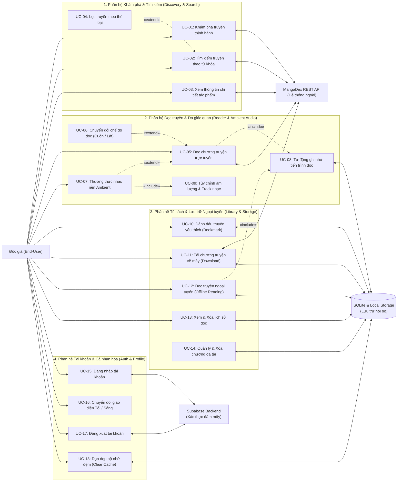

# 1.2 FUNCTIONAL REQUIREMENTS SPECIFICATION

---

## 1. Phân loại ưu tiên yêu cầu chức năng (MoSCoW Prioritisation)

| Mã FR | Tên Yêu cầu chức năng | Mô tả chi tiết | Phân loại MoSCoW | Căn cứ từ Khảo sát & Pain Points (Mục 1.1) |
| :--- | :--- | :--- | :---: | :--- |
| **FR-01** | **Khám phá truyện thịnh hành (Trending & Featured)** | Tải và hiển thị danh sách truyện tranh mới nhất, nổi bật từ MangaDex REST API v5 với cơ chế phân trang vô hạn (Infinite Scroll). | **MUST-HAVE** | Giải quyết Pain Point 3 (Kho truyện phân tán). Đảm bảo nguồn dữ liệu phong phú ngay khi mở app. |
| **FR-02** | **Tìm kiếm truyện theo từ khóa & Thể loại** | Cho phép người dùng tìm kiếm theo tên tác phẩm, tác giả, lọc nhanh theo thể loại (Manga, Manhwa, Romance, Action...). Áp dụng cơ chế Debounce 400ms. | **MUST-HAVE** | 75% người dùng khảo sát yêu cầu đề xuất/tìm kiếm truyện theo thể loại (Câu 5 - Khảo sát). |
| **FR-03** | **Xem thông tin chi tiết & Mục lục chapter** | Hiển thị ảnh bìa, tóm tắt nội dung, trạng thái phát hành, tác giả và danh sách toàn bộ các chương truyện theo thứ tự tăng/giảm. | **MUST-HAVE** | Chức năng cơ bản cốt lõi bắt buộc của ứng dụng đọc truyện. |
| **FR-04** | **Trình đọc Webtoon cuộn dọc mượt mà (Vertical Scroll)** | Tải và render danh sách trang ảnh theo dòng cuộn liên tục mượt mà 60 FPS, áp dụng bộ nhớ đệm hình ảnh LRU và Virtualized List (`ListView.builder` với `cacheExtent: 2500`), 100% không quảng cáo. | **MUST-HAVE** | Khắc phục Pain Point 1 (100% ghét quảng cáo rác) và Pain Point 5 (50% phàn nàn app lậu giật lag khi cuộn 40-60 ảnh lớn). |
| **FR-05** | **Trình đọc Manga lật trang ngang (Horizontal Page Flip)** | Chế độ đọc từng trang sang ngang qua `PageView.builder`, hỗ trợ cả lật Trái-sang-Phải (LTR) lẫn Phải-sang-Trái (RTL chuẩn Manga Nhật Bản). | **SHOULD-HAVE** | Đáp ứng thói quen đọc Manga truyền thống của Persona Kiệt và 25% phản hồi khảo sát. |
| **FR-06** | **Tự động lưu vết tiến trình đọc đến từng trang** | Lưu chính xác `user_id`, `comic_id`, `chapter_id`, số trang (`last_page_read`) và mốc thời gian ngay khi người dùng cuộn/lật trang hoặc thoát app. | **MUST-HAVE** | Đáp ứng 75% người dùng khảo sát (Câu 5); giải quyết triệt để ức chế phải lướt tìm lại trang đọc dở (Pain Point 7). |
| **FR-07** | **Đọc tiếp nhanh (Continue Reading)** | Hiển thị nút "Đọc tiếp" tại trang chi tiết và danh sách "Lịch sử đọc" ở màn Tủ sách để mở đúng chương và số trang đang đọc dở với 1 chạm. | **MUST-HAVE** | Tối ưu trải nghiệm truy cập tức thì cho độc giả di động tranh thủ lúc rảnh rỗi (Persona Thảo). |
| **FR-08** | **Tải chapter đọc Ngoại tuyến (Offline Download)** | Cho phép tải toàn bộ trang ảnh của chương truyện theo cụm 4 trang đồng thời về bộ nhớ máy, lưu trữ đường dẫn và metadata vào SQLite bảng `offline_downloads`. | **MUST-HAVE** | Giải quyết triệt để Pain Point 4 (50% người dùng bức xúc vì rớt 4G bị đứng hình; các app đối thủ khóa tính năng sau cổng nạp tiền). |
| **FR-09** | **Trình đọc Ngoại tuyến độc lập (Offline Reader)** | Khi mất kết nối Internet, hệ thống tự động nhận diện và đọc truyện từ dữ liệu đã tải lưu trong máy qua `Image.file(...)` mà không gây crash hay đơ app. | **MUST-HAVE** | Yêu cầu cốt lõi về tính ổn định ứng dụng di động trong môi trường mạng yếu/chập chờn (Offline-First). |
| **FR-10** | **Dịch vụ âm thanh nền Ambient Audio tích hợp** | Tích hợp trình phát nhạc nền Lo-fi thư giãn offline nhúng sẵn trong ứng dụng (`AmbientAudioService`), phát lặp vô hạn với âm lượng dịu nhẹ. | **SHOULD-HAVE** | Tính năng tạo sự khác biệt (UVP) độc nhất của Naomi; phục vụ Persona Kiệt và 100% người dùng có thói quen nghe nhạc khi đọc truyện (Pain Point 6). |
| **FR-11** | **Bảng điều khiển & Floating Mini-Player âm thanh** | Floating Mini-Player nổi xuyên suốt ứng dụng và Bottom Sheet tùy chỉnh âm lượng, chọn bản nhạc trực tiếp bên trong màn hình đọc truyện hoặc trang chính. | **SHOULD-HAVE** | Cho phép kiểm soát âm thanh tiện lợi mà không làm gián đoạn dòng cảm xúc đọc truyện. |
| **FR-12** | **Quản lý Tủ sách & Đánh dấu yêu thích (Bookmarks)** | Thêm/xóa tác phẩm vào danh mục "Yêu thích" (Bookmarks), lưu trữ cục bộ SQLite bảng `bookmarks` phân tách theo từng tài khoản người dùng (`user_id`). | **MUST-HAVE** | Nhu cầu cơ bản để quản lý bộ sưu tập cá nhân, giải quyết Pain Point 7. |
| **FR-13** | **Quản trị Lịch sử & Dọn dẹp bộ nhớ đệm (Cache/Downloads)** | Xem danh sách lịch sử đọc, thống kê dung lượng bộ nhớ đệm ảnh thật trên đĩa, cho phép dọn sạch cache hoặc xóa chương tải ngoại tuyến để giải phóng bộ nhớ. | **SHOULD-HAVE** | Đảm bảo app không làm tràn bộ nhớ máy của các thiết bị tầm trung (Galaxy A54, Redmi Note 12). |
| **FR-14** | **Đăng nhập & Quản lý hồ sơ người dùng (Auth & Profile)** | Đăng ký, đăng nhập tài khoản độc giả qua Supabase Cloud Auth, lưu token phiên bảo mật bằng `FlutterSecureStorage` (AES-256). | **MUST-HAVE** | Nền tảng xác thực cho kiến trúc đa thiết bị và bảo mật dữ liệu người dùng (Pain Point 7). |
| **FR-15** | **Chế độ giao diện Tối/Sáng (Dark Mode / Light Mode)** | Hỗ trợ giao diện nền tối thuần (Pure Black/Dark Grey AMOLED) và tự động ghi nhớ tùy chọn chủ đề qua `ThemeController`. | **SHOULD-HAVE** | Bảo vệ mắt độc giả đọc truyện đêm muộn trước khi ngủ (Persona Kiệt - 22h30-0h30). |
| **FR-16** | **Tìm kiếm bằng hình ảnh & Dịch tự động bằng AI** | Tải ảnh chụp màn hình lên để tìm truyện (Visual Search) và dịch bóng thoại ngôn ngữ tự động (AI Translation). | **COULD-HAVE** *(Lộ trình v2)* | Ghi nhận từ 100% mong muốn khảo sát (Pain Point 2 & 3); xếp vào Could-have để không gây nợ kỹ thuật cho bản triển khai v1. |
| **FR-17** | **Hệ thống nạp tiền VIP & Cổng thanh toán vi mô** | Nạp coin, mua gói đọc truyện có phí, khóa chương tính phí. | **WON'T-HAVE** | Dự án cam kết 100% miễn phí phi lợi nhuận vì trải nghiệm độc giả sạch sẽ nhất. |

---

## 2. Sơ đồ Use Case tổng thể (Use Case Diagram)

### 2.1 Các tác nhân hệ thống (Actors)
* **Độc giả (End-User):** Tác nhân chính (Primary Actor) trực tiếp tương tác với ứng dụng trên thiết bị di động (duyệt truyện, đọc online/offline, nghe nhạc ambient, quản lý tủ sách, đăng nhập tài khoản).
* **MangaDex REST API:** Tác nhân phụ bên ngoài (External System) cung cấp kho dữ liệu truyện mở, danh mục chương và máy chủ ảnh CDN (At-Home Network).
* **Supabase Cloud Backend:** Tác nhân phụ bên ngoài (External Cloud Provider) cung cấp dịch vụ xác thực tài khoản độc giả (Supabase Auth) và quản lý phiên làm việc bảo mật.
* **Tầng Lưu trữ Cục bộ (Local Persistence Layer):** Thành phần cơ sở dữ liệu nhúng nội bộ (SQLite & Local File System) phục vụ kiến trúc Offline-First, lưu trữ bookmarks, lịch sử đọc dở và các tệp ảnh tải về máy.

### 2.2 Sơ đồ Use Case phân hệ (Global Use Case Diagram)

---

## 3. Đặc tả Use Case chi tiết (Use Case Specifications)

### 3.1 UC-05: Đọc chương truyện đa chế độ (Core Comic Reader)
* **Mã Use Case:** `UC-05` *(kết hợp UC-06, UC-08)*
* **Tên Use Case:** Đọc chương truyện đa chế độ và tự động lưu tiến trình
* **Mã Yêu cầu ánh xạ:** `FR-04`, `FR-05`, `FR-06`
* **Mức độ ưu tiên:** MUST-HAVE
* **Tác nhân chính:** Độc giả (End-User)
* **Tác nhân phụ:** MangaDex REST API, Tầng lưu trữ SQLite
* **Tiền điều kiện:** Người dùng đã chọn một tác phẩm và nhấn vào một chương cụ thể (hoặc nhấn nút "Đọc tiếp").
* **Hậu điều kiện:** Trang ảnh hiển thị mượt mà trên màn hình; chỉ số trang đọc dở (`last_page_read`), `chapter_id`, mốc thời gian được lưu vào bảng `reading_history`.
* **Kích hoạt:** Người dùng chạm vào một chương trong danh sách chapter hoặc chạm vào nút "Đọc tiếp".

#### Luồng sự kiện chính (Main Flow):
1. Người dùng chọn chương truyện muốn đọc.
2. Hệ thống điều hướng sang `ReaderScreen`, hiển thị trạng thái tải dữ liệu (Loading Spinner).
3. Hệ thống gửi yêu cầu lấy danh sách URL hình ảnh của chương truyện (qua MangaDex At-Home API hoặc thư mục Offline cục bộ).
4. Hệ thống tải cấu hình đọc mặc định của người dùng (Chế độ cuộn dọc Webtoon hoặc Lật ngang Manga).
5. Giao diện dựng khung hiển thị:
   - Chế độ **Cuộn dọc (Webtoon):** Khởi tạo danh sách ảo `ListView.builder` cuộn liên tục với bộ đệm `cacheExtent: 2500` nạp trước các trang ảnh tiếp theo nhằm duy trì 60 FPS.
   - Chế độ **Lật ngang (Manga):** Khởi tạo `PageView.builder` hỗ trợ lướt ngang mượt mà (hỗ trợ cả chuẩn LTR lẫn RTL Nhật Bản).
6. Khi người dùng cuộn hoặc lướt qua từng trang, hệ thống cập nhật chỉ số trang hiện tại trên thanh chỉ báo (VD: `Trang 12 / 45`).
7. Hệ thống tự động kích hoạt `saveReadingProgress` lưu trang hiện tại vào bảng SQLite cục bộ `reading_history` (`user_id`, `comic_id`, `chapter_id`, `last_page_read`, `total_pages`, `read_percentage`, `updated_at`).
8. Người dùng đọc đến trang cuối cùng; hệ thống hiển thị thẻ điều hướng hoàn thành chương kèm nút chuyển sang chương kế tiếp (Next Chapter).
9. Người dùng nhấn chuyển chương; hệ thống tải chương tiếp theo và đưa vị trí trang về `Trang 1`.

#### Luồng rẽ nhánh & ngoại lệ (Alternative & Exception Flows):
* **Alt 1 - Chuyển đổi giữa Cuộn dọc và Lật ngang (UC-06):**
  - *4a.* Người dùng chạm vào giữa màn hình để hiển thị thanh công cụ đọc.
  - *4b.* Người dùng nhấn nút chuyển chế độ hiển thị ("Webtoon / Manga").
  - *4c.* Hệ thống lập tức chuyển đổi giữa `_buildWebtoonViewer` và `_buildMangaViewer` mà vẫn giữ nguyên vị trí trang hiện tại.
* **Exc 1 - Mất kết nối Internet khi đang đọc online:**
  - *3a.* Tải ảnh thất bại do mất sóng 4G/Wi-Fi (`DioException` hoặc timeout).
  - *3b.* Khung hiển thị trang ảnh kích hoạt trạng thái lỗi kèm nút "Thử tải lại" và nút "Mở Kho Ngoại Tuyến".
  - *3c.* Người dùng có thể nhấn thử lại hoặc chuyển ngay về tab Đã tải trong Tủ sách để đọc ngoại tuyến.
* **Exc 2 - Lỗi tệp ảnh từ máy chủ CDN (404/Corrupted Image):**
  - *5a.* Tệp ảnh bị lỗi từ máy chủ nguồn MangaDex.
  - *5b.* `CachedNetworkImage` hiển thị icon ảnh lỗi cục bộ tại khung trang đó mà không làm crash ứng dụng.

---

### 3.2 UC-07: Thưởng thức nhạc nền Ambient Audio thư giãn
* **Mã Use Case:** `UC-07` *(kết hợp UC-09)*
* **Tên Use Case:** Phát nhạc nền Ambient Lo-fi thư giãn nhúng sẵn khi đọc truyện
* **Mã Yêu cầu ánh xạ:** `FR-10`, `FR-11`
* **Mức độ ưu tiên:** SHOULD-HAVE
* **Tác nhân chính:** Độc giả (End-User)
* **Tác nhân phụ:** Audio Hardware, `just_audio` Engine, `audio_session`
* **Tiền điều kiện:** Ứng dụng Naomi đang mở trên thiết bị, âm lượng media không bị tắt hoàn toàn.
* **Hậu điều kiện:** Nhạc nền Ambient Lo-fi phát ở chế độ lặp vô hạn (Infinite Loop), âm lượng êm dịu, không gián đoạn khi cuộn trang hay chuyển đổi màn hình.
* **Kích hoạt:** Người dùng chạm vào biểu tượng âm nhạc trên thanh công cụ `ReaderScreen`, hoặc chủ động bật từ `FloatingMiniPlayer`.

#### Luồng sự kiện chính (Main Flow):
1. Người dùng đang ở màn hình đọc truyện `ReaderScreen`, chạm vào biểu tượng nốt nhạc trên thanh công cụ trên cùng.
2. Hệ thống hiển thị bảng điều khiển `AmbientAudioSheet` (Bottom Sheet).
3. Người dùng chọn một bản nhạc trong danh mục Offline nhúng sẵn trong ứng dụng: *Sakura Girl - Flowers* hoặc *Sakura Girl - Sweet Note*.
4. Dịch vụ âm thanh `AmbientAudioService` khởi tạo luồng âm thanh thông qua engine `just_audio` với cấu hình `LoopMode.one` (tự động lặp lại bản nhạc khi kết thúc).
5. Âm thanh bắt đầu phát êm dịu. Biểu tượng Mini Audio Wave hiển thị trạng thái đang phát.
6. Người dùng có thể:
   - Tăng/giảm âm lượng độc lập qua thanh trượt Slider `setVolume(volume)` (từ 0.0 đến 1.0).
   - Nhấn Tạm dừng (Pause) hoặc Tiếp tục (Resume).
   - Chọn chuyển đổi giữa các bản nhạc có sẵn.
7. Người dùng vuốt đóng BottomSheet hoặc quay lại đọc truyện; âm thanh tiếp tục phát nền liền mạch.

#### Luồng rẽ nhánh & ngoại lệ (Alternative & Exception Flows):
* **Alt 1 - Điều khiển qua Floating Mini-Player khi thoát khỏi màn hình đọc:**
  - *1a.* Người dùng nhấn nút Back để quay về màn hình Khám phá hoặc Tủ sách.
  - *1b.* Trình điều khiển tự động thu nhỏ thành **Floating Mini-Player** neo cố định ở góc dưới màn hình, hiển thị tên bài hát, nút Play/Pause và nút Đóng (Dismiss).
  - *1c.* Người dùng chạm vào Floating Mini-Player để mở lại `AmbientAudioSheet` tùy chỉnh âm lượng hoặc dừng phát bất kỳ lúc nào.
* **Alt 2 - Có cuộc gọi đến hoặc ứng dụng khác chiếm quyền Audio Focus:**
  - *2a.* Hệ điều hành gửi sự kiện gián đoạn âm thanh qua `audio_session` (`interruptionEventStream` hoặc `becomingNoisyEventStream` khi rút tai nghe).
  - *2b.* `AmbientAudioService` tự động tạm dừng (Auto-pause) để bảo vệ trải nghiệm của người dùng.

---

### 3.3 UC-11 & UC-12: Tải chapter và Đọc ngoại tuyến (Offline Storage & Reader)
* **Mã Use Case:** `UC-11` (Tải ngoại tuyến) & `UC-12` (Đọc ngoại tuyến)
* **Tên Use Case:** Quản lý tải xuống và đọc truyện ngoại tuyến không cần mạng Internet
* **Mã Yêu cầu ánh xạ:** `FR-08`, `FR-09`
* **Mức độ ưu tiên:** MUST-HAVE
* **Tác nhân chính:** Độc giả (End-User)
* **Tác nhân phụ:** MangaDex REST API, SQLite Local Database, Local File System
* **Tiền điều kiện:**
  - Với UC-11 (Tải): Có kết nối mạng và bộ nhớ máy trống tối thiểu 50 MB.
  - Với UC-12 (Đọc): Chương truyện đã được tải hoàn tất về máy trước đó.
* **Hậu điều kiện:** Toàn bộ tệp ảnh lưu trong thư mục `${appDir}/offline_chapters/{chapterId}/`; bản ghi metadata lưu trong bảng SQLite `offline_downloads`; đọc được trơn tru khi không có Internet.

#### Luồng sự kiện chính (UC-11: Tải chương truyện):
1. Người dùng mở trang chi tiết truyện (`ComicDetailScreen`).
2. Tại danh sách chapter, người dùng chạm vào biểu tượng "Tải xuống" bên cạnh chương mong muốn.
3. Lớp `LibraryLocalDataSource` truy vấn MangaDex At-Home server API để lấy danh sách URL hình ảnh của chapter.
4. Hệ thống tạo thư mục nội bộ an toàn `${appDir}/offline_chapters/{chapterId}/`.
5. Hệ thống tải song song theo cụm 4 trang (Concurrent Batching) và cập nhật tiến trình phần trăm (0% $\rightarrow$ 100%) theo thời gian thực lên giao diện.
6. Tải xong toàn bộ trang ảnh, hệ thống tạo bản ghi mới trong bảng SQLite `offline_downloads` (`chapter_id`, `comic_id`, `comic_title`, `chapter_number`, `status = 'completed'`, `downloaded_pages`, `total_pages`, `local_directory`, `created_at`, `updated_at`).
7. Đồng thời đồng bộ metadata vào bảng `comics` và `chapters` để đảm bảo toàn vẹn dữ liệu quan hệ. Biểu tượng chuyển sang trạng thái "Đã tải xong" (Checkmark màu xanh).

#### Luồng sự kiện chính (UC-12: Đọc chương truyện ngoại tuyến):
1. Thiết bị ngắt hoàn toàn kết nối Internet (chế độ máy bay hoặc mất sóng).
2. Người dùng mở ứng dụng Naomi $\rightarrow$ tab **Tủ sách (Library)** $\rightarrow$ chọn tab con **Đã tải (Downloads)**.
3. Hệ thống truy vấn bảng `offline_downloads` trong SQLite và hiển thị danh sách các chương đã tải sẵn.
4. Người dùng chọn chương muốn đọc.
5. `ReaderScreen` khởi động và nhận diện nguồn phát là thư mục máy, sử dụng `Image.file(File(path))` nạp ảnh trực tiếp từ bộ nhớ trong.
6. Tốc độ nạp trang tức thì (< 300ms/trang), cuộn dọc mượt mà 60 FPS, tiến trình đọc vẫn tự động ghi nhận vào bảng `reading_history`.

#### Luồng rẽ nhánh & ngoại lệ (Alternative & Exception Flows):
* **Exc 1 - Lỗi mạng hoặc gián đoạn giữa chừng khi tải:**
  - *5a.* Quá trình tải một tệp ảnh thất bại do rớt kết nối.
  - *5b.* Hệ thống ghi nhận lỗi, dọn dẹp các tệp ảnh tải dở trong thư mục và không ghi trạng thái `completed` vào database.
  - *5c.* Hiển thị SnackBar thông báo: *"Tải chương thất bại do mất kết nối mạng. Vui lòng thử lại"*.
* **Exc 2 - Xóa chương đã tải để giải phóng dung lượng (UC-14):**
  - *1a.* Người dùng nhấn biểu tượng Thùng rác bên cạnh chương đã tải trong tab "Đã tải".
  - *1b.* Người dùng xác nhận xóa trên hộp thoại.
  - *1c.* Hệ thống xóa toàn bộ thư mục tệp ảnh vật lý trên đĩa máy và xóa bản ghi tương ứng trong bảng SQLite `offline_downloads` (đồng thời xóa dữ liệu liên kết trong bảng `chapters` và `pages`).

---

### 3.4 UC-02: Tìm kiếm và Lọc truyện theo danh mục
* **Mã Use Case:** `UC-02` *(kết hợp UC-04)*
* **Tên Use Case:** Tìm kiếm truyện theo từ khóa và bộ lọc thể loại
* **Mã Yêu cầu ánh xạ:** `FR-02`
* **Mức độ ưu tiên:** MUST-HAVE
* **Tác nhân chính:** Độc giả (End-User)
* **Tác nhân phụ:** MangaDex REST API
* **Tiền điều kiện:** Ứng dụng đã kết nối Internet và ở màn hình Khám phá (`DiscoverScreen`).
* **Hậu điều kiện:** Hiển thị danh sách kết quả tìm kiếm trực quan (ảnh bìa, tên truyện, tác giả, thể loại).

#### Luồng sự kiện chính:
1. Người dùng chạm vào thanh tìm kiếm ở đầu màn hình Khám phá.
2. Người dùng nhập từ khóa tìm kiếm (tên truyện, tác giả).
3. Hệ thống áp dụng cơ chế **Debounce (400ms)** sau khi người dùng ngừng gõ để tránh gửi request dồn dập gây quá tải API.
4. `DiscoverBloc` kích hoạt sự kiện `SearchComicsEvent` và gửi truy vấn đến MangaDex API.
5. Hệ thống nhận danh sách kết quả và hiển thị lên lưới truyện `GridView`.
6. Người dùng có thể nhấn vào các Chip lọc thể loại nhanh (*Action*, *Manga*, *Romance*, *Supernatural*...) để thu hẹp danh sách kết quả (UC-04).

#### Luồng rẽ nhánh & ngoại lệ:
* **Alt 1 - Không tìm thấy kết quả phù hợp:**
  - *5a.* Kết quả trả về danh sách rỗng.
  - *5b.* Giao diện hiển thị minh họa trạng thái trống (Empty State) kèm thông báo: *"Không tìm thấy bộ truyện nào phù hợp với từ khóa '{query}'. Vui lòng thử lại với từ khóa khác"*.
* **Exc 1 - Lỗi kết nối mạng khi tìm kiếm:**
  - *4a.* Mạng bị gián đoạn.
  - *4b.* Hiển thị thông báo lỗi mạng kèm nút "Thử lại" (Retry).

---

### 3.5 UC-10: Quản lý Tủ sách & Đánh dấu truyện yêu thích (Bookmark)
* **Mã Use Case:** `UC-10`
* **Tên Use Case:** Đánh dấu truyện yêu thích và quản lý tủ sách cá nhân
* **Mã Yêu cầu ánh xạ:** `FR-12`
* **Mức độ ưu tiên:** MUST-HAVE
* **Tác nhân chính:** Độc giả (End-User)
* **Tác nhân phụ:** SQLite Local Database
* **Tiền điều kiện:** Người dùng đang mở trang chi tiết một bộ truyện (`ComicDetailScreen`).
* **Hậu điều kiện:** Trạng thái Bookmark cập nhật tức thì; dữ liệu lưu bền vững trong SQLite theo `user_id` và hiển thị tại tab Tủ sách.

#### Luồng sự kiện chính:
1. Tại trang chi tiết tác phẩm, hệ thống tự động kiểm tra trạng thái yêu thích qua `isBookmarked(comicId)` và hiển thị icon Trái tim tương ứng (Viền xám nếu chưa lưu, Đỏ đặc nếu đã lưu).
2. Người dùng chạm vào nút Bookmark.
3. Hệ thống kích hoạt `toggleBookmark`:
   - Nếu chưa lưu: Tạo bản ghi mới và lưu vào bảng `bookmarks` (`user_id`, `comic_id`, `title`, `cover_url`, `author`, `created_at`). Đồng thời lưu metadata vào bảng `comics`.
   - Nếu đã lưu: Xóa bản ghi có `user_id` và `comic_id` tương ứng khỏi bảng `bookmarks`.
4. Icon đổi trạng thái tức thì kèm hiệu ứng rung nhẹ (Haptic Feedback) và hiển thị SnackBar: *"Đã thêm vào Tủ sách yêu thích"* (hoặc *"Đã bỏ lưu"*).
5. Khi chuyển sang màn hình **Tủ sách (LibraryScreen)**, tab **Yêu thích (Bookmarks)** tự động cập nhật danh sách truyện mới nhất.

---

### 3.6 UC-15 & UC-17: Xác thực tài khoản & Quản trị hồ sơ (Auth & Profile)
* **Mã Use Case:** `UC-15` (Đăng nhập), `UC-17` (Đăng xuất), `UC-16` (Giao diện), `UC-18` (Dọn cache)
* **Tên Use Case:** Quản lý tài khoản độc giả, tùy biến giao diện và giải phóng bộ nhớ
* **Mã Yêu cầu ánh xạ:** `FR-13`, `FR-14`, `FR-15`
* **Mức độ ưu tiên:** MUST-HAVE
* **Tác nhân chính:** Độc giả (End-User)
* **Tác nhân phụ:** Supabase Cloud Auth, `FlutterSecureStorage`, Tầng SQLite
* **Tiền điều kiện:** Người dùng đang ở màn hình Đăng nhập hoặc màn hình Cá nhân (`ProfileScreen`).
* **Hậu điều kiện:** Đăng nhập thành công, token phiên được lưu mã hóa AES-256 an toàn trong thiết bị; hồ sơ người dùng được cập nhật.

#### Luồng sự kiện chính (UC-15: Đăng nhập):
1. Người dùng mở `LoginScreen`, nhập Email và Mật khẩu.
2. Người dùng nhấn nút "Đăng nhập".
3. `AuthBloc` kiểm tra hợp lệ dữ liệu (email đúng định dạng, mật khẩu $\ge$ 6 ký tự) và gửi yêu cầu xác thực tới Supabase Cloud Auth qua `signInWithPassword`.
4. Máy chủ Supabase trả về Token xác thực và thông tin hồ sơ người dùng (`UserModel`: `id`, `email`, `displayName`, `avatarUrl`).
5. Hệ thống lưu token phiên vào `FlutterSecureStorage` và phát trạng thái `AuthenticatedState`.
6. Ứng dụng điều hướng vào màn hình chính `MainNavigationScreen`.

#### Luồng sự kiện chính (UC-17: Đăng xuất & UC-18: Dọn cache):
* **Đăng xuất (UC-17):**
  1. Người dùng vào màn hình **Cá nhân (ProfileScreen)** và nhấn "Đăng xuất".
  2. Hệ thống gọi `supabase.auth.signOut()`, xóa sạch token trong `FlutterSecureStorage`.
  3. Hệ thống điều hướng quay trở lại màn hình `LoginScreen`.
* **Dọn dẹp bộ nhớ đệm (UC-18):**
  1. Tại màn hình Profile, hệ thống hiển thị dung lượng bộ nhớ đệm ảnh thật trên đĩa (tính toán từ `getTemporaryDirectory()`).
  2. Người dùng nhấn nút "Dọn dẹp bộ nhớ đệm".
  3. Hệ thống dọn sạch `PaintingBinding.instance.imageCache` và xóa các tệp cache tạm trên đĩa, cập nhật dung lượng về 0.0 MB và hiển thị thông báo thành công.

---

## 4. User Stories & Tiêu chí chấp nhận kiểm thử (Acceptance Criteria)

### Epic 1: Trải nghiệm Đọc truyện Cốt lõi (Core Reading Experience)

#### User Story US-01: Đọc truyện mượt mà không quảng cáo rác (Mã ánh xạ: FR-04)
> **Là một** độc giả đọc truyện đêm muộn (Persona Kiệt),  
> **Tôi muốn** cuộn đọc các chương truyện Webtoon liên tục 60 FPS mà hoàn toàn không bị các video quảng cáo hay banner cờ bạc làm phiền,  
> **Để** tôi có thể đắm chìm vào cảm xúc nhân vật và thư giãn trọn vẹn trước khi đi ngủ.

* **Tiêu chí chấp nhận AC-01.1 (Kiểm thử hiển thị quảng cáo):**
  - **Given** người dùng đang ở màn hình đọc truyện `ReaderScreen`,
  - **When** người dùng cuộn qua toàn bộ 40 trang ảnh của một chương Webtoon,
  - **Then** hệ thống không hiển thị bất kỳ pop-up, video ad hay banner quảng cáo nào làm che khuất nội dung trang ảnh.
* **Tiêu chí chấp nhận AC-01.2 (Kiểm thử hiệu năng cuộn ảnh):**
  - **Given** chương truyện chứa hơn 30 trang ảnh độ phân giải cao,
  - **When** người dùng vuốt cuộn nhanh,
  - **Then** tốc độ khung hình duy trì ổn định $\ge 55$ FPS nhờ cơ chế `cacheExtent: 2500`, không xảy ra hiện tượng tràn bộ nhớ (Out-of-Memory Crash).

---

#### User Story US-02: Tự động ghi nhớ trang đọc dở (Progress Auto-Save) (Mã ánh xạ: FR-06, FR-07)
> **Là một** người đọc bận rộn thường tranh thủ đọc truyện lúc rảnh rỗi (Persona Thảo),  
> **Tôi muốn** ứng dụng tự động nhớ chính xác số trang tôi đang đọc dở khi tôi phải tắt app đột ngột,  
> **Để** lần sau mở app tôi có thể đọc tiếp ngay lập tức mà không phải tìm lại từ đầu.

* **Tiêu chí chấp nhận AC-02.1 (Kiểm thử lưu vết SQLite):**
  - **Given** người dùng đang đọc chương `Ch.15` của bộ truyện `Solo Leveling` và đang ở trang số `14`,
  - **When** người dùng cuộn qua trang 14 hoặc nhấn nút thoát màn hình đọc truyện,
  - **Then** bản ghi trong bảng `reading_history` của SQLite được cập nhật chính xác với `comic_id = 'solo-leveling'`, `chapter_id = 'ch-15'`, `last_page_read = 14`, `total_pages = 45`.
* **Tiêu chí chấp nhận AC-02.2 (Kiểm thử điều hướng đọc tiếp):**
  - **Given** người dùng mở lại trang chi tiết truyện hoặc tab Lịch sử đọc trong Tủ sách,
  - **When** người dùng nhấn nút "Đọc tiếp (Continue Reading)",
  - **Then** màn hình `ReaderScreen` được khởi động và tự động cuộn/lật chính xác đến trang số `14`.

---

### Epic 2: Đa giác quan & Âm thanh Ambient (Ambient Audio Experience)

#### User Story US-03: Nhạc nền Lo-fi thư giãn khi đọc truyện (Mã ánh xạ: FR-10, FR-11)
> **Là một** độc giả nhạy cảm với âm thanh (Persona Kiệt),  
> **Tôi muốn** có thể bật các bản nhạc Lo-fi êm dịu nhúng sẵn trực tiếp trong ứng dụng khi đang đọc truyện,  
> **Để** tôi không phải mở song song ứng dụng bên ngoài gây nóng máy, hao pin và phân tâm.

* **Tiêu chí chấp nhận AC-03.1 (Kiểm thử phát nhạc nền Lo-fi):**
  - **Given** người dùng đang ở màn hình đọc truyện `ReaderScreen`,
  - **When** người dùng chạm vào biểu tượng âm nhạc trên thanh công cụ và chọn phát bản nhạc *Sakura Girl - Flowers*,
  - **Then** dịch vụ `AmbientAudioService` lập tức phát âm thanh với chế độ lặp vô hạn qua `just_audio`, hiển thị biểu tượng sóng nhạc và không làm gián đoạn việc cuộn đọc truyện.
* **Tiêu chí chấp nhận AC-03.2 (Kiểm thử điều khiển qua Floating Mini-Player):**
  - **Given** nhạc nền đang phát trong màn hình đọc truyện,
  - **When** người dùng quay trở lại màn hình Khám phá hoặc Tủ sách,
  - **Then** thanh điều khiển `FloatingMiniPlayer` hiển thị ở góc dưới màn hình cho phép người dùng Tạm dừng (Pause), Tiếp tục (Play), hoặc Đóng (Dismiss) trình phát bất kỳ lúc nào.

---

### Epic 3: Đọc truyện Ngoại tuyến (Offline Capabilities)

#### User Story US-04: Tải chương truyện về máy để đọc khi mất mạng 4G (Mã ánh xạ: FR-08, FR-09)
> **Là một** sinh viên thường xuyên di chuyển bằng xe buýt sóng yếu (Persona Thảo),  
> **Tôi muốn** tải trước các chương truyện yêu thích về máy bằng mạng Wi-Fi tại nhà,  
> **Để** khi ngồi trên xe buýt rớt mạng 4G tôi vẫn mở ra đọc trơn tru và hoàn toàn miễn phí.

* **Tiêu chí chấp nhận AC-04.1 (Kiểm thử tải và lưu trữ tệp):**
  - **Given** thiết bị có kết nối Internet ổn định và bộ nhớ trống > 50 MB,
  - **When** người dùng nhấn nút "Tải xuống" ở một chương truyện trên `ComicDetailScreen`,
  - **Then** thanh tiến trình hiển thị phần trăm tải từ `0%` đến `100%`, toàn bộ tệp ảnh được tải theo cụm 4 trang lưu vào thư mục `${appDir}/offline_chapters/{chapterId}/` và một bản ghi trạng thái `completed` được tạo trong bảng SQLite `offline_downloads`.
* **Tiêu chí chấp nhận AC-04.2 (Kiểm thử đọc offline không mạng):**
  - **Given** thiết bị ngắt toàn bộ Wi-Fi và Dữ liệu di động (Chế độ máy bay),
  - **When** người dùng mở tab "Đã tải" trong Tủ sách (`LibraryScreen`) và chọn chương truyện đã tải,
  - **Then** chương truyện mở ra tức thì trong thời gian < 300 ms, toàn bộ trang ảnh hiển thị đầy đủ và sắc nét từ bộ nhớ máy qua `Image.file(...)` mà không xuất hiện bất kỳ hộp thoại báo lỗi mạng nào.

---

### Epic 4: Tủ sách & Tìm kiếm thông minh (Library & Discovery)

#### User Story US-05: Lưu trữ và phân loại truyện theo dõi (Mã ánh xạ: FR-12)
> **Là một** độc giả theo dõi cùng lúc nhiều bộ truyện,  
> **Tôi muốn** đánh dấu yêu thích các bộ truyện hay vào Tủ sách cá nhân của mình,  
> **Để** tôi dễ dàng theo dõi và không bị quên danh sách tác phẩm mình đang yêu thích.

* **Tiêu chí chấp nhận AC-05.1 (Kiểm thử toggle bookmark):**
  - **Given** người dùng đang ở trang chi tiết của bộ truyện chưa từng được lưu,
  - **When** người dùng nhấn vào nút biểu tượng Trái tim (Bookmark),
  - **Then** biểu tượng đổi màu đỏ kích hoạt, thông báo SnackBar hiển thị xác nhận và dữ liệu được ghi tức thời vào bảng `bookmarks` trong SQLite theo `user_id`.
* **Tiêu chí chấp nhận AC-05.2 (Kiểm thử đồng bộ hiển thị Tủ sách):**
  - **Given** bộ truyện đã nằm trong danh sách Bookmarks,
  - **When** người dùng mở tab Tủ sách (`LibraryScreen`) $\rightarrow$ mục "Yêu thích",
  - **Then** bộ truyện xuất hiện ngay đầu danh sách với đầy đủ ảnh bìa, tiêu đề và tác giả.
