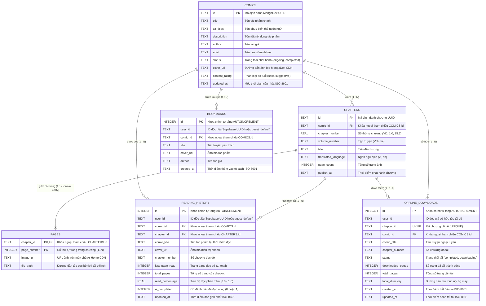
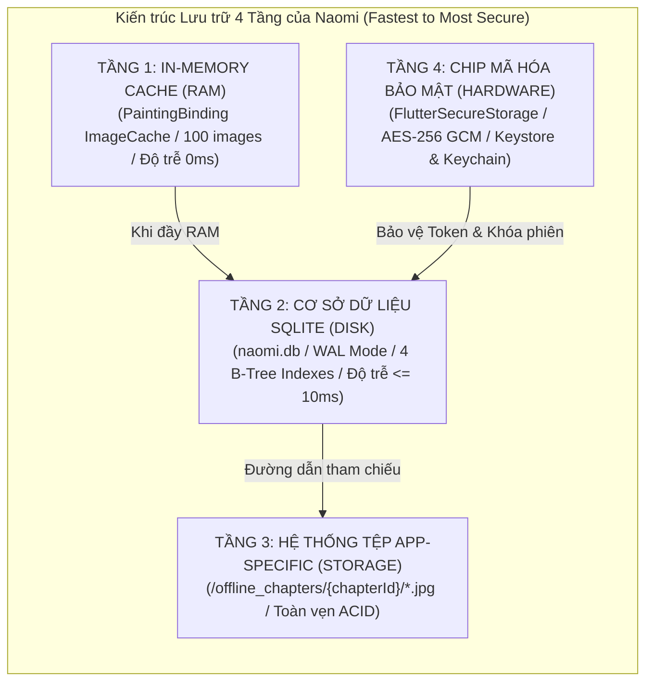

# 1.5 DATA & API DESIGN

---

## 1. Mô hình Dữ liệu Quan hệ & Sơ đồ ERD (Entity-Relationship Diagram & Data Model)

Ứng dụng **Naomi** áp dụng triết lý thiết kế **Offline-First**, trong đó cơ sở dữ liệu cục bộ đóng vai trò là "Single Source of Truth" cho toàn bộ trạng thái người dùng (tiến trình đọc dở, tủ sách yêu thích, các chương tải ngoại tuyến). 

### 1.1 Khung lý thuyết & Chuẩn hóa Cơ sở Dữ liệu (Database Normalization)

Cơ sở dữ liệu SQLite cục bộ (`naomi.db`) được thiết kế tuân thủ nghiêm ngặt **Dạng chuẩn 3 (Third Normal Form - 3NF)** theo lý thuyết cơ sở dữ liệu quan hệ quốc tế *(Elmasri & Navathe - Fundamentals of Database Systems)*:
1. **Dạng chuẩn 1 (1NF):** Toàn bộ các thuộc tính trong các bảng đều có giá trị nguyên tố (Atomic values), không chứa thuộc tính lặp hay mảng đa trị không chuẩn.
2. **Dạng chuẩn 2 (2NF):** Đạt 1NF và mọi thuộc tính không khóa đều phụ thuộc hàm toàn phần vào khóa chính (Full Functional Dependency). Đặc biệt, thực thể yếu `pages` sử dụng khóa chính phức hợp (Composite Primary Key: `chapter_id`, `page_number`), đảm bảo từng trang ảnh gắn chặt với số thứ tự và chương tương ứng.
3. **Dạng chuẩn 3 (3NF):** Đạt 2NF và loại bỏ hoàn toàn các phụ thuộc bắc cầu (Transitive Dependencies). Dữ liệu tác phẩm (`comics`), danh mục chương (`chapters`) và chi tiết trang (`pages`) được phân tách thành các bảng riêng biệt và liên kết qua ràng buộc khóa ngoại (Foreign Keys).

---

### 1.2 Sơ đồ Thực thể - Mối quan hệ Chuẩn hóa (Logical ERD Diagram)



---

### 1.3 Đặc tả Chi tiết Từ điển Dữ liệu (Data Dictionary)

Toàn bộ các bảng được khởi tạo qua mã nguồn [`DatabaseHelper`](file:///c:/Users/Lenovo/Desktop/appdev/Naomi/lib/core/database/database_helper.dart#L38-L136). Khi mở kết nối cơ sở dữ liệu, Naomi kích hoạt hai chỉ thị quan trọng:
* `PRAGMA foreign_keys = ON;`: Bắt buộc kiểm tra toàn vẹn tham chiếu khóa ngoại.
* `PRAGMA journal_mode = WAL;`: Sử dụng cơ chế ghi nhật ký Write-Ahead Logging giúp tăng tốc độ đọc/ghi đồng thời $\le 10\text{ ms}$.

#### Bảng 1: `comics` (Metadata Cache tác phẩm truyện tranh)
| Tên Cột | Kiểu Dữ liệu SQL | Ràng buộc | Ý nghĩa Kỹ thuật |
| :--- | :---: | :---: | :--- |
| `id` | `TEXT` | `PRIMARY KEY` | Mã định danh duy nhất (UUID) của tác phẩm từ MangaDex. |
| `title` | `TEXT` | `NOT NULL` | Tiêu đề chính thức của tác phẩm. |
| `alt_titles` | `TEXT` | `NULLABLE` | Danh sách tên phụ/bí danh (lưu chuỗi JSON string). |
| `description` | `TEXT` | `NULLABLE` | Tóm tắt tóm lược nội dung tác phẩm. |
| `author` | `TEXT` | `NULLABLE` | Tên tác giả kịch bản (Author). |
| `artist` | `TEXT` | `NULLABLE` | Tên họa sĩ minh họa (Artist). |
| `status` | `TEXT` | `NULLABLE` | Tình trạng: `ongoing`, `completed`, `hiatus`, `cancelled`. |
| `cover_url` | `TEXT` | `NULLABLE` | URL ảnh bìa trích xuất từ MangaDex CDN. |
| `content_rating` | `TEXT` | `NULLABLE` | Nhãn độ tuổi: `safe`, `suggestive`, `erotica`. |
| `updated_at` | `TEXT` | `NOT NULL` | Mốc thời gian đồng bộ dữ liệu gần nhất (ISO-8601). |

#### Bảng 2: `chapters` (Metadata Cache danh mục chương)
| Tên Cột | Kiểu Dữ liệu SQL | Ràng buộc | Ý nghĩa Kỹ thuật |
| :--- | :---: | :---: | :--- |
| `id` | `TEXT` | `PRIMARY KEY` | Mã định danh duy nhất (UUID) của chương truyện. |
| `comic_id` | `TEXT` | `NOT NULL, FK` | Khóa ngoại tham chiếu tới `comics(id)`. |
| `chapter_number` | `REAL` | `NULLABLE` | Số thứ tự chương (kiểu số thực hỗ trợ chapter thập phân như 10.5). |
| `volume_number` | `TEXT` | `NULLABLE` | Tập truyện (Volume). |
| `title` | `TEXT` | `NULLABLE` | Tiêu đề riêng của chương (nếu có). |
| `translated_language` | `TEXT` | `DEFAULT 'en'` | Ngôn ngữ dịch thuật (`vi`, `en`). |
| `page_count` | `INTEGER` | `DEFAULT 0` | Tổng số lượng trang ảnh của chương. |
| `publish_at` | `TEXT` | `NULLABLE` | Thời điểm phát hành trên MangaDex. |

#### Bảng 3: `pages` (Chi tiết trang ảnh - Thực thể yếu)
| Tên Cột | Kiểu Dữ liệu SQL | Ràng buộc | Ý nghĩa Kỹ thuật |
| :--- | :---: | :---: | :--- |
| `chapter_id` | `TEXT` | `NOT NULL, FK, PK1` | Khóa ngoại tham chiếu `chapters(id)`, tạo khóa chính phức hợp. |
| `page_number` | `INTEGER` | `NOT NULL, PK2` | Số trang (1, 2, 3...), tạo khóa chính phức hợp `(chapter_id, page_number)`. |
| `image_url` | `TEXT` | `NOT NULL` | URL ảnh trực tuyến trên máy chủ At-Home CDN. |
| `file_path` | `TEXT` | `NULLABLE` | Đường dẫn tệp ảnh lưu trong bộ nhớ máy (khi tải offline). |

#### Bảng 4: `reading_history` (Theo dõi tiến trình đọc dở)
| Tên Cột | Kiểu Dữ liệu SQL | Ràng buộc | Ý nghĩa Kỹ thuật |
| :--- | :---: | :---: | :--- |
| `id` | `INTEGER` | `PRIMARY KEY AUTOINCREMENT` | Khóa chính tự động tăng. |
| `user_id` | `TEXT` | `NOT NULL` | ID độc giả (phân tách dữ liệu đa tài khoản). |
| `comic_id` | `TEXT` | `NOT NULL, FK` | Khóa ngoại tham chiếu `comics(id)`. |
| `chapter_id` | `TEXT` | `NOT NULL, FK` | Khóa ngoại tham chiếu `chapters(id)` đang đọc dở. |
| `comic_title` | `TEXT` | `NOT NULL` | Tên truyện hiển thị nhanh tại màn hình Tủ sách. |
| `cover_url` | `TEXT` | `NULLABLE` | URL ảnh bìa để render thumbnail tức thì không cần JOIN. |
| `chapter_number` | `TEXT` | `NOT NULL DEFAULT '1'` | Số chương đang đọc dở (VD: "Chương 12"). |
| `last_page_read` | `INTEGER` | `NOT NULL DEFAULT 1` | Vị trí trang đọc dở chính xác (FR-06 & US-02). |
| `total_pages` | `INTEGER` | `NOT NULL DEFAULT 1` | Tổng số trang của chương đó. |
| `read_percentage` | `REAL` | `DEFAULT 0.0` | Tỷ lệ đọc đã hoàn thành từ `0.0` đến `1.0`. |
| `is_completed` | `INTEGER` | `DEFAULT 0` | Đánh dấu đọc xong chương (0: Chưa xong, 1: Đã xong). |
| `updated_at` | `TEXT` | `NOT NULL` | Thời điểm cập nhật tiến trình (sắp xếp giảm dần). |
| Ràng buộc duy nhất | `UNIQUE` | `UNIQUE(user_id, comic_id)` | Mỗi người dùng chỉ có 1 bản ghi tiến trình mới nhất cho mỗi bộ truyện. |

#### Bảng 5: `bookmarks` (Tủ sách truyện yêu thích)
| Tên Cột | Kiểu Dữ liệu SQL | Ràng buộc | Ý nghĩa Kỹ thuật |
| :--- | :---: | :---: | :--- |
| `id` | `INTEGER` | `PRIMARY KEY AUTOINCREMENT` | Khóa chính tự động tăng. |
| `user_id` | `TEXT` | `NOT NULL` | ID người dùng sở hữu bookmark. |
| `comic_id` | `TEXT` | `NOT NULL, FK` | Khóa ngoại tham chiếu `comics(id)`. |
| `title` | `TEXT` | `NOT NULL DEFAULT ''` | Tiêu đề bộ truyện được yêu thích. |
| `cover_url` | `TEXT` | `NULLABLE` | Ảnh bìa tác phẩm phục vụ hiển thị lưới. |
| `author` | `TEXT` | `NOT NULL DEFAULT ''` | Tên tác giả bộ truyện. |
| `created_at` | `TEXT` | `NOT NULL` | Thời điểm nhấn yêu thích (sắp xếp mới nhất lên đầu). |
| Ràng buộc duy nhất | `UNIQUE` | `UNIQUE(user_id, comic_id)` | Ngăn chặn trùng lặp bộ truyện trong tủ sách yêu thích. |

#### Bảng 6: `offline_downloads` (Quản lý chương tải ngoại tuyến)
| Tên Cột | Kiểu Dữ liệu SQL | Ràng buộc | Ý nghĩa Kỹ thuật |
| :--- | :---: | :---: | :--- |
| `id` | `INTEGER` | `PRIMARY KEY AUTOINCREMENT` | Khóa chính tự động tăng. |
| `user_id` | `TEXT` | `NOT NULL DEFAULT 'guest_default'` | ID người dùng thực hiện tải. |
| `chapter_id` | `TEXT` | `NOT NULL, UNIQUE, FK` | Khóa ngoại tham chiếu `chapters(id)` (Mỗi chapter tải 1 lần). |
| `comic_id` | `TEXT` | `NOT NULL DEFAULT '', FK` | Khóa ngoại tham chiếu `comics(id)`. |
| `comic_title` | `TEXT` | `NOT NULL DEFAULT 'Manga'` | Tên truyện tải về. |
| `chapter_number` | `TEXT` | `NOT NULL DEFAULT '1'` | Số chương tải về. |
| `status` | `TEXT` | `NOT NULL DEFAULT 'completed'` | Trạng thái tải: `completed`, `downloading`, `failed`. |
| `downloaded_pages` | `INTEGER` | `DEFAULT 0` | Số lượng trang ảnh đã tải về thành công. |
| `total_pages` | `INTEGER` | `DEFAULT 0` | Tổng số trang ảnh cần tải. |
| `local_directory` | `TEXT` | `NULLABLE` | Đường dẫn thư mục lưu ảnh: `${appDir}/offline_chapters/{chapterId}/`. |
| `created_at` | `TEXT` | `NOT NULL` | Thời điểm bắt đầu tải. |
| `updated_at` | `TEXT` | `NOT NULL` | Thời điểm hoàn tất tải. |

---

### 1.4 Thiết kế Chỉ mục B-Tree Tối ưu hóa Hiệu năng (Indexing Strategy)

Để thỏa mãn yêu cầu phi chức năng **NFR-04** (thời gian truy vấn SQLite $\le 20\text{ ms}$ ngay cả khi có hàng nghìn bản ghi), Naomi đã xây dựng **4 chỉ mục B-Tree chuyên biệt**:

```sql
-- 1. Tối ưu nạp danh sách lịch sử đọc dở của người dùng theo thời gian mới nhất (LibraryScreen Tab 2)
CREATE INDEX idx_reading_history_user ON reading_history (user_id, updated_at DESC);

-- 2. Tối ưu nạp danh sách Bookmarks yêu thích của người dùng (LibraryScreen Tab 1)
CREATE INDEX idx_bookmarks_user ON bookmarks (user_id, created_at DESC);

-- 3. Tối ưu kiểm tra trạng thái chapter đã tải hay chưa (ComicDetailScreen & Offline Reader)
CREATE INDEX idx_offline_downloads ON offline_downloads (chapter_id);

-- 4. Tối ưu nạp danh mục chapter theo bộ truyện tương ứng
CREATE INDEX idx_chapters_comic ON chapters (comic_id);
```

---

## 2. Chiến lược Lưu trữ Cục bộ Đa tầng (Local Storage Strategy & Cache Eviction)

Nhằm tối ưu hóa hiệu năng, giảm thiểu tối đa độ trễ và tiết kiệm băng thông mạng 4G, Naomi áp dụng **Kiến trúc Lưu trữ 4 Tầng (4-Tier Storage Architecture)**:



### 2.1 Đặc tả 4 Tầng Lưu trữ Cục bộ

1. **Tầng 1 - In-Memory Cache (Bộ nhớ RAM tạm thời):**
   * **Cơ chế:** Sử dụng bộ nhớ đệm `PaintingBinding.instance.imageCache` kết hợp với thư viện `cached_network_image`.
   * **Dung lượng & Giới hạn:** Giới hạn lưu tối đa 100 hình ảnh gần nhất. Khi cuộn ngược lên, ảnh hiển thị tức thì với độ trễ **$0\text{ ms}$**.
   * **Phòng ngừa OOM (Out-of-Memory):** Tự động thu hồi bộ nhớ ảnh cũ khi vượt ngưỡng bằng hàm `clearLiveImages()`.

2. **Tầng 2 - Relational SQLite Database (Lưu trữ Cấu trúc trên Đĩa):**
   * **Tệp cơ sở dữ liệu:** `naomi.db` được lưu tại đường dẫn hệ thống qua hàm `getDatabasesPath()`.
   * **Đặc tính:** Chạy chế độ **WAL (Write-Ahead Logging)** cho phép luồng đọc và luồng ghi hoạt động đồng thời không chặn nhau (Non-blocking Concurrency).

3. **Tầng 3 - App-Specific Encapsulated File System (Lưu trữ Tệp Ngoại tuyến):**
   * **Đường dẫn thư mục:** Sử dụng `path_provider` nạp `getApplicationDocumentsDirectory()`, tạo cây thư mục bảo vệ:
     ```text
     /data/user/0/com.example.naomi/app_flutter/offline_chapters/
     └── {chapterId}/
         ├── 1-a8df8b...jpg
         ├── 2-b9cf9c...jpg
         └── ...
     ```
   * **Ưu điểm an toàn:** Toàn bộ tệp ảnh tải về đều nằm trong phân vùng riêng tư của app. Các ứng dụng khác trên thiết bị không thể đọc lén; khi người dùng gỡ cài đặt app, toàn bộ ảnh tự động được hệ điều hành xóa sạch.

4. **Tầng 4 - Hardware-Backed Secure Storage (Lưu trữ Khóa & Token Mã hóa):**
   * **Công nghệ:** Triển khai qua `flutter_secure_storage`.
   * **Cơ chế mã hóa:** Sử dụng chuẩn **AES-256 GCM**. Khóa giải mã được lưu giữ trong phần cứng an toàn: **Android Keystore** (trên chip bảo mật ARM TrustZone/Titan M) và **iOS Keychain** (trên Apple Secure Enclave).
   * **Dữ liệu lưu trữ:** JWT Access Token của Supabase, Session Refresh Token, và các cài đặt cá nhân (`ThemeMode: light/dark/system`, `PreferredLanguage: vi/en`).

---

### 2.2 Chiến lược Dọn dẹp Bộ nhớ & Thu hồi Tài nguyên (Cache Eviction Policies)

Để giải quyết triệt để **Nỗi đau tràn bộ nhớ máy** của Persona Thảo và Kiệt (sử dụng điện thoại 64GB - 128GB):

1. **Chính sách Thu hồi Bộ nhớ LRU (Least Recently Used):**
   * Bộ nhớ đệm ảnh tự động giải phóng các trang ảnh có thời gian truy cập xa nhất khi tổng dung lượng cache vượt quá định mức 200 MB.

2. **Tính năng Dọn sạch Bộ nhớ đệm Đĩa một chạm (Clear Cache Feature):**
   * Tại màn hình [`ProfileScreen`](file:///c:/Users/Lenovo/Desktop/appdev/Naomi/lib/features/profile/presentation/screens/profile_screen.dart#L44-L100), hệ thống tính toán chính xác tổng dung lượng ảnh rác đang lưu tạm trong thư mục `getTemporaryDirectory()`.
   * Khi người dùng nhấn "Dọn dẹp bộ nhớ đệm", hệ thống xóa sạch toàn bộ tệp tạm thời trên đĩa và giải phóng `PaintingBinding.instance.imageCache`, đưa dung lượng cache về `0.0 MB` ngay lập tức.

3. **Xóa Chương Ngoại tuyến An toàn (Safe Offline Deletion):**
   * Khi người dùng xóa một chương đã tải trong tab "Đã tải", lớp `LibraryLocalDataSource` thực hiện giao dịch xóa toàn vẹn:
     $$\text{Xóa thư mục ảnh trên đĩa} \longrightarrow \text{Xóa bản ghi trong } \texttt{offline\_downloads} \longrightarrow \text{Xóa } \texttt{pages} \longrightarrow \text{Xóa } \texttt{chapters}$$
   * Đảm bảo không để lại tệp ảnh mồ côi (Orphaned files) chiếm dụng dung lượng đĩa.

---

## 3. Hợp đồng Giao diện Lập trình Ứng dụng (API Contracts)

Hệ thống Naomi tương tác với hai nền tảng backend chính: **MangaDex REST API v5** (nguồn dữ liệu truyện mở) và **Supabase Cloud Platform** (dịch vụ xác thực tài khoản).

### 3.1 Quy ước Thiết kế & Chuẩn Giao thức Chung (General API Conventions)

* **Giao thức nền tảng:** Bắt buộc **HTTPS (TLS 1.3 / TLS 1.2)**.
* **Định dạng dữ liệu:** Chuẩn `application/json; charset=utf-8`.
* **Cấu hình Headers chuẩn hóa trong `DioClient`:**
  ```http
  User-Agent: Naomi-Manga-App/1.0.0 (https://github.com/kortav0103/Naomi)
  Content-Type: application/json
  Accept: application/json
  ```
* **Chiến lược Xử lý Giới hạn Tần suất (Rate Limit Handling):**
  * MangaDex API giới hạn 5 requests/giây cho mỗi IP.
  * Khi máy chủ phản hồi mã `HTTP 429 Too Many Requests`, bộ lọc Interceptor của Naomi tự động kích hoạt cơ chế **Exponential Backoff**: hoãn `600ms * (retryCount + 1)` và tự động gửi lại request tối đa 2 lần.

---

### 3.2 Đặc tả Chi tiết các Điểm cuối MangaDex REST API v5

#### Endpoint 1: Lấy Danh sách Truyện Thịnh hành (Trending / Featured)
* **Phương thức:** `GET`
* **Đường dẫn:** `https://api.mangadex.org/manga`
* **Mục đích:** Tải danh sách truyện tranh được quan tâm nhiều nhất cho màn hình Khám phá (`DiscoverScreen`).
* **Tham số Truy vấn (Query Parameters):**
  | Tham số | Kiểu | Bắt buộc | Mô tả |
  | :--- | :---: | :---: | :--- |
  | `limit` | `integer` | Không | Số lượng tác phẩm trả về (mặc định: `20`). |
  | `offset` | `integer` | Không | Vị trí bắt đầu phân trang (Infinite Scroll: `0, 20, 40...`). |
  | `includes[]` | `array` | Có | `cover_art`, `author`, `artist` (để lấy kèm ảnh bìa và tác giả). |
  | `order[followedCount]` | `string` | Có | `desc` (sắp xếp theo số lượt theo dõi giảm dần). |
  | `hasAvailableChapters` | `string` | Có | `true` (chỉ lấy truyện đã có chương để đọc). |
  | `contentRating[]` | `array` | Có | `safe`, `suggestive`, `erotica` (nhãn nội dung mở rộng). |

* **Phản hồi Thành công Mẫu (`200 OK`):**
  ```json
  {
    "result": "ok",
    "response": "collection",
    "data": [
      {
        "id": "a9667631-b7ac-4050-9576-cda11a59400e",
        "type": "manga",
        "attributes": {
          "title": { "en": "Solo Leveling" },
          "description": { "en": "10 years ago, after the Gate that connected the real world with the monster world opened..." },
          "status": "completed",
          "contentRating": "safe"
        },
        "relationships": [
          {
            "id": "b3e0c0a1-4321-4def-9876-abcdef123456",
            "type": "cover_art",
            "attributes": { "fileName": "solo_leveling_cover.jpg" }
          },
          {
            "id": "c4f1d1b2-5678-4abc-9999-bbbbbb222222",
            "type": "author",
            "attributes": { "name": "Chugong" }
          }
        ]
      }
    ],
    "limit": 20,
    "offset": 0,
    "total": 1540
  }
  ```

---

#### Endpoint 2: Tìm kiếm Truyện theo Từ khóa & Lọc Thể loại
* **Phương thức:** `GET`
* **Đường dẫn:** `https://api.mangadex.org/manga`
* **Mục đích:** Tìm kiếm truyện theo tên hoặc lọc theo tag thể loại.
* **Tham số Truy vấn (Query Parameters):**
  | Tham số | Kiểu | Bắt buộc | Mô tả |
  | :--- | :---: | :---: | :--- |
  | `title` | `string` | Tùy chọn | Từ khóa tìm kiếm (VD: `Solo Leveling`). |
  | `includedTags[]` | `array` | Tùy chọn | UUID của thể loại (VD: `Action`, `Romance`). |
  | `order[relevance]` | `string` | Có | `desc` (sắp xếp theo mức độ liên quan nhất). |
  | `limit` / `offset` | `integer` | Không | `limit=20`, `offset=0`. |

---

#### Endpoint 3: Lấy Chi tiết một Bộ truyện (Comic Detail)
* **Phương thức:** `GET`
* **Đường dẫn:** `https://api.mangadex.org/manga/{id}`
* **Tham số Đường dẫn (Path Parameters):**
  * `id`: UUID của bộ truyện trên MangaDex.
* **Tham số Truy vấn:** `includes[]=cover_art&includes[]=author&includes[]=artist`
* **Phản hồi Thành công (`200 OK`):** Trả về đầy đủ thông tin mô tả, trạng thái, tác giả và tệp ảnh bìa chất lượng cao.

---

#### Endpoint 4: Lấy Danh mục Chương của Truyện (Chapter Feed)
* **Phương thức:** `GET`
* **Đường dẫn:** `https://api.mangadex.org/manga/{id}/feed`
* **Mục đích:** Lấy danh sách toàn bộ các chương truyện để độc giả chọn đọc hoặc tải về.
* **Tham số Truy vấn (Query Parameters):**
  | Tham số | Kiểu | Giá trị trong Naomi | Ý nghĩa |
  | :--- | :---: | :--- | :--- |
  | `translatedLanguage[]`| `array` | `['vi', 'en']` | Ưu tiên bản dịch tiếng Việt, nếu chưa có sẽ nạp bản tiếng Anh. |
  | `order[chapter]` | `string` | `asc` | Sắp xếp thứ tự chương tăng dần từ Ch.1 đến mới nhất. |
  | `limit` | `integer` | `500` | Số lượng chương tối đa mỗi trang (hỗ trợ phân trang tiếp). |
  | `includeEmptyPages` | `integer`| `0` | Bỏ qua các chương rác không có ảnh. |

* **Phản hồi Thành công Mẫu (`200 OK`):**
  ```json
  {
    "result": "ok",
    "data": [
      {
        "id": "f5c78912-1111-4444-8888-abcdefabcdef",
        "type": "chapter",
        "attributes": {
          "volume": "1",
          "chapter": "1",
          "title": "Khởi đầu của thợ săn yếu nhất",
          "translatedLanguage": "vi",
          "pages": 45,
          "publishAt": "2024-01-15T10:00:00+00:00"
        }
      }
    ],
    "total": 179
  }
  ```

---

#### Endpoint 5: Lấy Máy chủ Phân phối Hình ảnh Chương (MangaDex@Home Server)
* **Phương thức:** `GET`
* **Đường dẫn:** `https://api.mangadex.org/at-home/server/{chapterId}`
* **Mục đích:** Cung cấp địa chỉ máy chủ CDN phân phối danh sách ảnh cho `ReaderScreen` và tính năng Tải offline.
* **Tham số Đường dẫn:**
  * `chapterId`: UUID của chương truyện cần đọc.
* **Phản hồi Thành công Mẫu (`200 OK`):**
  ```json
  {
    "result": "ok",
    "baseUrl": "https://cmdxd98sb0x3yprd.mangadex.network",
    "chapter": {
      "hash": "a1b2c3d4e5f67890123456789abcdef0",
      "data": [
        "1-4f8e5b6c7a8d.jpg",
        "2-9c8b7a6d5e4f.jpg"
      ],
      "dataSaver": [
        "1-4f8e5b6c7a8d.jpg",
        "2-9c8b7a6d5e4f.jpg"
      ]
    }
  }
  ```
* **Quy tắc Ghép URL Ảnh của Naomi:**
  * **Chế độ Ảnh chất lượng gốc (`data`):**
    $$\text{Image URL} = \texttt{\{baseUrl\}/data/\{hash\}/\{filename\}}$$
  * **Chế độ Tiết kiệm Dữ liệu 4G (`dataSaver` - NFR-18):**
    $$\text{Image URL} = \texttt{\{baseUrl\}/data-saver/\{hash\}/\{filename\}}$$

---

### 3.3 Đặc tả Chi tiết các Điểm cuối Supabase Cloud Auth API

Được tích hợp qua SDK chính thức `supabase_flutter: ^2.8.4` trỏ đến máy chủ `https://jrfwfyjvujxjrcawpncf.supabase.co`.

#### Endpoint 6: Đăng ký Tài khoản Độc giả Mới (Sign Up)
* **Phương thức:** `POST`
* **Đường dẫn:** `https://{project-id}.supabase.co/auth/v1/signup`
* **Headers:** `apikey: {anonKey}`, `Content-Type: application/json`
* **Payload Request:**
  ```json
  {
    "email": "reader_kiet@gmail.com",
    "password": "SecurePassword123@",
    "data": {
      "display_name": "Kiệt Nguyễn"
    }
  }
  ```
* **Phản hồi Thành công (`200 OK`):**
  ```json
  {
    "id": "e7b1a2c3-9999-4444-aaaa-123456789abc",
    "email": "reader_kiet@gmail.com",
    "user_metadata": { "display_name": "Kiệt Nguyễn" },
    "created_at": "2026-11-08T14:30:00Z"
  }
  ```

#### Endpoint 7: Đăng nhập Tài khoản & Cấp phát JWT (Sign In With Password)
* **Phương thức:** `POST`
* **Đường dẫn:** `https://{project-id}.supabase.co/auth/v1/token?grant_type=password`
* **Payload Request:**
  ```json
  {
    "email": "reader_kiet@gmail.com",
    "password": "SecurePassword123@"
  }
  ```
* **Phản hồi Thành công (`200 OK`):**
  ```json
  {
    "access_token": "eyJhbGciOiJIUzI1NiIsInR5cCI6IkpXVCJ9...",
    "token_type": "bearer",
    "expires_in": 3600,
    "refresh_token": "u_kLm98xYz12...",
    "user": {
      "id": "e7b1a2c3-9999-4444-aaaa-123456789abc",
      "email": "reader_kiet@gmail.com",
      "user_metadata": { "display_name": "Kiệt Nguyễn" }
    }
  }
  ```

#### Endpoint 8: Đăng xuất & Hủy Phiên làm việc (Sign Out)
* **Phương thức:** `POST`
* **Đường dẫn:** `https://{project-id}.supabase.co/auth/v1/logout`
* **Headers:** `Authorization: Bearer {access_token}`
* **Phản hồi:** `204 No Content` (Hệ thống xóa sạch token lưu trong `FlutterSecureStorage`).

---

### 3.4 Bảng Mã Trạng thái HTTP & Chiến lược Xử lý Ngoại lệ Hệ thống

| Mã HTTP | Tên Trạng thái | Ngữ cảnh Phát sinh trong Naomi | Lớp Exception Ánh xạ trong App | Hành vi Xử lý Giao diện người dùng (UI Response) |
| :---: | :--- | :--- | :--- | :--- |
| **`200`** | **OK** | Tải danh sách truyện, chi tiết, mục lục chapter thành công. | *(Không có)* | Dựng widget hiển thị kết quả bình thường. |
| **`201`** | **Created** | Tạo tài khoản độc giả thành công trên Supabase. | *(Không có)* | Thông báo thành công và chuyển sang màn hình đăng nhập. |
| **`204`** | **No Content** | Đăng xuất tài khoản thành công. | *(Không có)* | Điều hướng quay trở về màn hình `LoginScreen`. |
| **`400`** | **Bad Request** | Mật khẩu < 6 ký tự hoặc định dạng email không hợp lệ. | `AuthException` | Hiển thị cảnh báo màu cam dưới các ô nhập liệu (TextFormField). |
| **`401`** | **Unauthorized** | Nhập sai mật khẩu hoặc phiên đăng nhập JWT hết hạn. | `AuthException` | Hiển thị SnackBar: *"Email hoặc mật khẩu không chính xác"*. |
| **`403`** | **Forbidden** | Bị chặn truy cập từ localhost trên nền tảng Web. | `ServerException` | Tự động bọc request qua CORS Proxy (`corsproxy.io`) trong `DioClient`. |
| **`404`** | **Not Found** | Bộ truyện hoặc chương không tồn tại trên máy chủ. | `ServerException` | Hiển thị minh họa Empty State: *"Không tìm thấy dữ liệu truyện"*. |
| **`429`** | **Too Many Requests** | Gọi quá 5 requests/giây vi phạm chính sách MangaDex. | `ServerException` | **Kích hoạt Exponential Backoff Interceptor:** Tự động hoãn 600ms - 1200ms và thử lại ngầm. |
| **`500`** | **Internal Server Error** | Máy chủ MangaDex hoặc Supabase gặp sự cố nội bộ. | `ServerException` | Hiển thị nút "Thử lại" kèm thông báo máy chủ bận. |
| **`502/503/504`** | **Gateway / Service Error** | Máy chủ ảnh At-Home CDN bị quá tải hoặc rớt kết nối. | `ServerException` | Tự động chuyển sang máy chủ CDN dự phòng hoặc kích hoạt chế độ nạp ảnh ngoại tuyến. |
| **Timeout / Socket** | **Connection Timeout / No Internet** | Rớt sóng 4G, ngắt Wi-Fi khi đang đọc hoặc đang tải. | `NetworkException` | Hiển thị nút "Mở Kho Ngoại Tuyến", tự động nạp từ SQLite mà không crash app. |
