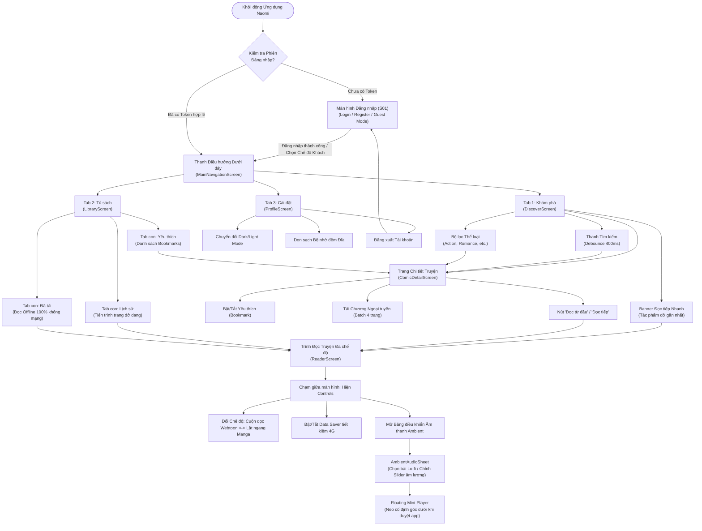

# 1.6 UI/UX DESIGN & INTERACTIVE SPECIFICATIONS

---

## 1. Hệ thống Thiết kế & Nguyên tắc Trực quan (Design System & Principles)

Giao diện ứng dụng **Naomi** được thiết kế dựa trên nguyên lý **Muted Minimal & Reader-First (Tối giản thanh lịch & Độc giả là trung tâm)**, tuân thủ các nguyên tắc thiết kế hiện đại của **Google Material Design 3 (Material You)** kết hợp với các chỉ dẫn công thái học của **Apple Human Interface Guidelines (HIG)**.

### 1.1 Triết lý Thiết kế Cốt lõi
1. **100% Sạch bóng Quảng cáo (Zero-Ad Experience):** Loại bỏ hoàn toàn banner quảng cáo, pop-up toàn màn hình hay video tự phát âm thanh to làm gián đoạn dòng cảm xúc đọc truyện (khắc phục triệt để **Pain Point 1**).
2. **Tối đa hóa Không gian Hiển thị Tranh vẽ (Canvas-First):** Thanh công cụ điều hướng và chỉ số trang được thiết kế ẩn tự động khi người dùng cuộn đọc truyện (Focus Mode), trả lại 100% diện tích màn hình cho các khung tranh Webtoon và Manga.
3. **Bảo vệ Thị giác Độc giả Đêm muộn (Dark Mode Ergonomics):** Thiết kế bảng màu tối thuần khiết (AMOLED Pure Black) giúp giảm chói mắt khi đọc trong phòng tối, đồng thời tắt các điểm ảnh OLED để tiết kiệm pin (phục vụ **Persona Kiệt**).
4. **Kiểm soát Âm thanh Liền mạch (Non-intrusive Ambient Audio):** Trình phát nhạc nền được tích hợp dưới dạng Bottom Sheet và Floating Mini-Player tinh tế, không che khuất nội dung trang truyện.

---

### 1.2 Bảng màu Chuẩn hóa (Design Tokens & Color Palette)

Toàn bộ mã màu trong ứng dụng được quản lý tập trung tại [`AppColors`](file:///c:/Users/Lenovo/Desktop/appdev/Naomi/lib/core/theme/app_colors.dart) và tích hợp thông qua `ThemeController` để chuyển đổi tức thì giữa hai chế độ Dark/Light:

| Tên Token Màu | Mã Hex | Vai trò & Ngữ cảnh Sử dụng | Chuẩn Tương phản WCAG 2.1 AA |
| :--- | :---: | :--- | :---: |
| `primary` | `#7066A6` | Màu tím oải hương chủ đạo: Nút CTA, tab active, thanh tiến trình đọc, thanh trượt slider. | Đạt chuẩn AA ($\ge 4.5:1$) |
| `primaryDark` | `#534A85` | Biến thể đậm: Hiệu ứng nhấn (Pressed state) trên nút CTA. | Đạt chuẩn AAA |
| `primaryLight` | `#9086C4` | Biến thể nhạt: Icon kích hoạt, viền nút Outlined, đường kẻ chỉ báo. | Đạt chuẩn AA |
| `darkBackground` | `#111116` | Nền tối chính (AMOLED Dark): Tiết kiệm 40% pin OLED, êm dịu mắt ban đêm. | Nền chính |
| `darkSurface` | `#1A1A22` | Nền card truyện, Bottom Sheet âm nhạc, thanh Navigation Bar dưới đáy. | Tương phản tốt với nền |
| `darkCardElevated` | `#22222D` | Thẻ truyện nổi bật, banner đọc tiếp gần nhất, khung tìm kiếm. | Phân lớp trực quan |
| `darkBorder` | `#2C2C38` | Đường viền mỏng ngăn cách giữa các item chương truyện. | Phân cách nhẹ nhàng |
| `darkTextPrimary` | `#EDEDF2` | Màu chữ tiêu đề chính, tên truyện, số chương: Sáng rõ, không lóa. | Tương phản **$13.8:1$** |
| `darkTextSecondary` | `#8E8E9E` | Màu chữ phụ: Tên tác giả, số lượt theo dõi, ngày phát hành. | Tương phản **$5.2:1$** |
| `darkTextMuted` | `#5A5A6E` | Màu chữ mờ: Placeholder ô tìm kiếm, icon chưa kích hoạt. | Tương phản $\ge 3.0:1$ |
| `lightBackground` | `#F8F8FC` | Nền sáng dịu mắt: Dành cho môi trường ánh sáng ban ngày. | Nền chính |
| `lightSurface` | `#FFFFFF` | Nền thẻ truyện sáng, màu nền ô nhập liệu trắng tinh tế. | Nền phụ |
| `success` | `#4E9E6F` | Xanh lá: Biểu tượng "Đã tải xong", thông báo thành công. | Đạt chuẩn AA |
| `warning` | `#D49B42` | Vàng hổ phách: Icon Data Saver kích hoạt, đánh dấu chương hot. | Đạt chuẩn AA |
| `error` | `#D9534F` | Đỏ cam: Nút bỏ lưu yêu thích, cảnh báo lỗi mạng, xóa cache. | Đạt chuẩn AA |

---

### 1.3 Hệ thống Kiểu chữ (Typography Scale)

Tuân thủ quy chuẩn phân cấp thị giác **Material Design 3 Type Scale**:

| Cấp bậc Kiểu chữ (Style) | Cỡ chữ (Size) | Độ đậm (Weight) | Chiều cao dòng (Line Height) | Áp dụng trên Màn hình |
| :--- | :---: | :---: | :---: | :--- |
| **Headline Large** | 22 sp | Bold (w800) | 28 sp | Tiêu đề màn hình chính (AppBar: "KHÁM PHÁ TRUYỆN", "TỦ SÁCH CÁ NHÂN"). |
| **Headline Medium** | 18 sp | Bold (w700) | 24 sp | Tiêu đề tác phẩm trong màn hình chi tiết (`ComicDetailScreen`). |
| **Title Medium** | 15 sp | SemiBold (w600) | 20 sp | Tên truyện trên lưới (`ComicCard`), tiêu đề chương trong danh sách. |
| **Body Large** | 14 sp | Regular (w400) | 20 sp | Nội dung tóm tắt cốt truyện, văn bản hướng dẫn chi tiết. |
| **Body Medium** | 13 sp | Regular (w400) | 18 sp | Tên tác giả, ngày cập nhật, phụ đề trong danh sách chương. |
| **Label Small** | 11 sp | Medium (w500) | 14 sp | Nhãn chip thể loại, chỉ số trang nổi trên reader ("Trang 12 / 45"). |

---

### 1.4 Lưới Bố cục (Layout Grid), Khoảng cách & Bán kính Góc bo

* **Hệ thống Lưới 8-Point Grid:** Toàn bộ khoảng cách (`padding`, `margin`, `spacing`) đều là bội số của **4dp** và **8dp** (`4dp`, `8dp`, `12dp`, `16dp`, `20dp`, `24dp`, `32dp`).
* **Bán kính Góc bo (Border Radius System):**
  * `8dp`: Bán kính bo ảnh bìa thumbnail chương, nút phụ nhỏ.
  * `12dp`: Bán kính bo thẻ truyện `ComicCard` trên lưới.
  * `16dp`: Bán kính bo khung tìm kiếm, hộp thoại thông báo Dialog.
  * `20dp`: Bán kính bo nút CTA lớn ("Đọc tiếp", "Tải chapter").
  * `24dp`: Bán kính bo đỉnh của `AmbientAudioSheet` (Bottom Sheet).

---

## 2. Sơ đồ Luồng Người dùng Hoàn chỉnh (End-to-End User Flows)

### 2.1 Sơ đồ Kiến trúc Điều hướng Toàn cục (Global Navigation Architecture Diagram)



---

## 3. Đặc tả Chi tiết Giao diện & 4 Trạng thái Màn hình (Screen Specifications & States)

Để đáp ứng tiêu chuẩn nghiệm thu khắt khe theo rubric môn học, toàn bộ các màn hình chính đều được đặc tả đầy đủ **4 trạng thái giao diện**:
1. **Trạng thái Mặc định (Default / Loaded State):** Hiển thị dữ liệu hoàn chỉnh, tương tác mượt mà.
2. **Trạng thái Đang tải (Loading State):** Hiển thị hiệu ứng khung xương nạp trước (Shimmer Skeleton) hoặc vòng xoay tiến trình để người dùng không cảm giác bị đơ app.
3. **Trạng thái Rỗng (Empty State):** Hiển thị hình vẽ minh họa trực quan kèm thông điệp hướng dẫn rõ ràng.
4. **Trạng thái Báo lỗi (Error State):** Hiển thị thông báo thân thiện và **nút "Thử lại" (Retry)** hoặc nút chuyển hướng khắc phục.

---

### 3.1 Màn hình Xác thực Tài khoản (`LoginScreen`)

* **Mã màn hình:** `S01`
* **Vị trí file:** [`login_screen.dart`](file:///c:/Users/Lenovo/Desktop/appdev/Naomi/lib/features/auth/presentation/screens/login_screen.dart)
* **Chức năng:** Hỗ trợ đăng nhập tài khoản độc giả, đăng ký tài khoản mới qua Supabase Cloud Auth, và nút **"Trải nghiệm ngay không cần tài khoản (Chế độ Khách)"**.

```text
+-------------------------------------------------------+
|  [Logo Naomi Tím]                                     |
|  NAOMI MANGA READER                                   |
|  Đọc truyện đỉnh cao kết hợp âm thanh thư giãn         |
|                                                       |
|  +-------------------------------------------------+  |
|  |  Email: [ reader@naomi.app                    ]  |  |
|  +-------------------------------------------------+  |
|  +-------------------------------------------------+  |
|  |  Mật khẩu: [ ••••••••••••                 (👁) ]  |  |
|  +-------------------------------------------------+  |
|                                                       |
|  [================ ĐĂNG NHẬP ================]       |
|                                                       |
|  ------------- hoặc tiếp tục với -------------        |
|                                                       |
|  [       Trải nghiệm ngay (Chế độ Khách)     ]        |
|                                                       |
|  Chưa có tài khoản? [Đăng ký ngay]                    |
+-------------------------------------------------------+
```

#### 4 Trạng thái Màn hình Xác thực:
* **Default State:** Form nhập liệu Email và Mật khẩu có nút ẩn/hiện mật khẩu (Eye icon). Có nút đăng nhập khách để truy cập nhanh.
* **Loading State:** Nút "Đăng nhập" chuyển thành vòng xoay `CircularProgressIndicator` màu tím, vô hiệu hóa form nhập để tránh submit kép.
* **Error State:** Hiển thị viền đỏ quanh ô nhập liệu nếu email sai định dạng RFC hoặc mật khẩu < 6 ký tự. Nếu sai thông tin đăng nhập, hiển thị SnackBar đỏ: *"Email hoặc mật khẩu không chính xác. Vui lòng kiểm tra lại!"*.
* **Success State:** Hiển thị SnackBar xanh *"Đăng nhập thành công!"* và chuyển cảnh mượt mà vào `MainNavigationScreen`.

---

### 3.2 Màn hình Khám phá (`DiscoverScreen`)

* **Mã màn hình:** `S02`
* **Vị trí file:** [`discover_screen.dart`](file:///c:/Users/Lenovo/Desktop/appdev/Naomi/lib/features/comic/presentation/screens/discover_screen.dart)
* **Chức năng:** Duyệt truyện thịnh hành, tìm kiếm từ khóa kèm Debounce 400ms, lọc theo chip thể loại và thanh truy cập nhanh truyện đang đọc dở.

```text
+-------------------------------------------------------+
|  KHÁM PHÁ TRUYỆN                         [Logo App]   |
|  +-------------------------------------------------+  |
|  | (🔍) Tìm kiếm tên truyện, tác giả...           |  |
|  +-------------------------------------------------+  |
|                                                       |
|  [ Tất cả ] [ Action ] [ Romance ] [ Fantasy ] [..]   |
|                                                       |
|  +-- TIẾP TỤC ĐỌC ---------------------------------+  |
|  | [Bìa] Solo Leveling - Chương 15 (Trang 14/45)   |  |
|  |       [=== 31% ===]              [ Đọc tiếp > ] |  |
|  +-------------------------------------------------+  |
|                                                       |
|  TRUYỆN NỔI BẬT THỊNH HÀNH                            |
|  +------------------+    +------------------+         |
|  | [Ảnh bìa truyện] |    | [Ảnh bìa truyện] |         |
|  | Jujutsu Kaisen   |    | One Piece        |         |
|  | Chugong • ⭐ 4.9 |    | Oda • ⭐ 5.0     |         |
|  +------------------+    +------------------+         |
+-------------------------------------------------------+
|  (🔍 Khám phá)       (🔖 Tủ sách)       (⚙ Cài đặt)    |
+-------------------------------------------------------+
```

#### 4 Trạng thái Màn hình Khám phá:
* **Loaded State:** Hiển thị lưới truyện 2 cột cân đối. Mỗi thẻ truyện có ảnh bìa sắc nét, tên truyện tối đa 2 dòng, tên tác giả và số chương. Banner "Tiếp tục đọc" tự động xuất hiện ở đầu trang nếu người dùng có lịch sử đọc dở gần nhất. Cuộn xuống 80% danh sách sẽ tự kích hoạt Infinite Scroll để tải thêm 20 truyện tiếp theo.
* **Loading State (Shimmer Skeleton):** Lưới hiển thị 6 khối thẻ truyện giả lập bằng hiệu ứng ánh sáng lượn sóng màu xám tối (`#22222D`), giữ nguyên bố cục lưới để tránh hiện tượng giật giật layout (Layout Shift).
* **Empty State:** Khi tìm kiếm không có kết quả, hiển thị hình minh họa kính lúp rỗng kèm dòng chữ: *"Không tìm thấy bộ truyện nào phù hợp với từ khóa '{query}'. Vui lòng thử lại với từ khóa khác"*.
* **Error State:** Khi mất kết nối mạng, hiển thị biểu tượng đám mây đứt kết nối (`cloud_off_rounded`), dòng thông báo *"Không thể kết nối đến máy chủ MangaDex"* và nút bấm **"Thử lại"** màu tím.

---

### 3.3 Màn hình Chi tiết Truyện (`ComicDetailScreen`)

* **Mã màn hình:** `S03`
* **Vị trí file:** [`comic_detail_screen.dart`](file:///c:/Users/Lenovo/Desktop/appdev/Naomi/lib/features/comic/presentation/screens/comic_detail_screen.dart)
* **Chức năng:** Trình bày chi tiết tác phẩm, quản lý bookmark yêu thích, lọc danh sách chương theo ngôn ngữ (`vi`, `en`, `all`), sắp xếp thứ tự và tải chương offline.

```text
+-------------------------------------------------------+
| (< Back)                     (❤️ Bookmark) (Share)    |
|                                                       |
|     +--------------+   Solo Leveling                  |
|     |   Ảnh Bìa    |   Tác giả: Chugong               |
|     |  Chất lượng  |   Họa sĩ: DUBU (REDICE)          |
|     |     Cao      |   Trạng thái: Đã hoàn thành      |
|     +--------------+   Thể loại: [Action] [Fantasy]   |
|                                                       |
|  [============= ĐỌC TỪ CHƯƠNG 1 =============]       |
|                                                       |
|  TÓM TẮT NỘI DUNG                                     |
|  10 năm trước, sau khi Cánh Cổng kết nối thế giới...  |
|  [Xem thêm...]                                        |
|                                                       |
|  DANH SÁCH CHƯƠNG (179 chương)       [Sắp xếp: 1 -> N]|
|  Lọc ngôn ngữ: (•) Tất cả   ( ) Tiếng Việt   ( ) Tiếng Anh |
|  +-------------------------------------------------+  |
|  | Chương 1: Khởi đầu của thợ săn yếu nhất  [⬇ Tải] |  |
|  +-------------------------------------------------+  |
|  | Chương 2: Nhiệm vụ kép (45 trang)        [✓ Tải] |  |
|  +-------------------------------------------------+  |
|  | Chương 3: Điện thờ Cartenon      [Đang tải 65%] |  |
|  +-------------------------------------------------+  |
+-------------------------------------------------------+
```

#### Các Đặc tả Tương tác Trọng tâm:
1. **Nút Bookmark Yêu thích:** Chạm vào biểu tượng Trái tim sẽ đổi sang màu đỏ đặc kèm hiệu ứng rung phản hồi xúc giác (Haptic Feedback) và hiển thị thông báo SnackBar tức thì.
2. **Nút Tải Ngoại tuyến Từng Chương:**
   * Trạng thái 1 (Chưa tải): Biểu tượng mũi tên tải xuống màu xám `download_rounded`.
   * Trạng thái 2 (Đang tải): Biểu tượng chuyển thành vòng tròn tiến trình kèm phần trăm phần cứng thực tế (0% $\rightarrow$ 100%).
   * Trạng thái 3 (Đã tải xong): Biểu tượng đổi sang chiếc khiên/dấu tích màu xanh lá `check_circle_rounded`.

---

### 3.4 Màn hình Trình Đọc Truyện Đa Chế độ (`ReaderScreen`)

* **Mã màn hình:** `S04`
* **Vị trí file:** [`reader_screen.dart`](file:///c:/Users/Lenovo/Desktop/appdev/Naomi/lib/features/reader/presentation/screens/reader_screen.dart)
* **Chức năng:** Đọc ảnh Webtoon cuộn dọc hoặc lật trang Manga ngang, tích hợp thanh điều khiển Focus Mode, nút bật Data Saver tiết kiệm 4G, và mở Ambient Audio.

```text
+-------------------------------------------------------+
| (<) Solo Leveling - Ch.15     (🔊 Nhạc) (📶 Data) (↕/↔)|
+ - - - - - - - - - - - - - - - - - - - - - - - - - - - +
|                                                       |
|                                                       |
|                 [ TRANG ẢNH TRUYỆN ]                  |
|                 Cuộn dọc mượt 60 FPS                  |
|             (cacheExtent: 2500 nạp trước)             |
|                                                       |
|                                                       |
|                                                       |
+ - - - - - - - - - - - - - - - - - - - - - - - - - - - +
|  [< Ch. trước]  --o----------- (Trang 14/45)  [Ch. sau >] |
+-------------------------------------------------------+
```

#### 2 Chế độ Đọc Chuyên sâu:
* **Chế độ 1 - Cuộn dọc Webtoon (Vertical Scroll):** Render toàn bộ danh sách ảnh nối liền liên tục bằng `ListView.builder`. Trang bị `InteractiveViewer` cho phép dùng 2 ngón tay phóng to thu nhỏ từ **1.0x đến 3.5x**. Khi cuộn đến đáy trang cuối, hiển thị thẻ chúc mừng hoàn thành chương kèm nút chuyển tiếp một chạm sang chương kế.
* **Chế độ 2 - Lật ngang Manga (Horizontal Flip):** Khởi tạo qua `PageView.builder`. Hỗ trợ chuyển đổi giữa lật Trái-sang-Phải (LTR) hoặc Phải-sang-Trái (RTL chuẩn truyện tranh Nhật Bản).
* **Cơ chế Chế độ Tập trung (Focus Mode):** Khi người dùng chạm vào giữa màn hình, thanh công cụ trên cùng và thanh điều hướng đáy sẽ đồng thời xuất hiện/biến mất với hiệu ứng mờ dần trong 200ms.

---

### 3.5 Bảng Điều khiển Âm thanh Ambient & Floating Mini-Player

* **Mã thành phần giao diện:** `S07`
* **Vị trí file:** [`ambient_audio_sheet.dart`](file:///c:/Users/Lenovo/Desktop/appdev/Naomi/lib/features/reader/presentation/widgets/ambient_audio_sheet.dart) và [`floating_mini_player.dart`](file:///c:/Users/Lenovo/Desktop/appdev/Naomi/lib/features/home/presentation/widgets/floating_mini_player.dart)
* **Chức năng:** Tùy biến nhạc nền Lo-fi offline nhúng sẵn trong ứng dụng giúp thư giãn và chữa lành khi đọc truyện ban đêm.

```text
+-- BẢNG ĐIỀU KHIỂN ÂM THANH AMBIENT -------------------+
|  [v Kéo xuống để đóng]                                |
|  NHẠC NỀN THƯ GIÃN (OFFLINE LO-FI)                    |
|                                                       |
|  Âm lượng: 40%                                        |
|  (🔈) ============o----------------------- (🔊)       |
|                                                       |
|  DANH SÁCH BẢN NHẠC NHÚNG SẴN:                        |
|  +-------------------------------------------------+  |
|  | (▶) Sakura Girl - Flowers           [Đang phát] |  |
|  +-------------------------------------------------+  |
|  | ( ) Sakura Girl - Sweet Note                    |  |
|  +-------------------------------------------------+  |
|                                                       |
|         [ ⏸ Tạm dừng ]     [ ⏹ Dừng hẳn ]            |
+-------------------------------------------------------+

        +-- FLOATING MINI-PLAYER (Neo góc dưới) --+
        | (🎵) Sakura Girl - Flowers   [⏸]  [✕]   |
        +-----------------------------------------+
```

* **Cơ chế Floating Mini-Player:** Khi người dùng đang phát nhạc mà thoát khỏi màn hình đọc truyện để ra ngoài trang chủ hoặc tủ sách, một thanh Mini Player siêu mỏng nổi lên ngay phía trên thanh Navigation Bar. Độc giả có thể nhấn Tạm dừng (Pause), Tiếp tục (Play), hoặc Đóng hẳn (Dismiss) mà không làm gián đoạn việc tìm kiếm truyện.

---

### 3.6 Màn hình Tủ sách Cá nhân (`LibraryScreen`)

* **Mã màn hình:** `S05`
* **Vị trí file:** [`library_screen.dart`](file:///c:/Users/Lenovo/Desktop/appdev/Naomi/lib/features/library/presentation/screens/library_screen.dart)
* **Chức năng:** Quản lý toàn diện 3 danh mục cá nhân qua 3 Tab: **Yêu thích (Bookmarks)**, **Lịch sử đọc dở (History)**, và **Đã tải ngoại tuyến (Downloads)**.

```text
+-------------------------------------------------------+
|  TỦ SÁCH CÁ NHÂN                                      |
|  [  YÊU THÍCH (12)  ] [  LỊCH SỬ (5)  ] [  ĐÃ TẢI (3) ]|
|                                                       |
|  (Hiển thị Tab 3: ĐÃ TẢI XUỐNG NGOẠI TUYẾN)           |
|  Dung lượng lưu trữ đã dùng: 142.5 MB                 |
|                                                       |
|  +-------------------------------------------------+  |
|  | [Bìa] Solo Leveling - Chương 1 (45 trang)       |  |
|  |       Đã tải: 15/10/2026 • 24.5 MB   (🗑 Xóa)    |  |
|  +-------------------------------------------------+  |
|  | [Bìa] One Piece - Chương 1050 (32 trang)        |  |
|  |       Đã tải: 18/10/2026 • 18.2 MB   (🗑 Xóa)    |  |
|  +-------------------------------------------------+  |
+-------------------------------------------------------+
|  (🔍 Khám phá)       (🔖 Tủ sách)       (⚙ Cài đặt)    |
+-------------------------------------------------------+
```

#### Đặc tả 3 Tab Chức năng:
1. **Tab Yêu thích (Bookmarks):** Hiển thị lưới các bộ truyện đã lưu. Có nút xóa nhanh khỏi tủ sách.
2. **Tab Lịch sử đọc (History):** Hiển thị danh sách các chương đọc dở kèm thanh tiến độ phần trăm (VD: *31% - Trang 14/45*) và nút bấm một chạm **"Đọc tiếp"** mở đúng vị trí trang dở dang.
3. **Tab Đã tải (Downloads):** Liệt kê các chương truyện đã tải trọn vẹn vào bộ nhớ máy. Hoạt động **100% không cần kết nối mạng Internet**. Có nút Thùng rác để xóa chương và giải phóng dung lượng đĩa.

---

### 3.7 Màn hình Hồ sơ & Cài đặt Hệ thống (`ProfileScreen`)

* **Mã màn hình:** `S06`
* **Vị trí file:** [`profile_screen.dart`](file:///c:/Users/Lenovo/Desktop/appdev/Naomi/lib/features/profile/presentation/screens/profile_screen.dart)
* **Chức năng:** Quản lý thông tin tài khoản, chuyển đổi chế độ Tối/Sáng, tính toán và dọn dẹp dung lượng cache thật trên đĩa, và đăng xuất.

```text
+-------------------------------------------------------+
|  CÀI ĐẶT & HỒ SƠ                                      |
|                                                       |
|  +-- THẺ THÔNG TIN NGƯỜI DÙNG ---------------------+  |
|  | (Avatar) Kiệt Nguyễn                            |  |
|  |          reader_kiet@gmail.com                  |  |
|  |          [ Huy hiệu Thành viên Naomi VIP ]       |  |
|  +-------------------------------------------------+  |
|                                                       |
|  TÙY CHỌN HỆ THỐNG                                    |
|  +-------------------------------------------------+  |
|  | (🌙) Chế độ Giao diện Tối (AMOLED Dark)   [ Xong ] |  |
|  +-------------------------------------------------+  |
|  | (🌐) Ngôn ngữ Đọc Mặc định: [ Tiếng Việt  v ]   |  |
|  +-------------------------------------------------+  |
|  | (🧹) Bộ nhớ đệm Tạm thời: 45.8 MB [ Dọn dẹp ngay ]|  |
|  +-------------------------------------------------+  |
|                                                       |
|  [================ ĐĂNG XUẤT ================]       |
+-------------------------------------------------------+
```

---

## 4. Khung Mô phỏng Thiết bị Tương tác (Interactive Mobile Simulator)

Nhằm đảm bảo thỏa mãn điều kiện tiên quyết **Gate Condition (Rubric Mục 2.7)** của Assignment 02 (ứng dụng phải biên dịch và chạy demo mượt mà trên máy tính của người chấm thi mà không cần máy ảo Android Studio nặng nề):

* **Thành phần:** Lớp bao bọc [`MobileSimulatorWrapper`](file:///c:/Users/Lenovo/Desktop/appdev/Naomi/lib/core/widgets/mobile_simulator_wrapper.dart).
* **Cơ chế vận hành:** Tự động nhận diện nền tảng Desktop (Windows / macOS / Web). Ứng dụng hiển thị một khung viền smartphone cao cấp với thanh Dynamic Island, viền bezel bo góc tròn và thanh Home Indicator chuẩn iOS/Android.
* **Bộ chọn thiết bị tương tác (Device Switcher):** Cho phép người chấm thi đổi kích thước hiển thị theo thời gian thực:
  1. *iPhone 16 Pro:* Độ phân giải mô phỏng $393 \times 852\text{ dp}$, góc bo 50px.
  2. *iPhone 16 Pro Max:* Độ phân giải mô phỏng $430 \times 932\text{ dp}$, góc bo 54px.
  3. *Google Pixel 8 Pro:* Độ phân giải mô phỏng $412 \times 892\text{ dp}$, góc bo 38px.
  4. *Chế độ Toàn màn hình (Desktop Fullscreen):* Mở rộng đáp ứng linh hoạt theo tỷ lệ cửa sổ máy tính.

---

## 5. Tiêu chuẩn Khả năng Tiếp cận & Công thái học Di động (Accessibility & Ergonomics)

1. **Tuân thủ Chuẩn Tương phản Quốc tế WCAG 2.1 Level AA:**
   * Màu chữ chính `#EDEDF2` trên nền tối `#111116` đạt tỷ lệ tương phản **$13.8 : 1$** (vượt xa mức tối thiểu $4.5 : 1$ của chuẩn AA).
   * Đảm bảo độc giả có thị lực yếu hoặc đọc truyện trong bóng tối không bị mỏi mắt hay lóa màn hình.

2. **Kích thước Vùng chạm Cảm ứng An toàn (Touch Target Size):**
   * Toàn bộ các icon tương tác (`IconButton`, nút chuyển trang, icon tải xuống, nút Bookmark) đều có kích thước vùng bấm tối thiểu **$\ge 48 \times 48\text{ dp}$** theo khuyến nghị của Google Material Design. Người dùng không bao giờ bị bấm nhầm khi sử dụng trên màn hình cảm ứng 6.5 inch.

3. **Thiết kế Công thái học Vùng ngón tay cái (Thumb-Zone Friendly):**
   * Các điểm chạm thao tác nhiều nhất (Thanh chuyển Tab, Nút bấm Đọc tiếp, Bottom Sheet âm nhạc, Nút chuyển chương) được bố trí tập trung ở **$1/3$ dưới của màn hình**. Người dùng có thể cầm điện thoại bằng 1 tay và điều khiển hoàn toàn bằng ngón tay cái khi đang nằm trên giường (Persona Kiệt) hoặc đang đứng bám tay vịn trên xe buýt (Persona Thảo).
