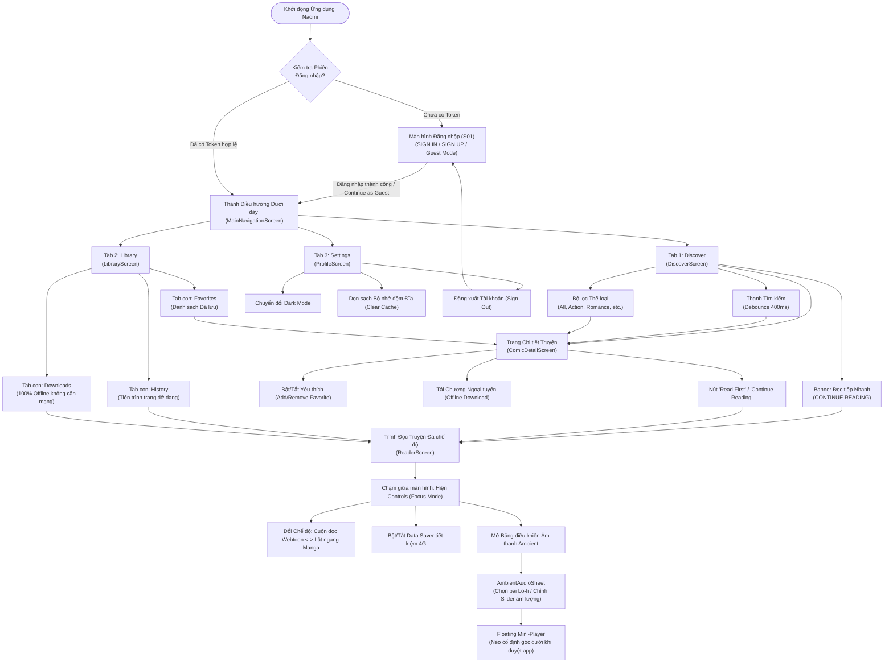

# 1.6 UI/UX DESIGN & INTERACTIVE SPECIFICATIONS

---

## 1. Hệ thống Thiết kế & Nguyên tắc Trực quan (Design System & Principles)

Giao diện ứng dụng **Naomi** được thiết kế dựa trên nguyên lý **Muted Minimal & Reader-First (Tối giản thanh lịch & Độc giả là trung tâm)**, tuân thủ các nguyên tắc thiết kế hiện đại của **Google Material Design 3 (Material You)** kết hợp với các chỉ dẫn công thái học của **Apple Human Interface Guidelines (HIG)**. Toàn bộ chuỗi văn bản tương tác trên giao diện người dùng (UI Strings) được chuẩn hóa **100% bằng Tiếng Anh (English)** theo định hướng ứng dụng truyện tranh quốc tế kết nối trực tiếp với nền tảng MangaDex API.

### 1.1 Triết lý Thiết kế Cốt lõi
1. **100% Sạch bóng Quảng cáo (Zero-Ad Experience):** Loại bỏ hoàn toàn banner quảng cáo, pop-up toàn màn hình hay video tự phát âm thanh to làm gián đoạn dòng cảm xúc đọc truyện (khắc phục triệt để **Pain Point 1**).
2. **Tối đa hóa Không gian Hiển thị Tranh vẽ (Canvas-First):** Thanh công cụ điều hướng và chỉ số trang được thiết kế ẩn tự động khi người dùng cuộn đọc truyện (Focus Mode), trả lại 100% diện tích màn hình cho các khung tranh Webtoon và Manga.
3. **Bảo vệ Thị giác Độc giả Đêm muộn (Dark Mode Ergonomics):** Thiết kế bảng màu tối thuần khiết (AMOLED Pure Black `#111116`) giúp giảm chói mắt khi đọc trong phòng tối, đồng thời tắt các điểm ảnh OLED để tiết kiệm pin (phục vụ **Persona Kiệt**).
4. **Kiểm soát Âm thanh Liền mạch (Non-intrusive Ambient Audio):** Trình phát nhạc nền được tích hợp dưới dạng Bottom Sheet (`AmbientAudioSheet`) và Floating Mini-Player tinh tế, không che khuất nội dung trang truyện và có thể phát xuyên suốt giữa các màn hình.

---

### 1.2 Bảng màu Chuẩn hóa (Design Tokens & Color Palette)

Toàn bộ mã màu trong ứng dụng được quản lý tập trung tại [`AppColors`](file:///c:/Users/Lenovo/Desktop/appdev/Naomi/lib/core/theme/app_colors.dart) và tích hợp thông qua `ThemeController` để chuyển đổi tức thì giữa hai chế độ Dark/Light:

| Tên Token Màu | Mã Hex | Vai trò & Ngữ cảnh Sử dụng | Chuẩn Tương phản WCAG 2.1 AA |
| :--- | :---: | :--- | :---: |
| `primary` | `#7066A6` | Màu tím oải hương chủ đạo: Nút CTA, tab active, thanh tiến trình đọc, thanh trượt slider. | Đạt chuẩn AA ($\ge 4.5:1$) |
| `primaryDark` | `#534A85` | Biến thể đậm: Hiệu ứng nhấn (Pressed state) trên nút CTA. | Đạt chuẩn AAA |
| `primaryLight` | `#9086C4` | Biến thể nhạt: Icon kích hoạt, viền nút Outlined, đường kẻ chỉ báo. | Đạt chuẩn AA |
| `darkBackground` | `#111116` | Nền tối chính (AMOLED Dark): Tiết kiệm 40% pin OLED, êm dịu mắt ban đêm. | Nền chính |
| `darkSurface` | `#1A1A22` | Nền card truyện, Bottom Sheet âm nhạc, thanh Navigation Bar dưới đáy. | Tương phản tốt với nền |
| `darkCardElevated` | `#22222D` | Thẻ truyện nổi bật, banner đọc tiếp gần nhất, khung tìm kiếm. | Phân lớp trực quan |
| `darkBorder` | `#2C2C38` | Đường viền mỏng ngăn cách giữa các item chương truyện. | Phân cách nhẹ nhàng |
| `darkTextPrimary` | `#EDEDF2` | Màu chữ tiêu đề chính, tên truyện, số chương: Sáng rõ, không lóa. | Tương phản **$13.8:1$** |
| `darkTextSecondary` | `#8E8E9E` | Màu chữ phụ: Tên tác giả, số lượt theo dõi, ngày phát hành. | Tương phản **$5.2:1$** |
| `darkTextMuted` | `#5A5A6E` | Màu chữ mờ: Placeholder ô tìm kiếm, icon chưa kích hoạt. | Tương phản $\ge 3.0:1$ |
| `lightBackground` | `#F8F8FC` | Nền sáng dịu mắt: Dành cho môi trường ánh sáng ban ngày. | Nền chính |
| `lightSurface` | `#FFFFFF` | Nền thẻ truyện sáng, màu nền ô nhập liệu trắng tinh tế. | Nền phụ |
| `success` | `#4E9E6F` | Xanh lá: Biểu tượng "100% Offline", thông báo tải chương thành công. | Đạt chuẩn AA |
| `spotifyGreen` | `#1DB954` | Xanh thương hiệu Spotify: Viền active Mini-Player, nút kích hoạt tab Spotify. | Đạt chuẩn AA |
| `warning` | `#D49B42` | Vàng hổ phách: Icon Data Saver kích hoạt, huy hiệu Guest Reader. | Đạt chuẩn AA |
| `error` | `#D9534F` | Đỏ cam: Nút bỏ lưu yêu thích, cảnh báo lỗi mạng, xóa cache. | Đạt chuẩn AA |

---

### 1.3 Hệ thống Kiểu chữ (Typography Scale)

Tuân thủ quy chuẩn phân cấp thị giác **Material Design 3 Type Scale**:

| Cấp bậc Kiểu chữ (Style) | Cỡ chữ (Size) | Độ đậm (Weight) | Chiều cao dòng (Line Height) | Áp dụng trên Màn hình |
| :--- | :---: | :---: | :---: | :--- |
| **Headline Large** | 22 sp | Bold (w800) | 28 sp | Tiêu đề màn hình chính (AppBar: `DISCOVER COMICS`, `MY LIBRARY`, `PROFILE & SETTINGS`). |
| **Headline Medium** | 18 sp | Bold (w700) | 24 sp | Tiêu đề tác phẩm trong màn hình chi tiết (`ComicDetailScreen`). |
| **Title Medium** | 15 sp | SemiBold (w600) | 20 sp | Tên truyện trên lưới (`ComicCard`), tiêu đề chương trong danh sách. |
| **Body Large** | 14 sp | Regular (w400) | 20 sp | Nội dung tóm tắt cốt truyện (Synopsis), văn bản hướng dẫn chi tiết. |
| **Body Medium** | 13 sp | Regular (w400) | 18 sp | Tên tác giả, ngày cập nhật, phụ đề trong danh sách chương. |
| **Label Small** | 11 sp | Medium (w500) | 14 sp | Nhãn chip thể loại, chỉ số trang nổi trên reader (`Page 14 / 45`). |

---

### 1.4 Lưới Bố cục (Layout Grid), Khoảng cách & Bán kính Góc bo

* **Hệ thống Lưới 8-Point Grid:** Toàn bộ khoảng cách (`padding`, `margin`, `spacing`) đều là bội số của **4dp** và **8dp** (`4dp`, `8dp`, `12dp`, `16dp`, `20dp`, `24dp`, `32dp`).
* **Bán kính Góc bo (Border Radius System):**
  * `8dp`: Bán kính bo ảnh bìa thumbnail chương, nút phụ nhỏ.
  * `12dp`: Bán kính bo thẻ truyện `ComicCard` trên lưới.
  * `16dp`: Bán kính bo khung tìm kiếm, hộp thoại thông báo Dialog, thẻ nhóm cài đặt Profile.
  * `20dp`: Bán kính bo nút CTA lớn (`CONTINUE READING`, `READ FIRST`, `SIGN IN`).
  * `24dp`: Bán kính bo đỉnh của `AmbientAudioSheet` (Bottom Sheet).

---

## 2. Sơ đồ Luồng Người dùng Hoàn chỉnh (End-to-End User Flows)

### 2.1 Sơ đồ Kiến trúc Điều hướng Toàn cục (Global Navigation Architecture Diagram)



---

## 3. Đặc tả Chi tiết Giao diện & 4 Trạng thái Màn hình (Screen Specifications & States)

Toàn bộ các màn hình chính đều được đặc tả đầy đủ **4 trạng thái giao diện**:
1. **Trạng thái Mặc định (Default / Loaded State):** Hiển thị dữ liệu hoàn chỉnh, nhãn tiếng Anh rõ nét, tương tác mượt mà.
2. **Trạng thái Đang tải (Loading State):** Hiển thị hiệu ứng khung xương nạp trước (Shimmer Skeleton) hoặc vòng xoay tiến trình để người dùng không cảm giác bị đơ app.
3. **Trạng thái Rỗng (Empty State):** Hiển thị hình vẽ minh họa trực quan kèm thông điệp tiếng Anh hướng dẫn người dùng.
4. **Trạng thái Báo lỗi (Error State):** Hiển thị thông báo thân thiện và **nút "Retry"** hoặc nút chuyển hướng khắc phục.

---

### 3.1 Màn hình Xác thực Tài khoản (`LoginScreen`)

* **Mã màn hình:** `S01`
* **Vị trí file:** [`login_screen.dart`](file:///c:/Users/Lenovo/Desktop/appdev/Naomi/lib/features/auth/presentation/screens/login_screen.dart)
* **Chức năng:** Hỗ trợ đăng nhập tài khoản độc giả, đăng ký tài khoản mới qua Supabase Cloud Auth, và nút **"Continue as Guest"** để trải nghiệm ngay không bắt buộc đăng ký.

```text
+-------------------------------------------------------+
|                    [Logo Sách Tím]                    |
|                        NAOMI                          |
|           Ambient Manga Reader & Tracker              |
|                                                       |
|  SIGN IN TO YOUR ACCOUNT                              |
|  +-------------------------------------------------+  |
|  | (✉) Email Address: [ reader@naomi.app         ]  |  |
|  +-------------------------------------------------+  |
|  +-------------------------------------------------+  |
|  | (🔒) Password:     [ ••••••••••••         (👁) ]  |  |
|  +-------------------------------------------------+  |
|                             [ Forgot Password? ]      |
|                                                       |
|  [================== SIGN IN ==================]      |
|                                                       |
|  [         (👤) Continue as Guest              ]      |
|                                                       |
|      Don't have an account? Sign Up for free          |
+-------------------------------------------------------+
```

#### 4 Trạng thái Màn hình Xác thực:
* **Default State:** Form nhập liệu `Email Address` và `Password` có nút ẩn/hiện mật khẩu (Eye icon). Nút `Continue as Guest` giúp truy cập app ngay lập tức.
* **Loading State:** Nút `SIGN IN` chuyển thành vòng xoay `CircularProgressIndicator` màu trắng trên nền tím, vô hiệu hóa form nhập để tránh submit kép.
* **Error State:** Hiển thị viền đỏ quanh ô nhập liệu nếu email sai định dạng hoặc password trống. Nếu sai thông tin đăng nhập, hiển thị SnackBar đỏ: *"Invalid email or password. Please try again!"*.
* **Success State:** Hiển thị SnackBar xanh *"Signed in successfully!"* và chuyển cảnh mượt mà vào `MainNavigationScreen`.

---

### 3.2 Màn hình Khám phá (`DiscoverScreen`)

* **Mã màn hình:** `S02`
* **Vị trí file:** [`discover_screen.dart`](file:///c:/Users/Lenovo/Desktop/appdev/Naomi/lib/features/comic/presentation/screens/discover_screen.dart)
* **Chức năng:** Duyệt truyện thịnh hành, tìm kiếm từ khóa kèm Debounce 400ms, lọc theo chip thể loại và thanh truy cập nhanh truyện đang đọc dở (`CONTINUE READING`).

```text
+-------------------------------------------------------+
|  DISCOVER COMICS                                 (🔄) |
|  +-------------------------------------------------+  |
|  | (🔍) Search comics, authors, genres...          |  |
|  +-------------------------------------------------+  |
|                                                       |
|  [ All ] [ Action ] [ Romance ] [ Fantasy ] [ Comedy ]|
|                                                       |
|  +-- CONTINUE READING -----------------------------+  |
|  | [Cover] The Eminence in Shadow                  |  |
|  |         Chapter 58 • Page 14/45  [31%]          |  |
|  |         [=== 31% ===]              [ Read > ]   |  |
|  +-------------------------------------------------+  |
|                                                       |
|  FEATURED THIS WEEK                   20 titles See > |
|  +------------------+    +------------------+         |
|  | [Manga Cover]    |    | [Manga Cover]    |         |
|  | The Eminence in  |    | Solo Leveling    |         |
|  | Shadow           |    | Chugong • ⭐ 4.9 |         |
|  | Aizawa • ⭐ 4.8  |    | Ongoing          |         |
|  +------------------+    +------------------+         |
+-------------------------------------------------------+
|    (🔍 Discover)        (🔖 Library)       (⚙ Settings)|
+-------------------------------------------------------+
```

#### 4 Trạng thái Màn hình Khám phá:
* **Loaded State:** Hiển thị lưới truyện 2 cột cân đối. Mỗi thẻ truyện `ComicCard` có ảnh bìa sắc nét, tên truyện tối đa 2 dòng, tên tác giả, trạng thái phát hành và số điểm đánh giá. Banner `CONTINUE READING` tự động xuất hiện ở đầu trang nếu người dùng có lịch sử đọc dở gần nhất. Cuộn xuống 80% danh sách sẽ tự kích hoạt Infinite Scroll để tải thêm truyện từ MangaDex API.
* **Loading State (Shimmer Skeleton):** Lưới hiển thị 6 khối thẻ truyện giả lập bằng hiệu ứng ánh sáng lượn sóng màu xám tối (`#22222D`), giữ nguyên bố cục lưới để tránh hiện tượng giật giật layout (Layout Shift).
* **Empty State:** Khi tìm kiếm không có kết quả, hiển thị hình minh họa kính lúp rỗng kèm dòng chữ: *"No comics found matching '{query}'. Try searching for a different keyword or genre"*.
* **Error State:** Khi mất kết nối mạng, hiển thị biểu tượng đám mây đứt kết nối (`cloud_off_rounded`), thông báo *"Unable to connect to MangaDex servers"* và nút bấm **"Retry"** màu tím cùng tùy chọn **"Open Offline Library"**.

---

### 3.3 Màn hình Chi tiết Truyện (`ComicDetailScreen`)

* **Mã màn hình:** `S03`
* **Vị trí file:** [`comic_detail_screen.dart`](file:///c:/Users/Lenovo/Desktop/appdev/Naomi/lib/features/comic/presentation/screens/comic_detail_screen.dart)
* **Chức năng:** Trình bày chi tiết tác phẩm, quản lý bookmark yêu thích, lọc chương chuẩn tiếng Anh (`English (EN)`), sắp xếp thứ tự và tải chương offline.

```text
+-------------------------------------------------------+
| (< Back)                           (❤️ Favorite) (🔗) |
|                                                       |
|     +--------------+   The Eminence in Shadow         |
|     |  HD Cover    |   Author: Daisuke Aizawa         |
|     |  Thumbnail   |   Artist: Anri Sakano            |
|     |              |   Status: Ongoing                |
|     +--------------+   Genres: [Action] [Fantasy]     |
|                                                       |
|  [  (▶) Read First  ]      [  (⏩) Latest Chapter  ]  |
|                                                       |
|  [================ CONTINUE READING ===============]  |
|                                                       |
|  SYNOPSIS                                             |
|  Just like everyone used to have a phase where they...|
|  [Read more...]                                       |
|                                                       |
|  CHAPTERS (58)                       [Sort: 1 -> N]   |
|  Language: [ English (EN) ]                           |
|  +-------------------------------------------------+  |
|  | Chapter 1: The Prologue                  [⬇]   |  |
|  +-------------------------------------------------+  |
|  | Chapter 2: The Shadow Garden (32 pages)  [✓]   |  |
|  +-------------------------------------------------+  |
|  | Chapter 3: Infiltration          [Downloading 65%]|
|  +-------------------------------------------------+  |
+-------------------------------------------------------+
```

#### Các Đặc tả Tương tác Trọng tâm:
1. **Nút Favorite Yêu thích:** Chạm vào biểu tượng Trái tim trên thanh AppBar sẽ đổi màu tức thì kèm hiệu ứng SnackBar: *"Added to Favorites!"* hoặc *"Removed from Favorites."*.
2. **Bộ lọc Ngôn ngữ Chương (Language Filter):** Được cố định chuẩn hóa chip `English (EN)` ([comic_detail_screen.dart:190](file:///c:/Users/Lenovo/Desktop/appdev/Naomi/lib/features/comic/presentation/screens/comic_detail_screen.dart#L190)), tự động loại bỏ các ngôn ngữ không đồng nhất để đảm bảo chất lượng hình ảnh dịch thuật tốt nhất.
3. **Nút Tải Ngoại tuyến Từng Chương (Offline Download):**
   * *Trạng thái 1 (Chưa tải):* Biểu tượng mũi tên tải xuống màu xám `download_rounded`.
   * *Trạng thái 2 (Đang tải):* Biểu tượng chuyển thành vòng tròn tiến trình kèm phần trăm phần cứng thực tế (0% $\rightarrow$ 100%).
   * *Trạng thái 3 (Đã tải xong):* Biểu tượng đổi sang dấu tích màu xanh lá `offline_pin_rounded` kèm thông báo *"Chapter downloaded for offline reading!"*.

---

### 3.4 Màn hình Trình Đọc Truyện Đa Chế độ (`ReaderScreen`)

* **Mã màn hình:** `S04`
* **Vị trí file:** [`reader_screen.dart`](file:///c:/Users/Lenovo/Desktop/appdev/Naomi/lib/features/reader/presentation/screens/reader_screen.dart)
* **Chức năng:** Đọc ảnh Webtoon cuộn dọc hoặc lật trang Manga ngang, tích hợp thanh điều khiển Focus Mode, nút bật Data Saver tiết kiệm 4G, và mở Ambient Audio.

```text
+-------------------------------------------------------+
| (<) The Eminence in Shadow - Ch.58 (🔊) (📶 Data) (↕/↔)|
+ - - - - - - - - - - - - - - - - - - - - - - - - - - - +
|                                                       |
|                                                       |
|                 [ MANGA PAGE IMAGE ]                  |
|                 Smooth 60 FPS Scroll                  |
|             (cacheExtent: 2500 preloaded)             |
|                                                       |
|                                                       |
|                                                       |
+ - - - - - - - - - - - - - - - - - - - - - - - - - - - +
|  [< Prev Ch.]   --o----------- (Page 14/45)   [Next Ch. >]|
+-------------------------------------------------------+
```

#### 2 Chế độ Đọc Chuyên sâu:
* **Chế độ 1 - Cuộn dọc Webtoon (Vertical Scroll):** Render toàn bộ danh sách ảnh nối liền liên tục bằng `ListView.builder`. Trang bị `InteractiveViewer` cho phép dùng 2 ngón tay phóng to thu nhỏ từ **1.0x đến 3.5x**. Khi cuộn đến đáy trang cuối, hiển thị nút chuyển tiếp một chạm sang chương kế tiếp (`Next Chapter`).
* **Chế độ 2 - Lật ngang Manga (Horizontal Flip):** Khởi tạo qua `PageView.builder`. Hỗ trợ chuyển đổi giữa lật Trái-sang-Phải (LTR) hoặc Phải-sang-Trái (RTL chuẩn truyện tranh Nhật Bản).
* **Cơ chế Chế độ Tập trung (Focus Mode):** Khi người dùng chạm vào giữa màn hình, thanh công cụ trên cùng và thanh điều hướng đáy sẽ đồng thời xuất hiện/biến mất với hiệu ứng mờ dần trong 200ms.

---

### 3.5 Bảng Điều khiển Âm thanh Giải trí Kép & Floating Mini-Player

* **Mã thành phần giao diện:** `S07`
* **Vị trí file:** [`ambient_audio_sheet.dart`](file:///c:/Users/Lenovo/Desktop/appdev/Naomi/lib/features/reader/presentation/widgets/ambient_audio_sheet.dart) và [`floating_mini_player.dart`](file:///c:/Users/Lenovo/Desktop/appdev/Naomi/lib/features/home/presentation/widgets/floating_mini_player.dart)
* **Chức năng:** Tùy biến hệ thống âm thanh giải trí kép: Chuyển đổi linh hoạt giữa các bản nhạc Lo-Fi offline nhúng sẵn trong ứng dụng và dịch vụ trực tuyến Spotify Music Streaming (hỗ trợ Curated Reading Playlists, tìm kiếm bài hát và Quick Connect Demo).

```text
+-- AMBIENT AUDIO (BOTTOM SHEET) -----------------------+
|  [v Drag down to close]                               |
|  (🎵) AMBIENT AUDIO        [ (🎧) Lo-Fi | (📶) Spotify ]|
|  +-------------------------------------------------+  |
|                                                       |
|  [ TAB 1: LO-FI OFFLINE SOUNDTRACK ]                  |
|  Volume: 40%                                          |
|  (🔈) ============o----------------------- (🔊)       |
|                                                       |
|  OFFLINE TRACKS:                                      |
|  +-------------------------------------------------+  |
|  | (▶) Sakura Girl - Flowers           [Playing]   |  |
|  +-------------------------------------------------+  |
|  | ( ) Sakura Girl - Sweet Note                    |  |
|  +-------------------------------------------------+  |
|  | ( ) Sakura Girl - Daisy                         |  |
|  +-------------------------------------------------+  |
|  | ( ) Sakura Girl - Fresh                         |  |
|  +-------------------------------------------------+  |
|         [ ⏸ Pause ]          [ ⏹ Stop ]              |
|                                                       |
|  - - - - - - - - - - - - - - - - - - - - - - - - - -  |
|                                                       |
|  [ TAB 2: SPOTIFY MUSIC STREAMING ]                   |
|  (🟢 Spotify Connected: Kiet Nguyen)   [Disconnect]  |
|  +-------------------------------------------------+  |
|  | (🔍) Search Spotify tracks, artists...          |  |
|  +-------------------------------------------------+  |
|                                                       |
|  CURATED READING PLAYLISTS:                           |
|  [Anime Lofi Chill] [Studio Ghibli Piano] [Coffee..]  |
|                                                       |
|  PLAYLIST TRACKS:                                     |
|  +-------------------------------------------------+  |
|  | [Art] Merry-Go-Round of Life        [▶ Play]    |  |
|  |       Joe Hisaishi • 2:34                          |  |
|  +-------------------------------------------------+  |
|  | [Art] A Town with an Ocean View     [▶ Play]    |  |
|  |       Joe Hisaishi • 3:00                          |  |
|  +-------------------------------------------------+  |
|  [        (⚡) Quick Connect Demo Account          ]  |
+-------------------------------------------------------+

        +-- FLOATING MINI-PLAYER (Offline Lo-Fi) -----+
        | (🎵) Sakura Girl - Flowers    [⏸]   [✕]     |
        +---------------------------------------------+

        +-- FLOATING MINI-PLAYER (Spotify Mode) ------+
        | [AlbumArt] Merry-Go-Round...  [⏸]   [✕]     |
        | (Viền xanh #1DB954 • Joe Hisaishi)          |
        +---------------------------------------------+
```

* **Cơ chế Floating Mini-Player Hợp nhất:**
  * Khi người dùng đang phát nhạc (Lo-Fi hoặc Spotify) mà thoát khỏi màn hình đọc truyện để ra ngoài trang chủ hoặc tủ sách, một thanh Mini Player siêu mỏng nổi lên ngay phía trên thanh Navigation Bar.
  * **Tự động thích ứng giao diện:** Ở chế độ Lo-Fi, thanh mang viền tím Lavender (`#7066A6`); khi chuyển sang chế độ Spotify, thanh tự động chuyển sang viền xanh Spotify (`#1DB954`) và hiển thị ảnh bìa album thật (`CachedNetworkImage`) nạp từ Spotify CDN.
  * Độc giả có thể nhấn Tạm dừng (`Pause`), Tiếp tục (`Play`), hoặc Đóng hẳn (`Dismiss`) mà không làm gián đoạn việc duyệt truyện.

---

### 3.6 Màn hình Tủ sách Cá nhân (`LibraryScreen`)

* **Mã màn hình:** `S05`
* **Vị trí file:** [`library_screen.dart`](file:///c:/Users/Lenovo/Desktop/appdev/Naomi/lib/features/library/presentation/screens/library_screen.dart)
* **Chức năng:** Quản lý toàn diện 3 danh mục cá nhân qua 3 Tab: **FAVORITES**, **HISTORY**, và **DOWNLOADS**.

```text
+-------------------------------------------------------+
|  MY LIBRARY                                           |
|  [ FAVORITES (12) ] [ HISTORY (5) ] [ DOWNLOADS (3) ] |
|                                                       |
|  (Active Tab: DOWNLOADS)                              |
|  3 offline chapters (96 pages)        (📶 100% Offline|
|                                                       |
|  +-------------------------------------------------+  |
|  | (✓) The Eminence in Shadow                      |  |
|  |     Chapter 1 • 32 pages               (🗑 Delete)|  |
|  +-------------------------------------------------+  |
|  | (✓) Solo Leveling                               |  |
|  |     Chapter 15 • 45 pages              (🗑 Delete)|  |
|  +-------------------------------------------------+  |
+-------------------------------------------------------+
|    (🔍 Discover)        (🔖 Library)       (⚙ Settings)|
+-------------------------------------------------------+
```

#### Đặc tả 3 Tab Chức năng:
1. **Tab FAVORITES (Yêu thích):** Hiển thị lưới các bộ truyện đã lưu. Có nút xóa nhanh khỏi tủ sách.
2. **Tab HISTORY (Lịch sử đọc):** Hiển thị danh sách các chương đọc dở kèm thanh tiến độ phần trăm (VD: *Chapter 58 • Page 14/45 - 31%*) và nút bấm một chạm **"Read"** mở đúng vị trí trang dở dang. Kèm nút **"Clear History"** để dọn sạch lịch sử.
3. **Tab DOWNLOADS (Đã tải ngoại tuyến):** Liệt kê các chương truyện đã tải trọn vẹn vào bộ nhớ máy. Hoạt động **100% không cần kết nối mạng Internet**. Có nút Thùng rác để xóa chương và giải phóng dung lượng đĩa.

---

### 3.7 Màn hình Hồ sơ & Cài đặt Hệ thống (`ProfileScreen`)

* **Mã màn hình:** `S06`
* **Vị trí file:** [`profile_screen.dart`](file:///c:/Users/Lenovo/Desktop/appdev/Naomi/lib/features/profile/presentation/screens/profile_screen.dart)
* **Chức năng:** Quản lý thông tin tài khoản, chuyển đổi chế độ Dark Mode, tùy chọn ngôn ngữ đọc, tính toán và dọn dẹp dung lượng cache thật trên đĩa, và đăng xuất.

```text
+-------------------------------------------------------+
|  PROFILE & SETTINGS                                   |
|                                                       |
|  +-- USER PROFILE CARD ----------------------------+  |
|  | (Avatar N)  Kiet Nguyen               (✏ Edit)  |  |
|  |             reader_kiet@gmail.com               |  |
|  |             [ OFFICIAL MEMBER ]                 |  |
|  +-------------------------------------------------+  |
|                                                       |
|  APP PREFERENCES                                      |
|  +-------------------------------------------------+  |
|  | (🌙) Dark Mode (AMOLED Dark)           [ ON / ] |  |
|  +-------------------------------------------------+  |
|  | (🌐) Comic Translation Language                 |  |
|  |      English Only (EN)                      (>) |  |
|  +-------------------------------------------------+  |
|                                                       |
|  STORAGE & LOCAL DATA                                 |
|  +-------------------------------------------------+  |
|  | Image Cache on Disk         45.8 MB / 500 MB    |  |
|  | [===========o---------------------------------] |  |
|  | [                (🧹) Clear Cache              ]|  |
|  +-------------------------------------------------+  |
|                                                       |
|  [================== SIGN OUT ==================]     |
+-------------------------------------------------------+
```

---

## 4. Khung Mô phỏng Thiết bị Tương tác (Interactive Mobile Simulator)

Nhằm đảm bảo thỏa mãn điều kiện tiên quyết **Gate Condition (Rubric Mục 2.7)** của Assignment 02 (ứng dụng phải biên dịch và chạy demo mượt mà trên máy tính của người chấm thi mà không cần máy ảo Android Studio nặng nề):

* **Thành phần:** Lớp bao bọc [`MobileSimulatorWrapper`](file:///c:/Users/Lenovo/Desktop/appdev/Naomi/lib/core/widgets/mobile_simulator_wrapper.dart).
* **Cơ chế vận hành:** Tự động nhận diện nền tảng Desktop (Windows / macOS / Web). Ứng dụng hiển thị một khung viền smartphone cao cấp với thanh Dynamic Island, viền bezel bo góc tròn và thanh Home Indicator chuẩn iOS/Android.
* **Bộ chọn thiết bị tương tác (Device Switcher):** Cho phép người chấm thi đổi kích thước hiển thị theo thời gian thực:
  1. *iPhone 15 Pro:* Độ phân giải mô phỏng $393 \times 852\text{ dp}$, góc bo 50px.
  2. *Google Pixel 7:* Độ phân giải mô phỏng $412 \times 915\text{ dp}$, góc bo 38px.
  3. *Chế độ Toàn màn hình (Desktop Fullscreen):* Mở rộng đáp ứng linh hoạt theo tỷ lệ cửa sổ máy tính.

---

## 5. Tiêu chuẩn Khả năng Tiếp cận & Công thái học Di động (Accessibility & Ergonomics)

1. **Tuân thủ Chuẩn Tương phản Quốc tế WCAG 2.1 Level AA:**
   * Màu chữ chính `#EDEDF2` trên nền tối `#111116` đạt tỷ lệ tương phản **$13.8 : 1$** (vượt xa mức tối thiểu $4.5 : 1$ của chuẩn AA).
   * Đảm bảo độc giả có thị lực yếu hoặc đọc truyện trong bóng tối không bị mỏi mắt hay lóa màn hình.

2. **Kích thước Vùng chạm Cảm ứng An toàn (Touch Target Size):**
   * Toàn bộ các icon tương tác (`IconButton`, nút chuyển trang, icon tải xuống, nút Favorite) đều có kích thước vùng bấm tối thiểu **$\ge 48 \times 48\text{ dp}$** theo khuyến nghị của Google Material Design. Người dùng không bao giờ bị bấm nhầm khi sử dụng trên màn hình cảm ứng 6.5 inch.

3. **Thiết kế Công thái học Vùng ngón tay cái (Thumb-Zone Friendly):**
   * Các điểm chạm thao tác nhiều nhất (Thanh chuyển Tab Bottom Navigation, Nút bấm Continue Reading, Bottom Sheet âm nhạc, Nút chuyển chương) được bố trí tập trung ở **$1/3$ dưới của màn hình**. Người dùng có thể cầm điện thoại bằng 1 tay và điều khiển hoàn toàn bằng ngón tay cái khi đang nằm trên giường (Persona Kiệt) hoặc đang đứng bám tay vịn trên xe buýt (Persona Thảo).
