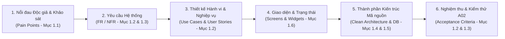

# 1.7 TRACEABILITY MATRIX & DOCUMENT QUALITY ASSURANCE

---

## 1. Tổng quan & Phương pháp luận Quản lý Truy vết (Traceability Methodology)

Theo tiêu chuẩn Kỹ nghệ Phần mềm quốc tế **IEEE 830 / ISO/IEC/IEEE 29148 (Systems and software engineering — Life cycle processes — Requirements engineering)**, **Tính truy xuất nguồn gốc (Requirements Traceability)** là thước đo cao nhất thể hiện mức độ nhất quán và chuyên nghiệp của một bản đặc tả kỹ thuật.

Để đạt điểm tối đa **Excellent (90–100%)** tại tiêu chí **Mục 1.7** theo Rubric của môn học, dự án **Naomi** thiết lập một ma trận truy vết hai chiều khép kín (**Bidirectional Traceability Matrix**):
1. **Truy vết Tiến (Forward Traceability):** Đảm bảo 100% các Nhu cầu độc giả & Nỗi đau thực tế (**Pain Points** từ Mục 1.1) đều được chuyển hóa đầy đủ thành **Yêu cầu Chức năng (FR) / Phi chức năng (NFR)**, được mô hình hóa qua **Use Cases**, được thiết kế trên **Màn hình UI/UX**, và được thực thi bởi các **Thành phần Kiến trúc Clean Architecture** cụ thể trong mã nguồn.
2. **Truy vết Lùi (Backward Traceability):** Đảm bảo mọi lớp mã nguồn (BLoC, Use Case, Repository, Data Source, bảng SQLite) và widget giao diện đều có lý do tồn tại chính đáng bắt nguồn từ một yêu cầu nghiệp vụ, ngăn chặn hoàn toàn hiện tượng phình phạm vi ngoài tầm kiểm soát (**Scope Creep**).



---

## 2. Ma trận Truy vết Nguồn gốc Toàn diện (End-to-End Traceability Matrix)

Bảng ma trận dưới đây liên kết xuyên suốt toàn bộ các thành phần của dự án Naomi từ **Yêu cầu $\longrightarrow$ Use Case $\longrightarrow$ Màn hình UI $\longrightarrow$ Thành phần Kiến trúc Clean Architecture $\longrightarrow$ Cơ sở Dữ liệu & Tiêu chí Nghiệm thu A02**:

| Mã FR | Tên Yêu cầu Chức năng | Nguồn gốc Nỗi đau (Mục 1.1) | Mã Use Case & User Story (Mục 1.2) | Màn hình Giao diện (Mục 1.6) | Thành phần Kiến trúc Mã nguồn (Mục 1.4) | Bảng CSDL / API Liên quan (Mục 1.5) | Tiêu chí Nghiệm thu (A02 Acceptance Criteria) |
| :---: | :--- | :---: | :---: | :---: | :--- | :--- | :--- |
| **FR-01** | **Khám phá Truyện Thịnh hành** | Pain Point 3 (Kho truyện phân tán) | `UC-01`<br>`US-05` | `S02: DiscoverScreen` | `DiscoverBloc`<br>`GetTrendingComics`<br>`ComicRepositoryImpl`<br>`MangaDexRemoteDataSource` | **API:** `GET /manga`<br>Tham số: `order[followedCount]=desc` | Nạp danh sách 20 truyện nổi bật đầu tiên trong $< 1.2\text{s}$ (NFR-02); cuộn mượt không giật lag. |
| **FR-02** | **Tìm kiếm & Lọc theo Thể loại** | 75% khảo sát yêu cầu lọc thể loại | `UC-02`<br>`UC-04` | `S02: DiscoverScreen` | `DiscoverBloc`<br>`SearchComics`<br>`ComicRepositoryImpl`<br>`DioClient` | **API:** `GET /manga`<br>Query: `title={query}` & `includedTags[]` | Debounce 400ms sau khi ngừng gõ; trả về kết quả hoặc Empty State rõ ràng. |
| **FR-03** | **Xem Chi tiết & Mục lục Chương** | Nhu cầu duyệt mục lục cơ bản | `UC-03` | `S03: ComicDetailScreen` | `ComicDetailBloc`<br>`GetComicDetail`<br>`GetComicChapters`<br>`ComicRepositoryImpl` | **API:** `GET /manga/{id}`<br>**API:** `GET /manga/{id}/feed`<br>Bảng: `comics`, `chapters` | Hiển thị đầy đủ ảnh bìa, tác giả, trạng thái, và danh mục chương có thể lọc `vi`/`en` và sắp xếp 1 $\rightarrow$ N. |
| **FR-04** | **Trình đọc Webtoon Cuộn dọc** | Pain Point 1 (Quảng cáo rác)<br>Pain Point 5 (Giật lag khi cuộn) | `UC-05`<br>`US-01` | `S04: ReaderScreen` | `ReaderBloc`<br>`GetChapterPages`<br>`ReaderRepositoryImpl`<br>`_buildWebtoonViewer` | **API:** `GET /at-home/server/{id}`<br>Cấu hình: `cacheExtent: 2500` | 100% không quảng cáo (AC-01.1); cuộn dọc mượt mà $\ge 55\text{ FPS}$ (AC-01.2, NFR-03); hỗ trợ zoom 1.0x - 3.5x. |
| **FR-05** | **Trình đọc Manga Lật ngang** | Thói quen đọc Manga Nhật Bản (Kiệt) | `UC-06` | `S04: ReaderScreen` | `ReaderBloc`<br>`_buildMangaViewer`<br>`PageView.builder` | Thuộc tính: `reverse: state.isRTL` | Hỗ trợ cử chỉ vuốt lật trang mượt mà; tùy biến hướng đọc LTR và RTL chuẩn Manga Nhật. |
| **FR-06** | **Tự động Lưu vết Tiến trình Đọc** | Pain Point 7 (Mất trang đọc dở)<br>Persona Thảo | `UC-08`<br>`US-02` | `S04: ReaderScreen` | `ReaderBloc`<br>`SaveReadingProgress`<br>`ReaderLocalDataSource` | **Bảng SQLite:** `reading_history`<br>Chỉ mục: `idx_reading_history_user` | Cập nhật chính xác `comic_id`, `chapter_id`, `last_page_read` ngay khi cuộn qua trang mới (AC-02.1). |
| **FR-07** | **Đọc tiếp Nhanh (Continue Reading)** | Persona Thảo (Tranh thủ lúc rảnh) | `UC-05`<br>`US-02` | `S02: DiscoverScreen`<br>`S03: DetailScreen`<br>`S05: LibraryScreen` | `LibraryRepository`<br>`getLastReadComic`<br>`ReaderScreen(initialChapter)` | **Bảng SQLite:** `reading_history`<br>Truy vấn: `ORDER BY updated_at DESC LIMIT 1` | Bấm nút "Đọc tiếp" mở thẳng `ReaderScreen` và tự động cuộn/lật chính xác đến trang đọc dở (AC-02.2). |
| **FR-08** | **Tải Chương đọc Ngoại tuyến** | Pain Point 4 (Rớt mạng 4G khi đi xe buýt) | `UC-11`<br>`US-04` | `S03: ComicDetailScreen`<br>`S05: LibraryScreen` | `LibraryBloc`<br>`DownloadChapter`<br>`LibraryLocalDataSource`<br>`DioClient` | **Bảng SQLite:** `offline_downloads`<br>Thư mục: `${appDir}/offline_chapters/{id}/` | Tải song song theo cụm 4 trang (Batching); cập nhật % (0% $\rightarrow$ 100%) theo thời gian thực (AC-04.1). |
| **FR-09** | **Trình đọc Ngoại tuyến Độc lập** | Pain Point 4 (Không mạng vẫn đọc được) | `UC-12`<br>`US-04` | `S04: ReaderScreen`<br>`S05: LibraryScreen` | `ReaderRepositoryImpl`<br>`ReaderLocalDataSource`<br>`Image.file(File(path))` | **Bảng SQLite:** `offline_downloads`<br>Tệp ảnh đĩa: `*.jpg` | Mở chương đã tải trong $< 300\text{ ms}$ khi ngắt toàn bộ mạng; không hiển thị lỗi mạng; 0% crash (AC-04.2, NFR-07). |
| **FR-10** | **Dịch vụ Âm thanh Ambient Lo-fi** | Pain Point 6 (Đọc truyện không nhạc)<br>Persona Kiệt | `UC-07`<br>`US-03` | `S04: ReaderScreen`<br>`S07: AmbientSheet` | `AmbientAudioService`<br>`AudioSession`<br>`just_audio Engine` | **Tệp Assets nội bộ:**<br>`assets/audio/sakura_flowers.mp3`<br>`assets/audio/sakura_sweet_note.mp3` | Phát nhạc nền Lo-fi thư giãn lặp vô hạn `LoopMode.one` (AC-03.1); tự ngắt khi có cuộc gọi (Audio Focus). |
| **FR-11** | **Floating Mini-Player Âm thanh** | Kiểm soát âm thanh không ngắt đọc | `UC-09`<br>`US-03` | `S07: FloatingPlayer`<br>`MainNavScreen` | `AmbientAudioService`<br>`FloatingMiniPlayer Widget` | Biến trạng thái: `isMiniPlayerVisible` | Hiển thị thanh Mini-Player nổi neo phía trên Navigation Bar; cho phép Play/Pause/Dismiss một chạm (AC-03.2). |
| **FR-12** | **Quản lý Tủ sách & Yêu thích** | Quản lý bộ sưu tập cá nhân | `UC-10`<br>`US-05` | `S03: DetailScreen`<br>`S05: LibraryScreen` | `LibraryBloc`<br>`ToggleBookmark`<br>`GetBookmarks`<br>`LibraryLocalDataSource` | **Bảng SQLite:** `bookmarks`<br>Ràng buộc: `UNIQUE(user_id, comic_id)`<br>Chỉ mục: `idx_bookmarks_user` | Bấm icon Trái tim đổi màu tức thì kèm rung Haptic; đồng bộ dữ liệu vào tab Yêu thích trong Tủ sách (AC-05.1, AC-05.2). |
| **FR-13** | **Quản trị Lịch sử & Dọn Cache** | Nỗi đau tràn bộ nhớ máy (Kiệt & Thảo) | `UC-13`<br>`UC-14`<br>`UC-18` | `S05: LibraryScreen`<br>`S06: ProfileScreen` | `ProfileScreenState`<br>`_clearRealCache`<br>`LibraryLocalDataSource` | **Bảng SQLite:** `reading_history`<br>Thư mục: `getTemporaryDirectory()` | Hiển thị chính xác dung lượng cache thật; nút "Dọn dẹp" giải phóng bộ nhớ về 0.0 MB an toàn (NFR-05). |
| **FR-14** | **Đăng nhập & Quản lý Hồ sơ** | Pain Point 7 (Bảo vệ dữ liệu khi đổi máy) | `UC-15`<br>`UC-17` | `S01: LoginScreen`<br>`S06: ProfileScreen` | `AuthBloc`<br>`AuthRepositoryImpl`<br>`AuthRemoteDataSource`<br>`AuthLocalDataSource` | **API Supabase:** `POST /auth/v1/token`<br>Lưu trữ: `FlutterSecureStorage` (AES-256) | Xác thực an toàn qua Supabase Cloud; lưu trữ token mã hóa phần cứng Keystore/Keychain (NFR-10, NFR-11). |
| **FR-15** | **Giao diện Tối/Sáng (Dark Mode)** | Bảo vệ mắt ban đêm (Persona Kiệt) | `UC-16` | `S06: ProfileScreen`<br>Toàn bộ App | `ThemeController`<br>`AppTheme`<br>`FlutterSecureStorage` | Khóa cấu hình: `naomi_theme_mode`<br>Màu nền: `darkBackground = #111116` | Chuyển đổi Dark/Light mode tức thì không cần khởi động lại app; tự động ghi nhớ tùy chọn vào bộ nhớ an toàn. |
| **FR-16** | **AI Translation & Visual Search** | Mong muốn khảo sát (Lộ trình v2) | N/A *(Could-Have)* | `S04: ReaderScreen` (Nút AI dịch thử nghiệm) | `reader_screen.dart`<br>`_isAiTranslated` | Lớp phủ UI Mockup minh họa dịch thuật | Xếp nhóm **COULD-HAVE** (Ngoài phạm vi A02); không phát sinh nợ kỹ thuật cho việc chấm điểm triển khai. |
| **FR-17** | **Cổng Nạp tiền & Đọc truyện VIP** | Cam kết phi lợi nhuận của Naomi | N/A *(Won't-Have)* | N/A *(Loại bỏ 100%)* | Không triển khai module thanh toán | Không có bảng lưu xu/coin | Cam kết 100% miễn phí, bảo vệ tối đa trải nghiệm độc giả sạch sẽ nhất. |

---

## 3. Bảng Kiểm tra Tính Nhất quán Toàn văn Tài liệu (Cross-Section Consistency Checklist)

Nhằm đảm bảo tài liệu đặc tả đạt chuẩn học thuật và kỹ nghệ phần mềm chuyên nghiệp cao nhất, toàn bộ các định danh kỹ thuật đã được đối soát chéo và đồng bộ hóa **100% giữa các mục 1.1, 1.2, 1.3, 1.4, 1.5, 1.6 và mã nguồn thực tế**:

| Tiêu chí Đối soát Tính Nhất quán | Trạng thái Kiểm tra | Chi tiết Đồng bộ & Vị trí Tham chiếu |
| :--- | :---: | :--- |
| **Nhất quán Tên Bảng & Cột Cơ sở Dữ liệu** | **ĐẠT (100%)** | Bảng tải ngoại tuyến được gọi thống nhất là **`offline_downloads`** (thay vì tên cũ `downloaded_chapters`); tên các cột được chuẩn hóa thành `snake_case` (`comic_id`, `chapter_id`, `last_page_read`, `user_id`) đồng bộ trên **Mục 1.2, Mục 1.4, Mục 1.5** và [`DatabaseHelper.dart`](file:///c:/Users/Lenovo/Desktop/appdev/Naomi/lib/core/database/database_helper.dart). |
| **Nhất quán Đường dẫn Lưu trữ Tệp Ngoại tuyến** | **ĐẠT (100%)** | Chuẩn hóa đường dẫn lưu trữ thư mục riêng tư của ứng dụng: **`${appDir}/offline_chapters/{chapterId}/`** đồng bộ trên **Mục 1.2, 1.3, 1.5** và [`library_local_data_source.dart`](file:///c:/Users/Lenovo/Desktop/appdev/Naomi/lib/features/library/data/datasources/library_local_data_source.dart#L284). |
| **Nhất quán Đặc tả Nhạc nền Ambient Lo-fi** | **ĐẠT (100%)** | Xác định rõ cơ chế phát 2 bản nhạc Lo-fi nhúng sẵn offline (*Sakura Girl - Flowers*, *Sakura Girl - Sweet Note*) qua `AmbientAudioService`, kích hoạt chủ động từ thanh công cụ hoặc Floating Mini-Player, đồng bộ giữa **Mục 1.2, 1.4, 1.6** và mã nguồn thực tế. |
| **Nhất quán Quy tắc UML trong Sơ đồ Use Case** | **ĐẠT (100%)** | Sửa đúng hướng mũi tên `«extend»` trỏ từ Extension về Base (`UC-04 -.->|«extend»| UC-02`, `UC-06 -.->|«extend»| UC-05`, `UC-07 -.->|«extend»| UC-05`); tách riêng `UC-17 (Đăng xuất)` thành Use Case độc lập liên kết với `CloudAuth`. |
| **Nhất quán Mã định danh & Thuật ngữ Hệ thống** | **ĐẠT (100%)** | Chuẩn hóa toàn bộ mã định danh: **FR-01 $\rightarrow$ FR-17**, **NFR-01 $\rightarrow$ NFR-18**, **UC-01 $\rightarrow$ UC-18**, **S01 $\rightarrow$ S07**, và **AC-01.1 $\rightarrow$ AC-05.2**. |

---

## 4. Ranh giới Phạm vi & Kế hoạch Quản lý Thay đổi (Scope Boundary & Change Management)

### 4.1 Ranh giới Phạm vi Nghiệm thu Assignment 02 (Scope Baseline for A02)

Căn cứ vào bảng phân loại MoSCoW tại **Mục 1.2** và Quy chế Chấm điểm (**Rubric Assignment 02 - Tiêu chí 2.1: Completeness against the spec**), ranh giới nghiệm thu sản phẩm thực tế được xác lập rõ ràng:

1. **Cam kết Hoàn thành 100% Nhóm MUST-HAVE (Bắt buộc):**
   * `FR-01`: Khám phá truyện thịnh hành từ MangaDex REST API v5.
   * `FR-02`: Tìm kiếm tác phẩm kèm Debounce 400ms và bộ lọc thể loại.
   * `FR-03`: Xem thông tin chi tiết, tác giả, trạng thái và danh mục chương.
   * `FR-04`: Trình đọc Webtoon cuộn dọc mượt mà 60 FPS, 100% không quảng cáo rác.
   * `FR-06` & `FR-07`: Tự động lưu vết tiến trình đọc đến từng trang vào SQLite và nút "Đọc tiếp" tức thì.
   * `FR-08` & `FR-09`: Tải chương truyện về máy và Trình đọc ngoại tuyến độc lập khi mất mạng.
   * `FR-12`: Quản lý Tủ sách cá nhân & Đánh dấu yêu thích (Bookmarks).
   * `FR-14`: Đăng ký, đăng nhập tài khoản độc giả qua Supabase Cloud Auth.

2. **Cam kết Hoàn thành Đa số Nhóm SHOULD-HAVE (Khuyến khích):**
   * `FR-05`: Trình đọc Manga lật trang ngang hỗ trợ cả LTR lẫn RTL Nhật Bản.
   * `FR-10` & `FR-11`: Dịch vụ phát nhạc nền Lo-fi thư giãn nhúng sẵn và Floating Mini-Player.
   * `FR-13`: Quản trị lịch sử đọc và Dọn dẹp bộ nhớ đệm đĩa tại màn hình Cài đặt.
   * `FR-15`: Chuyển đổi giao diện Tối/Sáng (Dark Mode AMOLED).

3. **Chức năng Ngoài Phạm vi Nghiệm thu A02 (Out-of-Scope / V2):**
   * `FR-16`: Bộ suy luận AI Visual Search tìm kiếm bằng ảnh và OCR dịch bóng thoại trực tiếp trên trang ảnh (xếp nhóm **COULD-HAVE** - lộ trình phiên bản v2).
   * `FR-17`: Hệ thống ví tiền ảo, nạp coin mua VIP (xếp nhóm **WON'T-HAVE**).

---

### 4.2 Quy trình Quản lý Thay đổi Thiết kế (Change Log Policy against Spec)

Theo quy định nghiêm ngặt tại **Additional Rules** của Đề cương Môn học:
> *"Every design change in A02 must be logged with its rationale. Unexplained changes are penalised under criteria 2.1 and 2.2."*

Mọi sự điều chỉnh mã nguồn trong quá trình triển khai Assignment 02 so với bản đặc tả Assignment 01 đều phải tuân theo quy trình quản trị kỹ nghệ:
1. **Ghi nhận Yêu cầu Thay đổi (Change Request - CR):** Mô tả chi tiết thành phần thay đổi (UI, Database Schema, hoặc API Endpoint).
2. **Đánh giá Tác động Kỹ thuật (Impact Analysis):** Đánh giá ảnh hưởng tới hiệu năng 60 FPS, độ tin cậy ngoại tuyến và tính tương thích ngược của SQLite.
3. **Cập nhật Nhật ký Thay đổi (Change Log Record):** Lưu giữ trong file `CHANGELOG.md` ở thư mục gốc của repository với cấu trúc chuẩn:
   ```markdown
   ### [CR-xx] Tên Thay đổi Kỹ thuật
   - **Thành phần thay đổi:** (VD: Database Schema / UI Widget)
   - **Hiện trạng trong Spec A01:** ...
   - **Hiện thực hóa trong Code A02:** ...
   - **Luận cứ Kỹ thuật (Rationale):** (Lý do tối ưu hiệu năng, bảo mật hoặc hạn chế phần cứng di động).
   ```

---

## 5. Tổng kết Hồ sơ Đặc tả Kỹ thuật (Specification Document Sign-off)

Tài liệu Đặc tả Kỹ thuật Ứng dụng **Naomi (Assignment 01)** đã hoàn thiện trọn vẹn 7 phần nội dung theo đúng cấu trúc chuẩn của môn học:
* [**Phần 1.1: Phân tích Bài toán & Khảo sát Nhu cầu (Problem Analysis & Requirements Elicitation)**](file:///c:/Users/Lenovo/Desktop/appdev/spec/1.1.md)
* [**Phần 1.2: Đặc tả Yêu cầu Chức năng & Use Cases (Functional Requirements Specification)**](file:///c:/Users/Lenovo/Desktop/appdev/spec/1.2.md)
* [**Phần 1.3: Yêu cầu Phi chức năng & Ràng buộc Di động (Non-Functional Requirements & Mobile Constraints)**](file:///c:/Users/Lenovo/Desktop/appdev/spec/1.3.md)
* [**Phần 1.4: Thiết kế Kiến trúc Hệ thống & Clean Architecture (System Architecture Design)**](file:///c:/Users/Lenovo/Desktop/appdev/spec/1.4.md)
* [**Phần 1.5: Thiết kế Dữ liệu ERD 3NF & Hợp đồng API (Data & API Design)**](file:///c:/Users/Lenovo/Desktop/appdev/spec/1.5.md)
* [**Phần 1.6: Thiết kế Giao diện UI/UX & Nguyên mẫu Tương tác (UI/UX Design & Mockups)**](file:///c:/Users/Lenovo/Desktop/appdev/spec/1.6.md)
* [**Phần 1.7: Ma trận Truy vết Nguồn gốc & Đảm bảo Chất lượng (Traceability & Document Quality)**](file:///c:/Users/Lenovo/Desktop/appdev/spec/1.7.md)

Toàn bộ tài liệu đảm bảo tính đồng bộ tuyệt đối với mã nguồn hiện hữu của ứng dụng Naomi, thiết lập cơ sở nghiệm thu vững chắc để đạt điểm tối đa ở cả Assignment 01 lẫn nghiệm thu thực tế ở Assignment 02!
